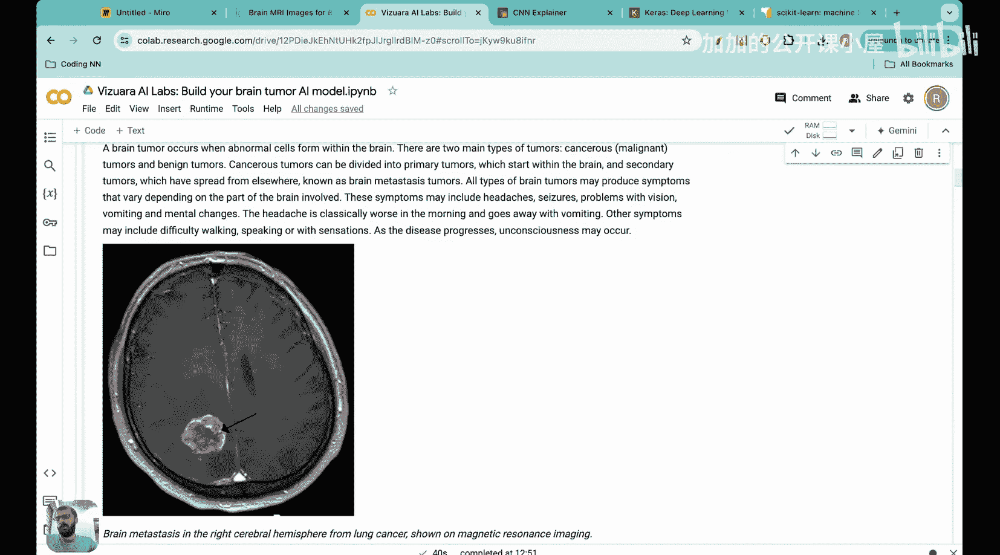
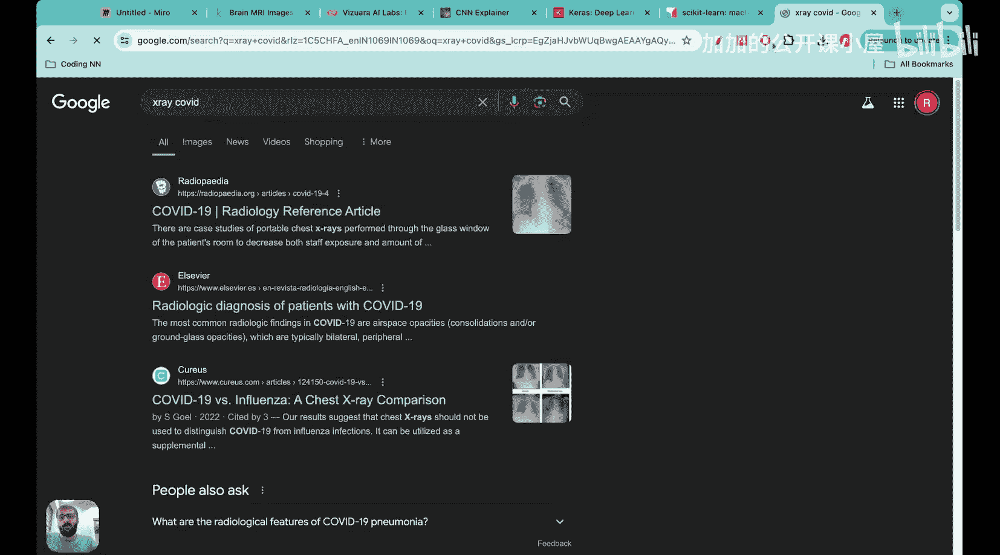
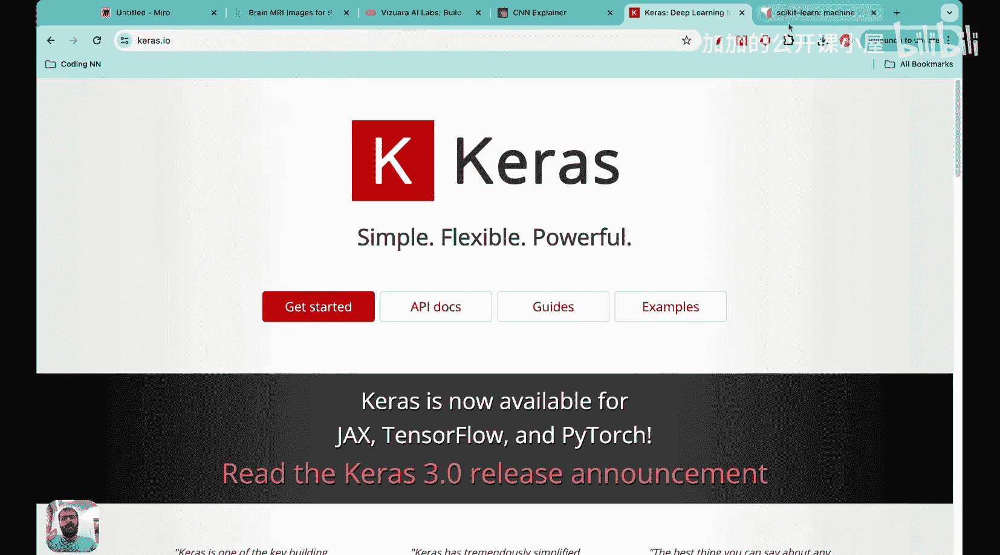
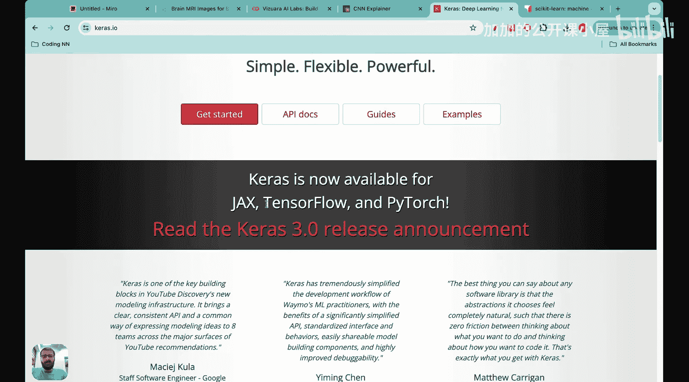
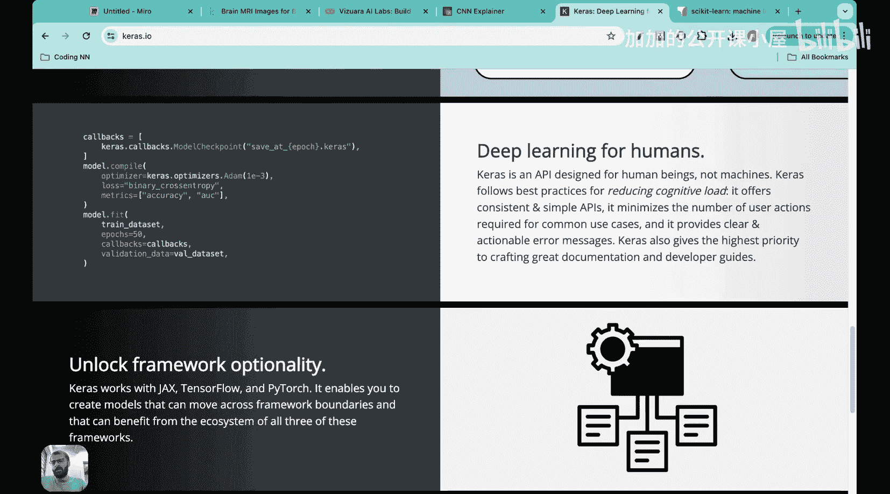
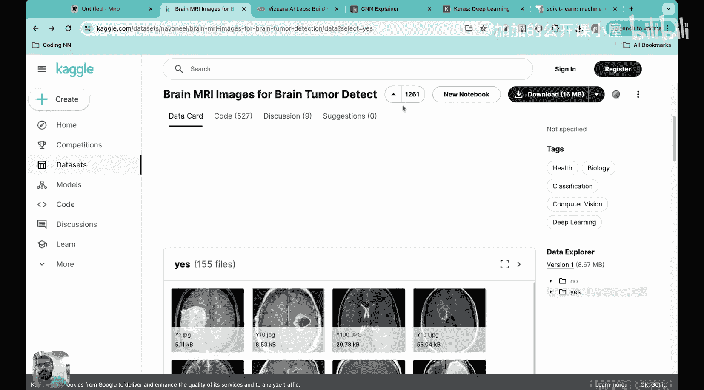

# Vizuara【中英⚡机器学习：实践教学｜Machine Learning： Teach by Doing】 p37 P37 Build your own brain tumor classification CNN application in Python [BV1RusDz1EXd_p37]

Hello everyone， welcome to this video on convolutional neural networks。In this video。

 well be building our own CNN model。And we'll be applying it to a very hands on project。

Well be building our own brain tumor AI model， which can classify MRI scans into whether a brain tumor is present or whether a brain tumor is absent。

This is an excellent project to practically work on convolutional neural networks。

This will be a handson implementation I would not go into the theory too much in this lecture if you want to understand the basics and the theory at different portions I will encourage you to go and check out our YouTube channel in which we have convolutional neural network theory videos as well and the conceptual videos。

So let's get started with today's lecture。My name is Dr。

 Rajdlecker and I graduated with a PhD from MIT in machine learning。

Now our goal through this channel is to make AI and ML accessible to everyone。

So let us get started with today's project， as I mentioned today we will be building our brain tumor AI model we can look at MRI scans and classify whether a tumor is present or whether it is not present。

So first。Let's look at the overview of the project。

 let's look at the objectives and let's look at the data set which we have。

So here is the link for the data I'll also put the link in the description of the video when I click on this link I'll be taken to this Kagggle page to those of you who don't know about KaL it's a website where people do machine learning projects there are machine learning computations and there are some amazing datas which are hosted on Kaggle。

For example， this is a brain tumor data set which is hosted on Kagggle and。

Here you can see that this data set has。Two tags， if you see over here yes， it has no and yes。

 which means that if you click on the no， these will be images where brain tumor is not present。

These are MRI images from actual patients， and these are images where brain tumor is not present。

So and if I click on yes， you will see that here are the images where brain tumor are present。

 so we have a large number of GPG files for brain tumor not present and we have a large number of GPG files for brain tumor which is present。

Further investigation about the data reveals that it is a black and white dataset and people have permitteded very nice things about this data it is also gold star。

 it is supported by 1261 people this is an indication that this is a reliable data and we can use this for our purposes of implementing the project。

So this is the dataset description you can form a visual map of okay brain tumor yes no and yes I have some images and no I have some images the main goal is that if any new image is given to you whether your CNN model will be able to correctly predict if a brain tumor is present or not。

Okay， so one more thing which I would like to mention here is that at the end of this project。

 actually we willll be developing a dashboard and hosting it so that you can also share it with your friends and your colleagues and you can also add it to a resume。

Okay， so I hope you understood the data description part and now whenever you are working on a real life problem like this。

 it always makes sense to think a bit more about what am I trying to solve where do I know more about this project etc？

For example， if you don't know what a brain tumor is。

 a brain tumor occurs when abnormal cells form within the brain， there are two main types。

 malignant tumor and benign tumor。Beennign tumor means it's not risky and malignant tumor means that it's risky。

So this is the brain tumor and that's why doctors take MRI scans The reason we are doing this project in the first place is because imagine there are a huge number of MRI scans and it's quite difficult for the doctors to just look at the image and say whether a brain tumor is present or absent for such a large number doctors can of course do an amazing job for a limited amount of image dataset but as the patients increase then it becomes much more difficult this was seen during COVID times as well for example during COVD times the chest X rays were taken and there is so many patients that sometimes it was very difficult for doctors to manually scan or detect whether there is an abnormality or not in such cases AI is your friend and AI is helpful because it can do the classification in a very short and quick period of time。

Okay， now once we have understood the data set， once we have understood the project and the objectives of the project。

 now we can move towards the setting up the environment， which is step number two。

So in this part well be loading and importing some packages and I would just like to tell you about two major machine learning packages which we'll be using。

And why they are important， the first is Kas and the second iss Ki。

So kas is basically an API which is which gives many functions in its library。

 it makes it very easy to build machine learning models to train machine learning models using ks Kaas is integrated with Tensorflow。

 which makes it brilliant to。

Run it in Python So what Kas does is that it can help us define convolutional neural networks it gives functions such as model dot fit model do compile etc and within five to six slide of code we can fit the convolutional neural network model we can compile the model etc。

 It just makes life very easy for us We don't have to code too many things from scratch。

Then you might be wondering okay， if we are using cares for machine learning what is the use of psychit Learn psyit learn is actually very useful for some things like if you have a data and if you want to split it into training and testing。

Using one one line of code you can do it using psychit learn packages secondly。

 if you want to one hot encoding to be implemented on your labels you can do it very easily using psyit learn packages so that's why we are going to be using psyit learn of course there are some common packages such as NI for scientific computing and mat plot lip for plotting which will of course be needing。

So let us import these packages we'll import Kas and from KRAs we need the following API or the following function calls the first sequential this is for creating the CNN architecture itself we will look at this in detail when we come to this part。

The next is we need ks dot layers so that we can create different layers such as the convolution filtering layer。

 max pooling layer， the flattening layer， the dense layer， dropout and badge normalization。Remember。

 dropout and batch normalization are very useful for regularization to make sure we are not overfitting that's where these also will be needed。

Of course NMI is needed， pandas is needed because as I'll show you will be dealing with data frames for easy understanding of the data and MA plotly is needed because we will be plotting different things such as the training loss。

 the validation loss， etc。As I told you before， psyit learn is useful because it will provide us two functionalities which we are going to need in this project。

 the first is splitting the data into training and testing and second is one hot encoding。Okay。

 so I hope you have understood this part you can run this， I've already prerun this。

 so I won't be running it again right now。It won't take too much time if you are installing careS for the first time it might take some time because it's a bulky library。

 everything else should be loaded quite quickly。The next thing we have to do is importing the data。

 so I am using a specific sequence here to import data into my Google collab the way I do it is that I go to this kgggle and then I click on download。

What this will do is that once I sign in， it will download the entire data set for me and then I go to Google Drive and I upload the data on Google Drive。

So I put it in the folder which reads my drive slash the name of my dataset。

 so I name it as brain tumor dataset this is where my dataset will be and you can follow along these steps。

If you want your Google coab to be connected with the Google Drive。

 because remember we will be needing the data which is stored in the Google Drive so you can run this part。

 which is from Google dot coll import drive， what this will do is that it will just mount。

The drive and then Google Coab will be able to access。All the data from the drive。

Once the data is imported， then we will be doing some of the data pre processing so remember the way the data is downloaded is that there are two labels there is no and there is yes。

So what I need is that since all of this will be in my training data。

 I I need to merge these images together and then I'll of course do the train test split。

But I need to append so let's say there are 500 images for no 500 images for yes。

 I will append all of these together first and then split them into training data set and the testing dataset。

So first task is to append these images together， so what I'll be doing is that。

