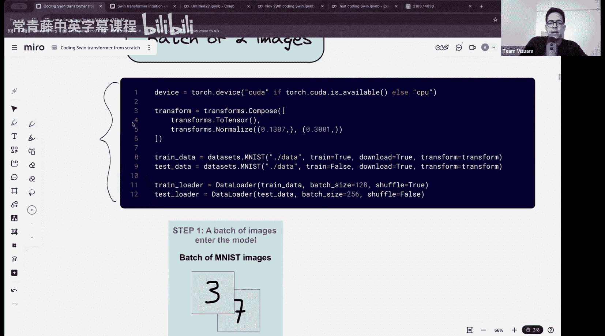
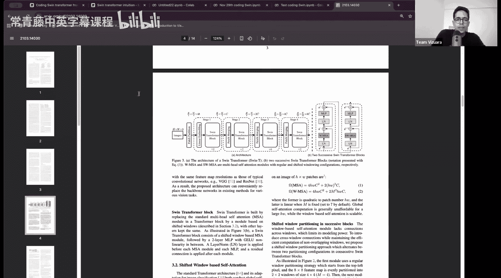
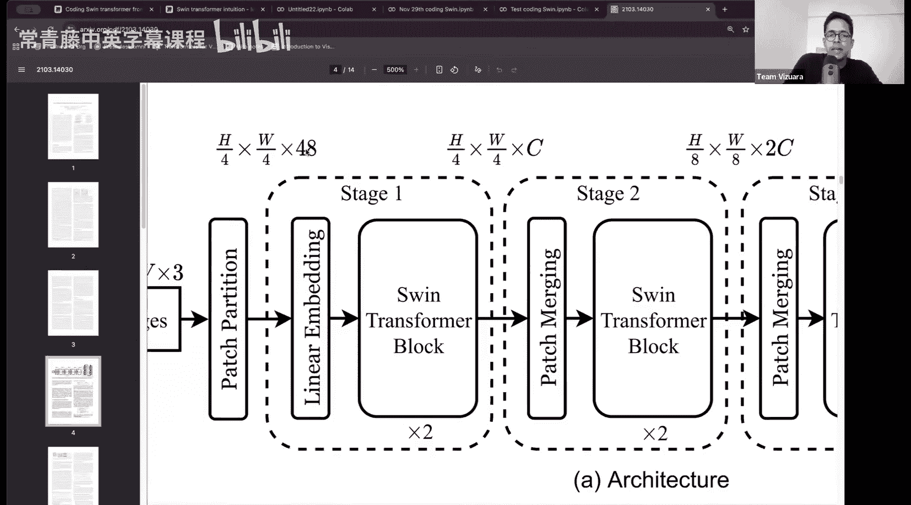
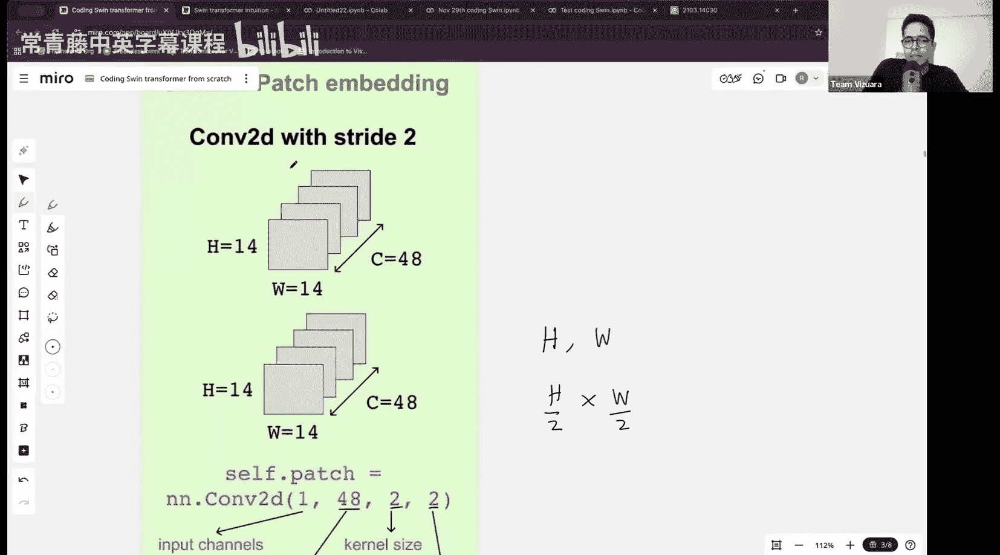

# Vizuara【中英⚡多模态LLM中的Transformer｜Transformers for Vision and Multimodal LLMs】 p01 P1 Coding Swin transformer from scratch [BV1X9zuByEuF_p1]

Awesome so welcome to a new lecture today we'll be coding a Sw transformer from Scash so in the last lecture I had given you an intuition about what is the architecture of Sw transformer and how is it different from vision transformer so I hope you have gone through the lecture as a recap which I had mentioned yesterday。

So you will require some prerequisite knowledge about the Sw transformer architecture itself。

 I'll try to give you a brief recap but most of the time today will be spent on coding itself so that's the reason why I decided to split Sw transformer into an intuition part and coding part because combining both into one single lecture would be very difficult。

And another comment which I want to make is today's coding。

 unlike nanoVLM or vision transformer models， it'll be much more difficult simply because the architecture of Sw Transer。

 when we go through it you will see that there are many modules that we have to build from scratch。

So it will not be easy， so you should be on your full attention and most likely it may so happen that you will not understand certain parts and that would definitely require a second round of you know you going through it or revising through it。

So just expect that， but I'll try to cover as much as many questions or doubts as possible in today's lecture itself。

So first let's do a quick recap of what exactly is Sw transformer so Sw transformer was introduced as a generalized transformer based architecture for images so they showed that in the paper they showed that you can use Sw transformer for image classification。

 object detection， semantic segmentation etc， although we will not be doing object detection or segmentation in today's lecture we'll be focusing on classification。

And the architecture is as shown in this diagram， so here what what is not shown is what happens to the context vector after it comes out of the transformer block。

 then it has to go through something like a global average pooling。

And then only the classification head comes。 So if it's a 10 class classification。

 whatever is the number of nodes in the。In the first layer。

 it will be connected to 10 nodes in the next layer。

 so this will be like a fully connected network so this part is not shown in this architecture。

Simply because this will depend on whether our problem statement is classification or object detection or segmentation。

But let's go through the architecture once very quickly。

So you have images of height width and three channels。

 it can be three or one channel today we'll be looking at a one channel image MNist so it will be etd by w by1。

Then we convert the image into patches so you know what patches are patches are splitting the image into non overlapping small segments and then patches are converted into flattened layer so that every patch will have spatially only one dimensional one by one as the spatial dimension but number of channels could be something like。

48 or whatever。And then a linear embedding layer basically projects all your patches into a dimensionality hidden I mean embedding dimensionality of C so from 48 you will go to whatever your embedding dimensionality is。

And then what happens is you have Sw transformer stages repeating， so this is stage one。Stage 2。

Stage three and stage four。Today we will not be having four stages。

 the main reason is that you know the resolution of the Mminist image itself if I'm not wrong it's 28 by 28 or something。

 which means it's pointless to you know divide the spatial dimension further by to h by 16 h by 32 etc。

 so we won't be needing all the stages we'll quote two stages and we'll see。Then inside these stages。

 you have the Sw transformer block and that consists of。These two things primarily。

 so this is the regular window on the left hand side。

Regular Windows wind transformer block and on the right hand side we have the shifted window。

Transformer block。And just to refresh your memory， I have one question。In the。

What's the difference between regular window and shifted window while calculating attention so if attention is alpha Ij between query I and keyj usually it is like this softm。

O。Q I Kj transpose divided by square root of d， this is how usually attention weights are calculated。

And then to get the context vector， you multiply it by value。

 but let's talk about attention ways alpha Ij， this is your usual。😊，Health attention。But。

What is there extra in this regular spin block？Is it the same as this formula or am I missing something？

There will be a relative positional bias term right so it's a relative position bias meaning you look at every single patch inside a window and see how far away they are from each other。

 so there should be a bias term we call it as B IJ。

So that is okay for regular and for shifted window， is this enough or am I missing something？😊。

For shifted window， we discussed about a mass term， so mass term is we do not allow。

Patches belonging to two different windows。To pay attention to each other。

 so how do we prevent this whole thing we introduce a masking term。We can call that as mask IJ。So。

If you don't have BIJ and mask IJ， you have your normal attention。

 if you have this term dot product of query and key plus the relative position embedding。

 you have your regular window。That to regular windows multi health self attention I'm only talking about this part right now everything else remains the same just like the transformer you have layer normalization multih self attention skip connections layer normalization multi layerer perceptron so everything is the same the only difference is how does this window regular window multih self attention and shifted window multi self attention look so this is the normal multiard self attention these two terms form part of regular window based multih self attention and if you have these three terms then you have shifted multih self attention shifted window multih self attention。

All right， so that is another thing。Now I just want to show you a few things about what happens to our image。

 so let's take MNist as the example we have input image of height 28 width 28 and number of channels one it's basically black and white。

😊，So， the original shape of an individual image will be c comma h comma w C is channels hs height W is the width。

 so 1 comm 20 a comm 20 this will be a single image。😊，Now let's say we have a batch。

 I'm not going through the code right now， this is very familiar。

 but let me show you this this image of one batch。

So let's say my batch size is just two for simplicity so that I can show these batches as actual visualrs。

😊，So， my batch size is two meaning every single batch will have two images。

 so let's say these are the two images then it will add one more dimension the batch dimension。😊。

So individual images height 28 width 28 number of channels one， but then I have two images per batch。

 so those are these two images。Now， what do we do when we pass a batch into our。Swim transformer。

 what is the first step？That we do。What do we do with our images first thing？

We convert to patches right because in transformer in all types of invention transformer data vision transformer everywhere we have to first convert image into somehow into tokens the the way of tokenization is patch so we have to first convert to patches。

So。😊，Patch embedding， if you remember from the convolutional neural network lecture was done using a line of code like this。

 so NN dot con 2D， so it will be basically a two dimensional convolution operation with learnable parameters。

Where if it is like con 2 d of 1 comma4ier comma 2 comma 2， can you tell me why is this value 1？

What does this one mean？It is the number of channels in your input image what is your input image input image is mNist mNist has one channel so this is a number of channels in the input this is the number of channels in the output which is equal to the number of filters so why is this set to be 48 if you look at the swing transformer architecture。

After patching， you end up with。

A48 channel set of images or 48 channel patches， so that's why we set it to be 48。

Then this two is kernel size and this is also。Striide， which is two。

 which means now we will create non overlapping patches and what will be the patch size according to this。

The size of each patch。It has to be2 by2 right because your kernel size is2 and each kernel becomes one patch so at the starting each patch will be of2 by two size so now if my image has high edge。

Originally and with W， how many total patches will I have？

I should have h by two patches along the height。Multiplied by w by  two patches along the width。

 so total number of patches will be h W by 4。So what will happen？So here after this con 2D。

