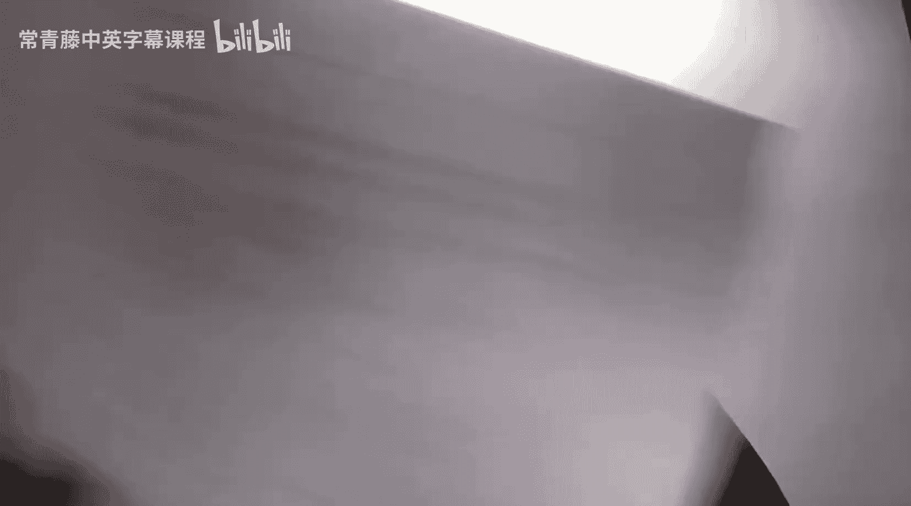
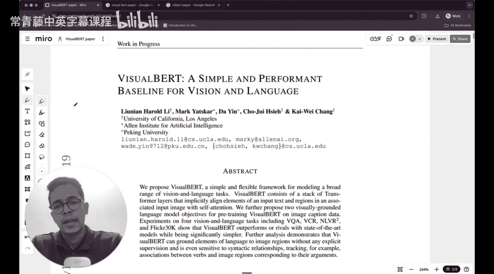
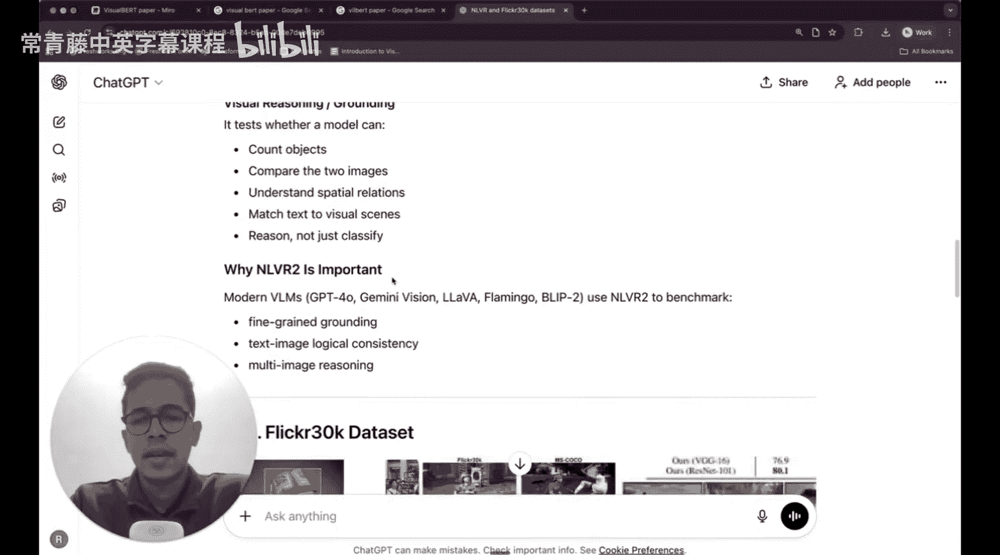

# Vizuara【中英⚡多模态LLM中的Transformer｜Transformers for Vision and Multimodal LLMs】 p03 P5 VisualBERT paper dissection [BV1X9zuByEuF_p3]

Hi welcome back to a new video from Reading Research Pa series today I'll be introducing you to a very interesting paper it's actually a small paper it's called visualual birth。

😊，The title of the paper is visualual B， a simple and performant baseline for vision and language。

So from the title list itself you can know that it's a vision language model。

 Bt was a language model， so visual Bt obviously has got something to do with the vision。

I came across this paper it came out from。I would say， I think looking at the researchers。

 it was a collaboration between UCLA and Peking University in China and Allen Institute for Artificial Intelligence。

So it's a very nicely written paper and the number of citations actually is not that high compared to rest of the papers in this domain it has around 2500 citations so there were a set of two papers that I came across one was called Willbert and the second one is visual Bt and then I realized that okay maybe going through visual Bt first will be a very good idea plus it's also going to be a very nice transition because in one of the earlier lectures in this series we had gone through the Bt paper。

So it'll be nice to know how you can utilize BRT in a vision language model。

So I came across this paper while diving deep into VLM's vision language models and I'm of course as you might have figured out from my bird video I'm very fascinated about the BRT model so I was also equally fascinated just to see how people implemented BRT in the context of VLM so this paper is actually very nice paper I love the way it is written it's very easy to understand relatively。

In the one of the last lectures we were dissecting Sw transformer paper and I was constantly saying the writing is very difficult Sw transformer the way it is written。

 but that's not the case with visual bird also the figures in this paper some of the figures are like very very beautiful meaningful and figures that teach you something I mean I'm having a black and white print here so you really cannot appreciate the beauty of this figure but I'll show you while dissecting the paper。

😊。

So overall， this paper will。Give you an idea that。You know。

 give you an idea about how to combine like a model that can take care of vision and a model that can take care of text like BRT into producing you know a unified embedding。

 like text embedding and vision embedding that are pretty much aligned with each other。

I when I read the paper for the first time I felt like， oh wow， if I knew all these things back then。

 so this paper was published in 2019， I honestly felt like oh if I knew all these things。

 all these things meaning all the things about the models like Bt and other computer vision models。

 maybe I could have also proposed a model like this。

 but I mean it's it's very naive of me to think like that because anything is easy in retrospect。

 I'm sure this was the result of hard work of。Multiple years of hard work of all these people who are authors on the paper on this research so no disrespect。

 but I still felt like oh wow， such as such a simple elegant idea and why did I not think of this before？

So that is why I'm so fascinated about this paper。😊。

So I will try to you know do this dissection in one sitting I am sitting at around 2 pm on a Thursday afternoon。

 so of course it's very different from how we did swing paper I was trying to do it in the morning。

 but you know we should be able to put our brain to focus at pretty much any time of the day if it's during the working hours so。

I'll attend this if I feel so tired of something in the in the middle。

 I'll simply take a break and I'll。😊，Continue the recording afterwards。

 but I'm hoping that I can finish it in one city。That being said。

 there are totally 14 pages in the paper out of which last five pages are references plus big figures so the core content。

 the textual content of the paper is in the first nine pages so you know just to give you an idea like how big the paper is some papers like click paper it's like 48 pages is like huge one reason why I so badly want to do a review of clip paper in this series but the only reason that is preventing me from doing so is the huge number of pages I have read it myself but dissecting is very different from reading it passively and doing it yourself right so。

But I'm happy that visuals B is going to be hopefully a relatively easy journey that you're going to enjoy now。

 so now let's get into the paper。😊，🎼Yeah。So this is the visual B paper。

 I have not made my own an notation C yet， but I will make it as I go through the paper。

I recommend you to print it if you have the ability to print and go through the paper by putting your hands with a pen or pencil on the page itself and going through it line by line as you listen to this lecture video。

But if not， you can simply open a PDF document or something on the side and so that you're also going through the paper on your own while listening to me。

So this is the visual Bd paper around 2，500 citations and there are a lot of similarities between visuals B and this paper which I'm going to do a dissection sometime in the near future called Wilbid。

 which has around 5，000 citations。

So this paper came out from a group of researchers affiliated with Peking University Ellen Institute。

 UCLA。Let's actually get into the paper draft I mean abstract itself so visual be a simple and performant baseline for vision and language so it's basically a VLM vision and language model。

😊，Abstract， we propose visualual B a simple and flexible framework for modeling a broad range of vision and language tasks。

Visual bird consists of a stack of transformer layers that implicitly align elements of the input text and regions in an associated image with self attention so basically。

If we have a sentence describing something and if we have an image which carries some part of the sentence description。

 then the words that are in the sentence which are describing some specific pixels in the image you can you can create very high degree of association with them and that too with the help of self- attention we'll see how this is done but basically you can imagine somehow you are passing tokenized text。

And tokenized image into transformer somehow， right we'll see how the paper actually does that。

But this alignment is one of the key issues or key challenges that researchers are trying to solve if you look at the text。

 which says Apple and if you look at an image of an apple， they both should mean the same thing。

So if you are converting the text of an apple into a vector and an image of an apple into a vector。

 then those two vectors should have high degree of cosine singularity。

 ideally assuming they are in the same space in the same representational space。

We further propose a two visually grounded language model objectives for pretraining visual B on image caption data。

 so image caption data we have we know its like it's collected one way in which it is collected for click paper is by taking image and their alt tags from websites but image caption data will be image caption data payers and like that 400 million or something like that payers were used in click paper here we will see how many are being used。

Experiments on four vision and language tasks including VQA VCR。

 NvLR2 and Flr 30 show that visual bird outperforms or arrivals the state of the art models while being significantly simpler So now the question is what is VQA VCR NLVR flicker 30 etc。

 VQA is visual question answering VCR is visual comments since reasoning and let's look at the details of NlVR and Flr 30 So what I'm going to do is I'll take a screenshot and I will ask Cha GPT which we always do so in this series we have no shame in asking Cha GPT what is the answer for something So let me ask what is。

NlVR， I think is natural language， visual reasoning or something and flicker 30。It does it。

30 or 30 k， I guess 30 k。I'm sure it's maybe 30k image caption pairs， I'm not sure let's see。嗯。

So NlVR is yes natural language， visual reasoning， synthetic images。

And NLVR2 uses real images so NLVR was using synthetic and now we have real images NLVR2 consists of pair of images。

 natural language statement and a label then the model must decide is this statement true about the pair of images the left image contains exactly two docs and the right image contains none okay then image image a has two docs image B has zero docs if the model is seeing something like this the label ground truth label will be true otherwise ground truth label will be for so basically answering。

Like having a label， which is a statement about the pair of images and the statement can be true or false。

😊，Then visual reasoning s grounding， it tests whether a model can count the objects。

 it can compare the two images， understand spatial relations， match text to visual scenes， reason。

Not just classifiedify。

