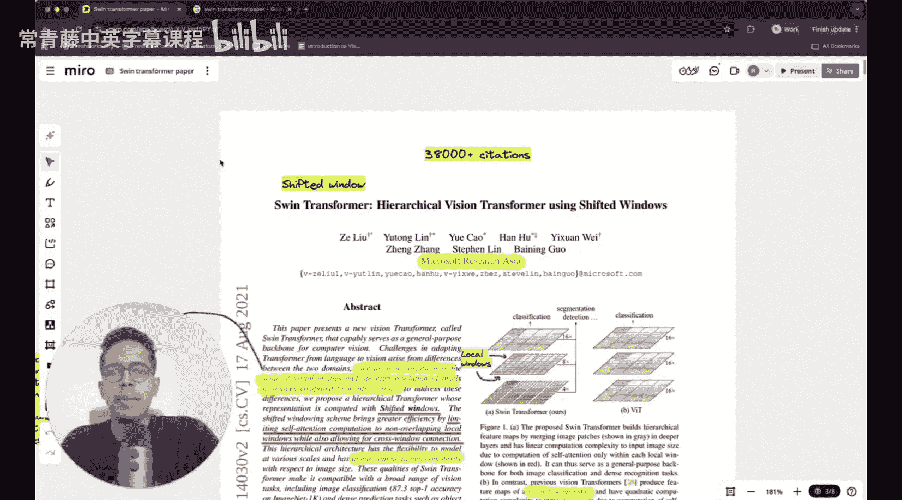
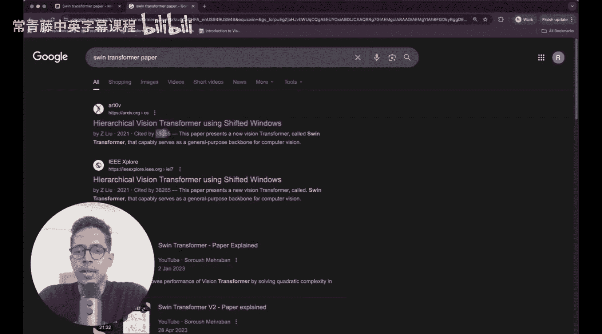
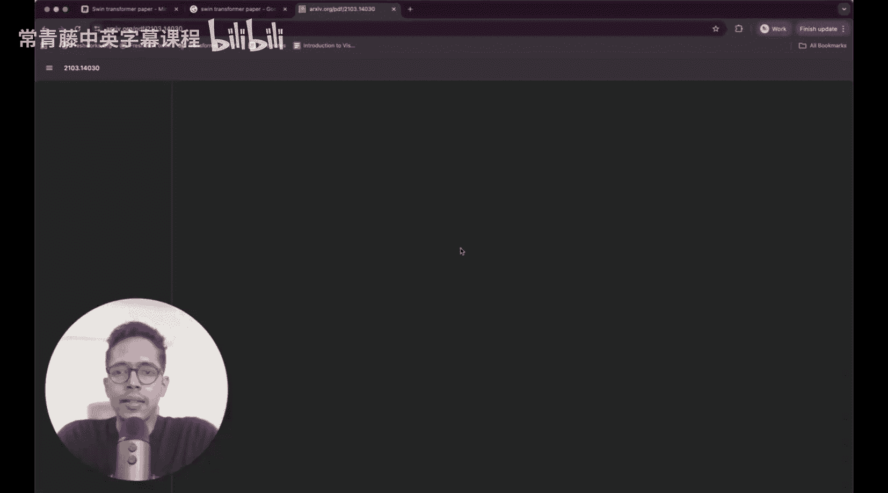
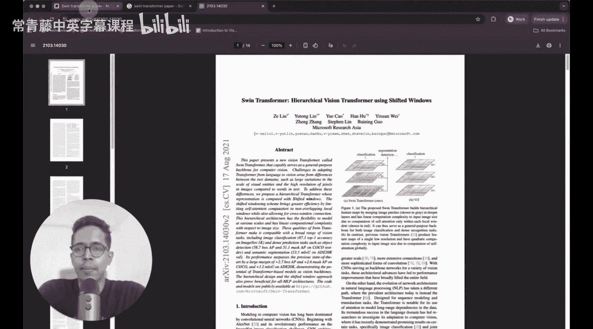
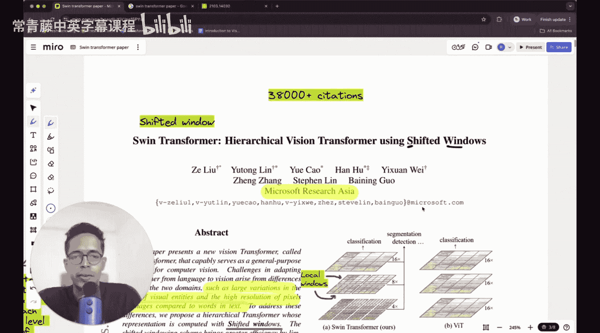

# Vizuara【中英⚡多模态LLM中的Transformer｜Transformers for Vision and Multimodal LLMs】 p04 P7 Swin transformer paper dissection - Hierarchical Vision Transformer using Shi [BV1X9zuByEuF_p4]

Hi， welcome back to Reading Research paper series today we are looking at Sw Transformer paper。

It's a very nice Saturday morning I'm sitting down to record this at 7。

 30 a right now I feel so good and so fresh。So I have gone through this paper maybe three times now。

And I must say that although this is an excellent idea， the paper is incredibly good， the idea is。

Fascinating。I personally don't think the paper is really well written。 Of course。

 it's well written from a point of view of a。Let's say somebody who already knows in and out of Sw transformer。

 but for someone who has not thought of this idea before。

You will struggle with it because it's so dense， the authors have been very， what should I say？

Fruugal with respect to use of words。Especially in some sections where we will discuss shifted window。

 although the idea on a broader level is easy to understand the exact implementation is a little bit complex and the way the paper is written was honestly to me a bit frustrating。

😊，But the good thing is I have already spent a lot of time understanding the nuts and bolts of this paper。

 I have also made some diagrams which are different versions of the figures in the paper themselves。

 which I strongly believe will help you better as probably as a beginner。And。

When I was reading the paper， I initially read it myself then used IGBT to get some explanation of some areas where I struggled。

And then also， I was failing。 And then what I did was。Some concepts I decided to visualize myself。

 so I opened Figma and then I created some visualizations of shifted window etc。

 we come to all of that I'm just saying my experience first。And once I did that。

 things started becoming more clear。From that point of view， I I'm very proud of。

The way I have approached this paper because it was conceptually difficult。

 although it's a short paper so I have the printeded copy of the paper with me here and it's only what 14 pages or something。

Yeah， and even in that around last four pages are references。So the paper is not a long paper。

 The second half of the paper is lot of tables with results where it where the。Classification。

 object detection， segmentation， etctera is compared with the state of the art。

 so there is not much intellectually challenging in those pages。😊，But despite all of that。

 I found the paper very。Technically does and。In my opinion。

 it's not because the idea is difficult to understand it's more because of the way it's written。

 maybe someone else feels differently but this is how I felt when I went through the paper multiple times。

Now in this series we have discussed about Vi transformer data efficient image transformer。

 so it's like a very nice transition to Sw transformer because it is an extension of what Vi transformer could do。

 so of course you should understand how Vi transformer works a little bit well discuss today but if you don't know anything about Vi transformer I recommend you to go through some 10 minute YouTube video from any channel。

That will be a good start。But as always we will pick up the paper on Miro board I have constructed the annotated Miro document and we will go through the paper line by line we will try not to skip anything whenever there is a question that we have we will ask that to chargeGBT in the hope of explaining certain things in an easier language。

For some figures I have constructed my own versions in the hope that it can explain things better to you so we will go through all of that and then lastly we I mean we'll spend most time on the architecture of course we want to understand what is the Sw transformer architecture but well also go through the rest of the things like research and what are the different types of experiments they did the authors did and。

What are the different ablation studies they conducted this paper came from Microsoft and it has my specifically Microsoft Research Asia and it has almost 38000 plus citation so it is a very very well known paper。

😊，In fact， it's a seminal paper， I mean， although I don't like the way it's written。😊，You know。

 the idea that they introduced， I would say it's。It's really a pivotal one because they showed that you can construct。

CNN like hierarchical features。啊 using。You know just by using transformer so there is no convolution operation it's just transformer。

 but they use the idea of windows and shifted windows so that helps you first constructed attention which is not necessarily global so that is the number one thing so there vision transformer they introduce in this paper is much faster it scales linearly with respect to the image size unlike vision transformer whose complexity attention complexity scales quadratically with the image size。

When I say image size， I simply mean the number of pixels。😊。

I know that you are not fully understanding what I'm saying I'm just spending initial few minutes to just discuss why this paper is significant so that you have enough motivation to go through the paper。

😊，And they showed that。Maybe this paper can become like a backbone architecture。

Where trans format is the。Is the key component， none of the papers before this。

Probably could make that claim and Sw transformer I think can make claim so the sentence or the wording that they use is this paper presents a new vision transformer called Sw transformer that capability serves as a general purpose backbone for computer vision we know that the backbone typically for computer vision is cs different cs but here they are showing。

In my opinion， probably for the first time that you can use a relatively efficient and state of the art transformer architecture as a general purpose backbone for computer vision tasks we know that transformer is a general purpose thing for NLP but not for CV but here they are showing it。

It can be the case for CV also。So that's most of it I will I'm hoping that this lecture or this video I can record in one sitting。

If not， maybe I'll try take one or two breaks。 I'm not I I can know only while recording。

 but I feel pretty good and energetic right now， but I'm also expecting to be very tired by the end of。

😊，m goinging through this paper。You may also experience the same thing it's not you may you will definitely experience the same thing so feel free to take enough number of breaks。

 feel free to take it slow there is no rush you can take as much time as you want to go through the papers but just make sure that you are going through it fully I recommend you printing it like this just it's only 14 pages have a printed version next to you as you are going through this video and then just annotate or underline or have a notebook next to you so that you can write down a few points so it's your your engagement your involvement with this paper is a bit more。

Interactive and engaging rather than just passive passively reading is is in my opinion。

 is' not the best thing to do。😊，All right， I think that's most of the things which I wanted to mention as an introduction to this paper。

A great idea， but。Not the easiest papers to understand。 So let's see how we can。

inKind of dissect this paper and try to understand it in the best possible way。🎼。

So let's now start looking at the paper。 This is the。

Miro annotated pages of the paper I don't think this will take too much time except for the section about shifted windows and its implementation there is also one part where we will have to spend a little bit of time which is relative positional bias I'm just mentioning these terms so that when you reach that point you are not surprised you know what to expect。

Al right， so the paper， if you can just Google Sw transform paper。

 it will come up and you can see that's 38，000 plus citations。

 you have the copy available on archive。

And this is the full paper， it has 14 pages， as I mentioned， and last four pages are。

Just references so in effect it's like a 10 page paper two columns so the number of words are I would say per page is quite high compared to data efficient image transformer paper and because of that this will probably take more time for you to go through but I mean that's part of the fun of reading research papers right fun meaning in a just like going to a gym like you are you are working out intellectually and you will be tired at the end of it but you will come out with a。

Feeling of high amount of reward。So the paper title is Sw transformer hierarchical vision transformer using shifted Windows。

 so the name Sw came from shifted S and win windows。

When I looked at some YouTube lectures based on Sw people were I mean。

 this is from Microsoft so people were commenting about。The Windows operating system。

 there were some jokes which I forgot what it was but people were mentioning something about the Windows OS itself in this context。

 but anyways that's the title of the paper it's from Microsoft Asia and let's get into the abstract。

This paper presents a new vision transformer called Sw Transformer that capability serves as a general purpose backbone for computer vision。

Challenges in adapting transformer from language to vision arise from differences between two domains。

 such as large variations in the scale of visual entities。😊。

