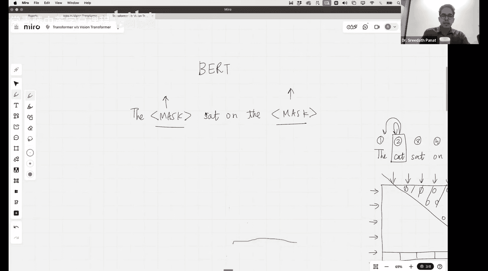
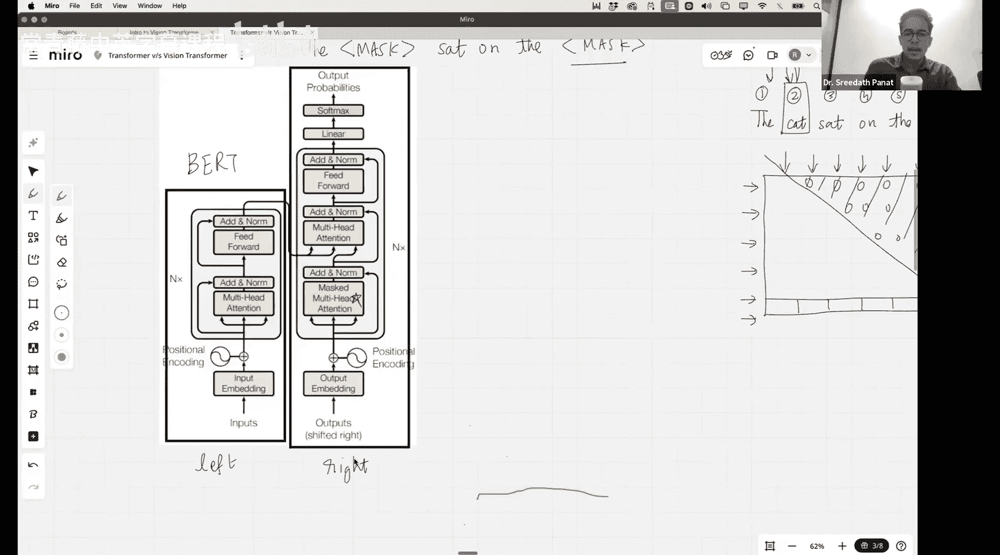

# Vizuara【中英⚡多模态LLM中的Transformer｜Transformers for Vision and Multimodal LLMs】 p05 P9 Build Vision transformer and NanoVLM from scratch ｜ Full 6 hour compilation [BV1X9zuByEuF_p5]

Okay， so welcome back to the lecture， today we'll be looking at vision transformer for the first time。

In the series and we'll be trying to understand the intuition behind vision transformer how vision transformer is different from transformers that are used for x based data so once we have that intuition we'll be coding one from scratch so when I say coding we will write every aspect wherever Pythtor libraries are applicable we will use those。

And training also will be done from scratch so at the end of today's lecture if you are coding along with me you will have a vision transformer built and trained by your own on one particular data set so at the end of the lecture that is where we are expecting to be。

So first， let's look at who proposed vision transformer。

So vision transformformer paper idea was proposed in this paper， which was originally out in 2020。

 but this paper on archive or the conference ICLR was appearing on 2021。

This paper three months ago had 65，000 citations now it has 76K so I assume that a few years down the line this will become one of the not the most highly cited paper in AI。

 but one of the highly cited papers in the entire history of AI。

And this paper came out three years after attention is all you need paper。Which was also from Google。

 So one thing you should note is that。I remember in 2022 many people were commenting on LinkedIn and all that when Open AI came out with ChaGT Google is not doing much in AI but Google always they have been doing a lot of things in AI it's just that many of those things were not in the consumer space necessarily many of those things were in the research domain。

And they had amazing papers， which are S papers， and they still do have many other papers coming out of different AI teams within Google。

So this paper was titled an image is worth 16 by 16 words so what they did was they proposed the usage of transformer architecture。

For image classification。And in their architecture。

 they had very minimal changes or modifications compared to the original transformer architecture that was proposed in attention is all unique paper。

This is a dense but well written paper I am conducting。

 I mean I am premiering a three and a half hour lecture video on reading this paper and properly dissecting the vision transformer paper if you are interested you can check out our YouTube。

But today we are not going to be going through this paper。

 but what we are going to look at is how does vision transformer differ from transformers for text which we have been exploring as part of the series。

And we just want to see where the key differences are and where are the similarities。

So a transformer for text works like this， you have a text input in the form of a prompt。

Then this input is tokenized， basically sentences are divided into tokens。

 you can imagine when I say token you can imagine words， but tokens can be words， subwords， etc。

And then each token is converted into a vector。If it is a GPT too small architecture。

 it was of 768 dimensions， so each vector was in a 768 dimensional space。

So every single sentence which we input into GPT will be converted into n number of tokens and those tokens。

 each of them will be converted into 768 vectors。And to each token。

 we add one thing called position emdding， which we have discussed in the past。

But the main difference between a text based transformer and vision transformer comes in the part where attention is calculated。

So in text based transformomer， we use something called as mask self attention。

 so we have discussed the reason why this masking is done。 So if we have a sentence like the。Cat。Set。

On the mat。And if we are dividing。A sentence into words， this consists of one， two。3。4our。Five， six。

 six tokens are there。Which means there are six queries and six keys。

And we construct this thing called as attention weight matrix。

 which we have discussed in detail in the past but。You will have six queries here along the road。

The cat sat on the mat。And you will have six keys， the CAssat。On the mat。

And what we have discussed in the last lecture was about masked self attention。

And multi head self attention were in masking we prevent current queries from paying attention to future keys。

 so if CAD is a query。That we are looking at currently， CA can only pay attention to itself。

And to the cat cannot pay attention to sat on the mat。

The reason why we did this was because of the task that we were trying to accomplish。

 the task that GPT was trying to accomplish was next word prediction。So in next word prediction。

 your current query should not pay attention to keys that are yet to come keys that are in the future。

So to accomplish this， what we did was we constructed an upper triangular mask。

Something that looked like this where all these elements in this attention weight matrix were  zero。

 so this was00000， this was0000，1 three zeros。Only the last query。

 which is the query corresponding to MA， will pay attention to all the keys because there is no more query after MA。

 so the query mat will have six keys to attend to。So this is what we discussed in the last lecture。

But you should also know that GP is not the only。Modern architecture that utilizes transformers。

 there is one more architecture， which is super famous called B。In bird architecture。

 what they were trying to do was not make sentence prediction。

Can you please erase the writing on the board because on zoom setting I cannot disable this so my only option if you guys draw will be to kick out whoever is drawing I'm sorry about that。

So in bird model， what we will have to do is or what they were trying to do was you will have a sentence which looks like this the。

Musask。Sad。啊。The。マスク。So in Bt， which also utilized transformer architecture。

They were not trying to do next word prediction， but rather they were inputting sentences and there they were trying to predict what the value of these mask tokens were。

Now， in this case， can you guys comment in the chat whether we need mask attention or not？

Should we have？Like causal cell attention which was there in the last lecture where GPT for an expert prediction was used in this case will we use an attention with mask or will we use an attention without mask most of you are saying without mask。

And that is correct because。In this case， you are not trying to predict an expert。

 but rather you are trying to take the entire context of the sentence。

Which means if you mask the attention between current query and future key。

 you won't have the full context available。And this is one reason why if you open this paper。

Attention is all you need bigger。

Yes， look at this vior。

Let me actually copy paste this。Now， focus on。This part so this paper is not GPT paper okay this paper is purely attention is all you need paper this has got nothing to do with GPT but look at this left hand side section。

And look at this right hand side section。And tell me， where do you find the mass self attention？

Is it on the left or right？It's here in the right。There is masked multi head attention over here on the left there is no masking。

Which means。Which one。Is GPPT， which one is bird is left one or is it right one？So essentially。

This transformer architecture has both encoder and decoder。But in bird model。

 they were just having this left hand side part。So mask multi head attention was not there。

 the input embedding was passed through attention was passed through transformer blocks。

 each transformer block had one multi head attention without masking and one feet forward multi layerer percept and that was repeated a number of times。

On the other。

