# Vizuara【中英⚡多模态LLM中的Transformer｜Transformers for Vision and Multimodal LLMs】 p06 P10 Input, output and filter dimensions in 2D convolution [BV1X9zuByEuF_p6]

Hi， I am recording this video to clarify one confusion that you may have if you are a computer vision learner for once and for all。

😊，So this is about 2D convolution operation and you will come across this operation in Python code like Nn。

com 2D。And when you look at what this expression is about。

 you will realize that this is 12D convolution operation。

 which may be part of a bigger convolutional neural network。😊。

Now if you may get confused about certain number of you know these parameters that are passed as arguments。

 that is easier thing to clarify which I will do first but the more important thing is here what exactly does the input look like to this 2D convolution and what exactly is the output what are the dimensions and how many learnable parameters does this particular 2D convolution create in the whole convolution neural network because at the end of the day if you want smaller neural networks the total number of learnable parameters should be small？

And these 2D convolution operations of course contribute to a good number of learnable parameters if you are working with a CNN。

 so if you want a small lightweight CNN you should know what is happening in this line of code。😊。

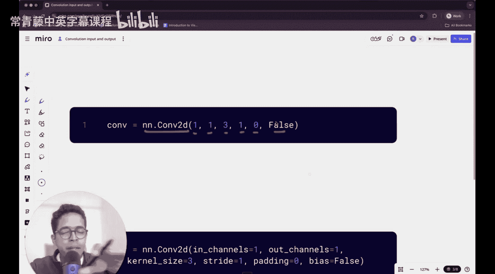

So let us look at that one by one。🎼Yeah。

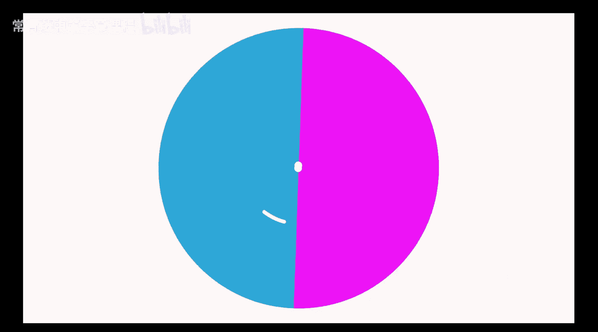

So firstly， if I expand this line of code like this。

I can explicitly mention the names of these input arguments so NN。

com 2D so anything that goes after Nn so NN is like a module which you inherit from Pytorch so NN。

 con 2D means you are defining a 2D convolution operation with bunch of trainable parameters in your convolutional neural network。

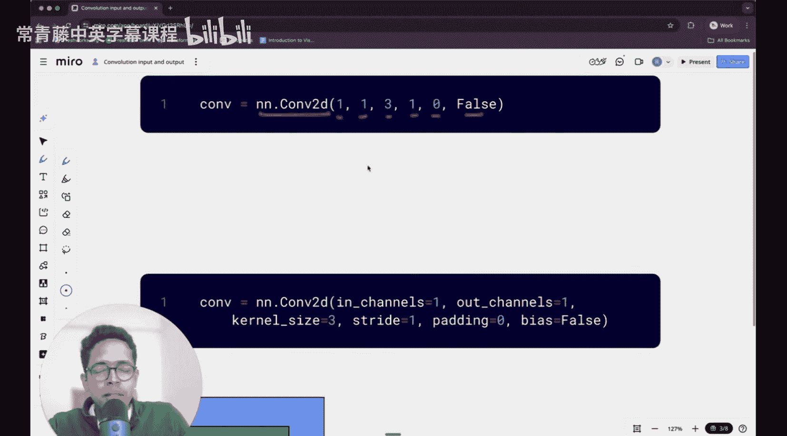

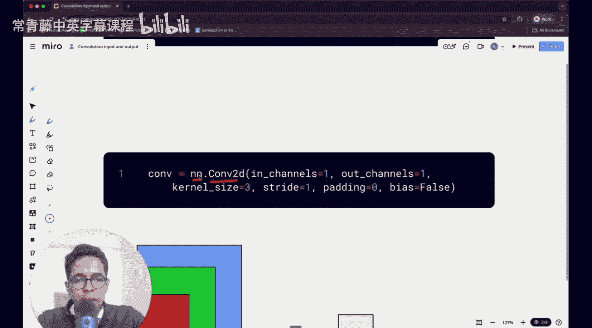

The first parameter is the input number of channels so I will come to what exactly are these channels what is stride padding etc ceter but lets first look at the definition number of channels in the input that is this。

😊，Number of channels in the output that is this the size of the kernel or size of the filter 2 d convolution filter that is 3 stride is 1。

Paaddding is0 and bias equal to false。So when you just read this line it feels like okay now I understand what are these different arguments sounds simple。

 but now if you were to imagine what the input size of the input image or you know input looks like and how does the dimension of the output looks like after this2ic convolution that is where true confusion begins？

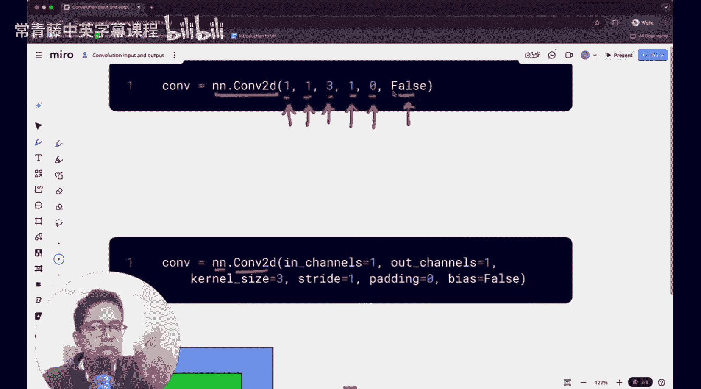

So， let's go through。

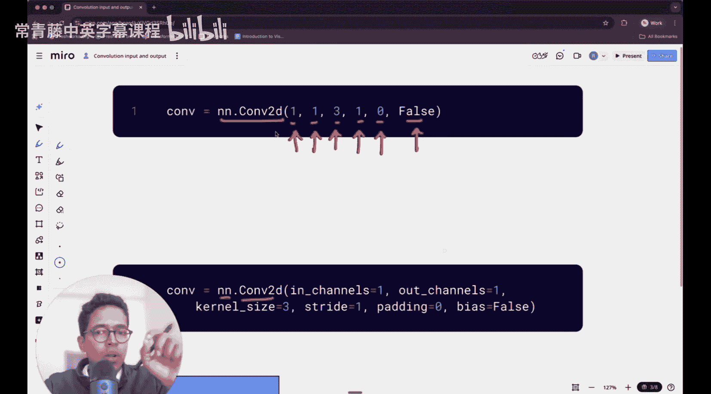

A simple example first， and then we will come back to this formula。

Let's say I have an image and say this image is9 by 9。So spatial dimension is 9 by 9。

 it has three filters RGB filters， so the channel dimension is 3。Now。

 if I am operating a convolution filter through this input， So now my input is。9ine by 9。

And there are three channels， so maybe I can write it as 3 by 9 by 9 where3 is the number of channels。

9 by 9 is the height and width。So the input number of channels should be equal to the total number of channels in my filter。

 so if my filter is size 3 by 3。So kernel sizes 3 by3。

The total number of channels in my filter also should be equal to input number of channels。

 so here input channels is 3 which means the total number of channels in my filter should also be 3。

So now what happens， how does this filter operate on this particular image input？

The way it does is the following， let me just drag and drop this here。

 so now the filter will start from here top left then based on the stride it will move to the next location。

 next location， next location and so on。So let's say there is no padding if the image is not padded with any extra pixels。

I have now three by3 filter。And I have nine by9 spatial dimension。

And if this stride is one meaning each time my filter will jump one pixel okay so then it will jump by one pixel it will jump by another pixel it will jump by another pixel like that how many jumps can I make I can make as many jumps as I reach this this right hand side end。

😊，tThen it will go to the you know next row and then again it will jump one pixel。

 one pixel one pixel and it will reach here and so on till it covers the whole set of X Y pixels in my input this is how convol works。

Now， if I have9 by9 as the input spatial dimension and 3 by3 as the kernel size。I can only jump。

 I can only occupy。Total 7 positions because this is my position number one then this is position number2 position number 3 and so on。

 and by the time you occupy the position number 7 my filters would have reached the rightmost end so along the horizontal dimension I can occupy 7 positions along the vertical dimension I can occupy 7 positions which means the spatial dimension of my output will shrink this is because there is no padding so my spatial dimension of the output will shrink to become7 by 7。

Now the question is， okay， spatial dimension will shrink that is understood。

 but what about the number of channels in the output？😊。

Are we going to have one channel in the output or are we going to have three channels in the output。

 this is where most of you may get confused。You might think that because your filter has three channels at the output you may have three channels as well。

 but that is not the case here output will have only one channel because the convolution operation。

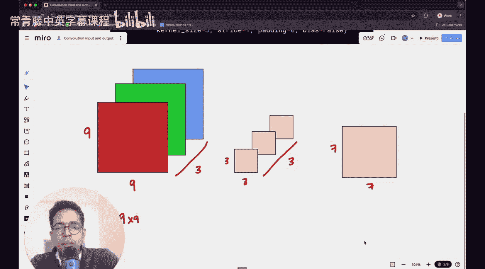

The way it works is， let's say this is three by three。

Right then it this is how it will look like there are bunch there are nine values of pixels behind this convolution filter and that filter itself have some values So those values will get multiplied and added same operation happens in channel number2 and channel number3 and then all of them will get added so basically to produce a one pixel output value at the output because here at the output I simply will have。

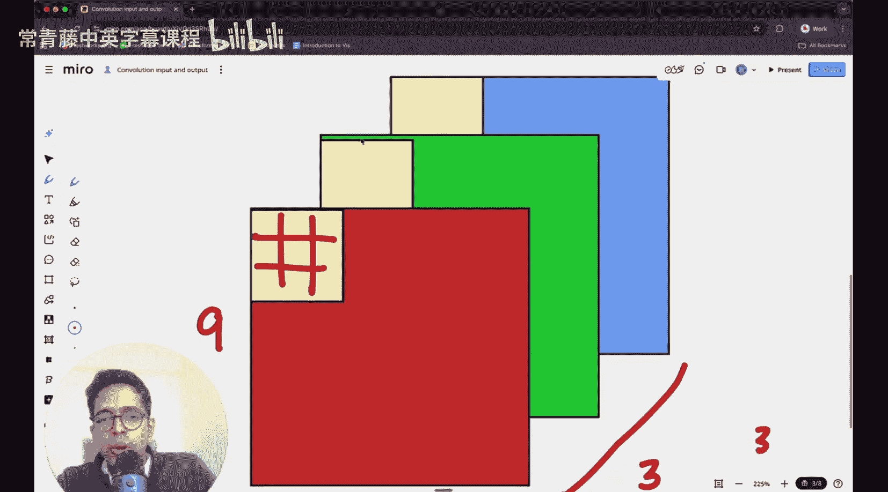

One pixel。As a result of this three channel filter operating across the RGB channels I will simply get one pixel output and that output will be the weighted sum of the pixel values according to the filter in channel number one plus weighted sum of the pixel values corresponding with the corresponding filter values in channel number2 plus weighted sum of the pixel values with the filter values in channel number 3 so basically you are adding all of them to produce just one single number。

So that one single number， let's say it is 26， it will occupy this pixel。Like that。

 I will have seven pixels along the row and seven pixels along the column to produce。

1 by 7 by7 output I have one channel for the output。

 I have seven as the spatial dimension along the width and7 as the spatial dimension along the height。

So now let me delete this and let me。Take another example。So。

 what if I did not want my channel dimension to shrink because here channel dimension became one instead of three。

 what if I did not want that to happen what could I do？

What I need is now instead of having three filters I should instead of having one filter with three channels I should have three filters with three channels。

 so let me move this filter here so I should have filter number one。

 filter number2 and filter number3。😊。

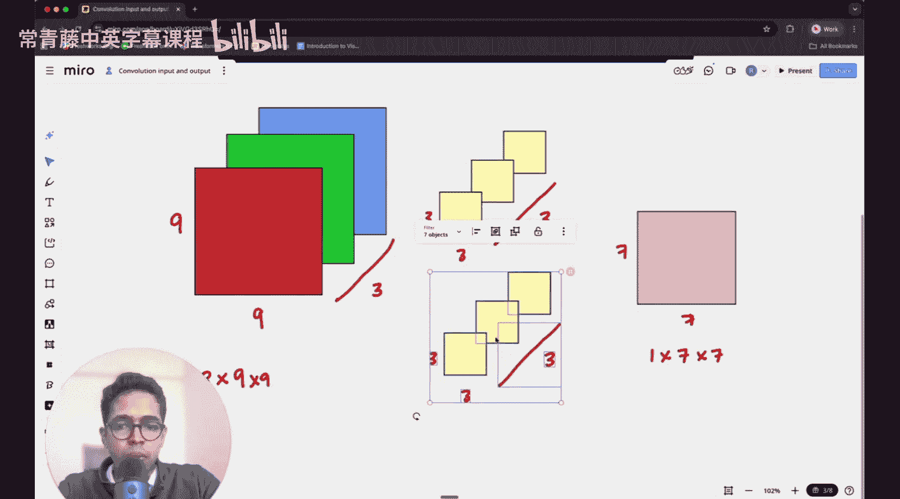

So now we have three filters， each filter has kernel size 3 by3 and each filter has total number of channels 3 Now what will happen is output will not be one channel anymore output will actually be three channels so channel number one let me just copy paste this。

😊，SoNow output will be three channels and spatial dimension will still be 7 by 7。

Because my kernel has not changed， padding has not changed and stride has not changed。

 only thing that is changed is the total number of filters， so now this will be 3 by 7 by 7。

And who is responsible for my channel number one， so this is channel number one。

 this is channel number two， and this is channel number 3。

So now filter 1 is responsible for channel1， filter 1 is this whole thing。

This is responsible for channel 1。😊，Filter 2 is responsible for producing the values in channel 2。

 and filter 3 is responsible for channel 3。So just to reiterate the total number of channels in the output will be equal to total number of filters so now if you go back to this formula here kernel size is 3 by 3。

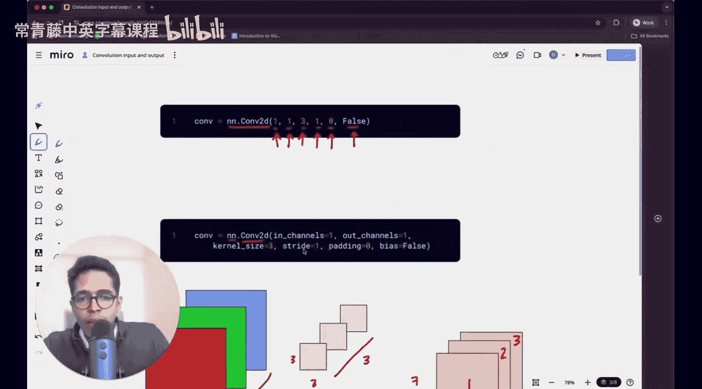

Input number of channels is three what this means is the image at the input will have only one channel。

 so it it would look like a gray scale image， but if it if it is not even an image if it' is like an abstract features that feature will have just one channel。

Sppatial dimension will be whatever。And if output channels is equal to1。

 that means you have only one filter， kernel size is3， it means you your filter dimension is 3 by 3。

 stride is equal to 1， addingdding equal to 0， bias equal to false。😊。

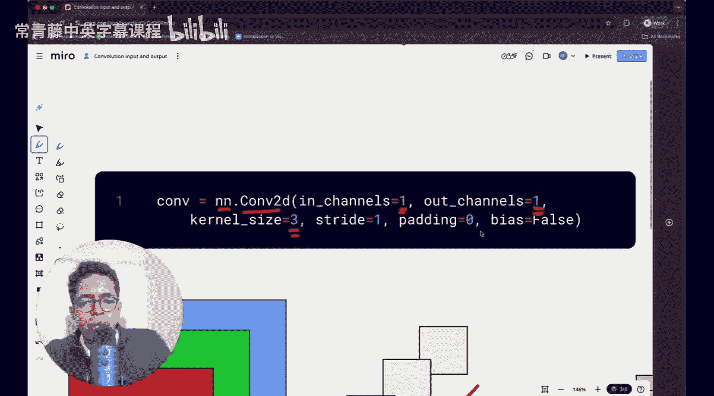

So now based on this， let's try to calculate。How many learnable parameters would be there so to this example we will come in a moment。

 but based on this example based on my 9 by 9 input based on0 padding straight equal to 1。

 three filters at the three channels are the output and you have three separate filters each filter has three channels based on this how many learnable parameters are there let's also assume that there is no bias okay。

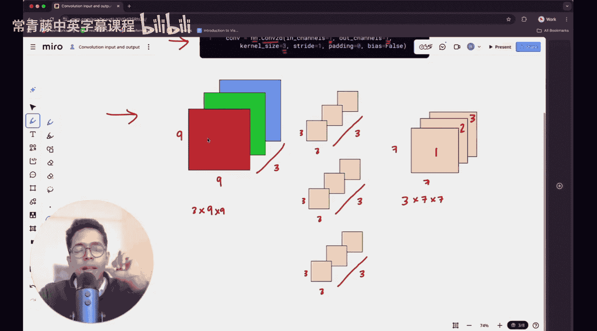