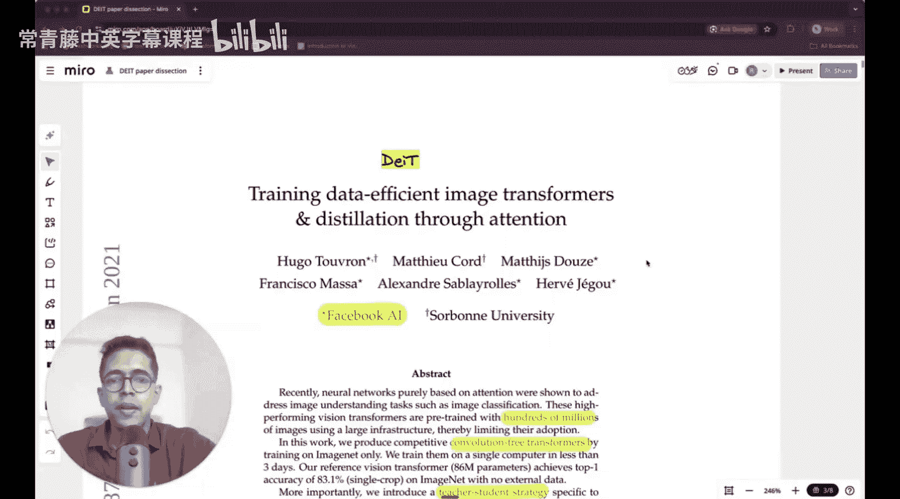
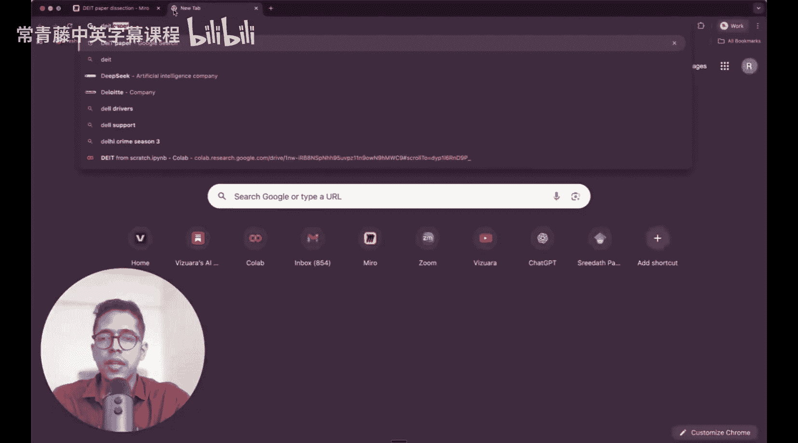
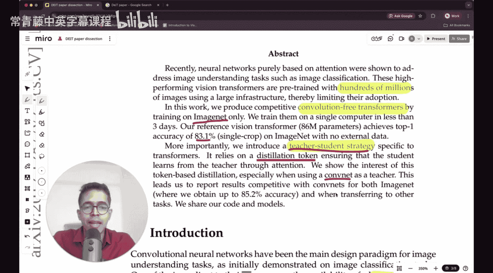

# Vizuara【中英⚡多模态LLM中的Transformer｜Transformers for Vision and Multimodal LLMs】 p08 P13 Dissecting DeiT paper - Data efficient image Transformer [BV1X9zuByEuF_p8]

Hi， welcome to a new video from Reading Research papers series。

 so the paper that I am picking for today's reading is this one。

It's on data efficient image transformers。I have already gone through these papers a couple of times and I have created a detailed paper dissection notes in Miro。

But I'll tell you what is the significance of this paper and why I decided to dissect this paper at this point of time in the series。

So one of the previous lectures that we had was on vision transformers so the problem with vision transformer was that it was using huge data so 300 million JFT data it was Google's own proprietary data and the training took a lot of time to finish you required a lot of GPU computational resources so what this paper showed this is the model is called DIT you might have seen it date DEIT model it's called data efficientff image transformer so the title of the paper is training data efficientff image transformers and distillation through attention so the interesting thing about this paper is that it talks about。

Few different ideas within the same paper it's not like they introduce the idea but the idea of teacher student model where how can you use a bigger pretrained neural network for training a smaller neural network so here the bigger neural network can be a convolutional neural network it can be a big vision transformer。

But how can you use that to train a smaller vision transformer with the help of the idea called distillation so that is one interesting aspect about the paper Another interesting aspect is that this paper shows that you can build on top of existing models and still be significantly efficient so this。

The authors of this paper show that you can simply use the Inet 1k dataset set the Inet dataset set with just the 1k classes on the other hand the Vi transformer paper they were showing they were saying that you needed INe 21k much much bigger data for getting sense out of Vi transformer。

 so we will go through all these things。I'll tell you first thing which I liked about this paper personally which was it is actually not a long paper although that number of pages are 22 the the it is not a two column paper it's just a single column and there is a lot of white space so as a researcher I know that I should not feel like this but as a human when I see。

😊，good famous papers that are short I like it because I know that I can get through the paper so when I picked up this paper for reading for the very first time I felt happy because I was I knew that I will finish this paper because it was relatively short。

If it had 6065 pages like， for example， the clip paper has I think 48 pages or something。

 Im realistically I'll take much longer for finishing that paper from friend to the last page so that is that was my first feeling。

😊，Second thing was while reading through the paper。

 I realized that I was glad that I went through the vision transformer paper first because then I was finding it very easy to understand a lot of things that are discussed in this paper so you will also feel the same as we go through the paper so that was a second good thing。

Yeah， third thing was just just reading through it。

 I actually did not find it that difficult to read the paper in just one sitting it was although I have read it maybe two or three times the second and third reading was just to understand it a bit in a bit more finer detail but I don't think it' will be so much difficult for you to you know get through this video in just one sitting it might be possible but of course as I always say please don't be harsh on yourself take adequateate breaks so that you will feel。

Really good。And one more thing is I just want to test how good my brain is working today like I'm just recovering from a fever so I first thought of recording this lecture at 615 a as soon as I woke up but then I thought let me not unnecessarily push let me be awake so I think Im right now in a good mind space to just sit down and go through the paper in detail with you。

And yeah， so I have written down a few points， which are。And notations in the paper itself。

 so I have added those points in the mirror board， so you will also see what my thought process was。

And as always we we will be using Cha GT without any shame and we will try to acknowledge if if we don't know certain things we will try to acknowledge the fact that we don't know everything only then we can learn all that and of course I am in a deep work mode I block my door and I put up like these sticky notes where is that I just put a small sticky note outside my door saying I'm in a deep work mode please do not knock。

So these are small things which I do to make sure that I get some deep chunk of work done in one session。

 so I hope to go through the paper in one setting， but let's see。And yeah， I mean。

s it's becoming slowly becoming a habit for me in the last few weeks I have read more papers。

Then I have maybe like on an average my weekly paper reading rate was significantly higher， much。

 much much higher than what it was over the last two to three years so I'm really personally proud of that for myself。

 but I also hope that through this series you are also slowly getting into that habit of reading papers end to end。

 not like capsule format like reading it end to end so let let's get into this lecture and this time I hope you will find a lot of things easy。

If you don't know about vision transformer just you know I will go through the vision transformer architecture a little bit but I still would advise you to maybe watch any vision transformer video related video from YouTube anywhere it can be from Visua's channel we have bunch of Vi transformer videos but it can be a shorter5 10 minute video if you don't know anything about Vi transformer in any case I'll be discussing about it a little bit so with that let's get into the dissection of this paper。

😊，🎼，So this is the paper which I got from archive the paper came out from Facebook AI research so if you search DAT paper archive you will see that this is the one so around 10。

000 plus citations so its you know from a purely citation point of view it is pretty famous but compared to vision transformer which had 75000 citations this is this may not be as comparable but I think this paper will teach you a lot of things even for the future especially the distillation token ideas about how exactly can you perform knowledge transfer from one model to another through distillation idea so all of these are。

Interesting concepts as a deep learning enthusiast all of us should know right so lets go through the paper starting from the very top so the title is training data efficientff image transformers and distillation through attention。

😊，These are the authors， I don't recognize any of these names from any other projects。

 but I assume whenever some other papers cite using this surname to run at all。

 we can assume that it's a DEIT paper。This is from Facebook AI research so let's go through the abstract recently neural networks purely based on attention were shown to address image understanding tasks such as image classification。

 I hope they are referring to vision transformer paper。

These highper vision transformers are pretrained with hundreds of millions of images using a large infrastructure thereby limiting their adoption this was very much true 300 million was their data size for one of the JFT dataset sets in this work we produce competitive convolution free transformers so that was the whole value proposition of vision transformer they don't use convolution at all so here also you will see that in their actual architecture there is no convolution。

So they use convolution free transformers by training only training on imagenet only and that to which imagenet Inet 1k if I am not wrong。

 we will see that。😊，We train them on a single computer in less than three days。

 our reference vision transformer with 86 million parameter achieve top 1 accuracy 83。

1% so this is on the imageed dataset。On image it with no external data more importantly we introduce a teacher student strategy so this is that important concept that I was talking about specific to transformers it relies on a distillation token so this distillation token is different from the classification class token you might you might remember the CLS or CA SSS token which was preended at the starting of the vision transformer token sequence so here there is a distillation token and we will see where it is actually appended is it at the beginning is it at the end does it matter all of that vacancy。

Ensuring the student learns from the teacher through attention so here maybe based on the way of writing we can imagine that student is probably the model that these guys are building teacher we don't know what is a teacher right so from so far what we have read that's what we can deuce。

😊，We show the interest of this token based distillation。

 especially when using convenet as a teacher so convolutional neural network is the teacher that they are using this leaves us to report results competitive with con conves which is CN。

😊。

