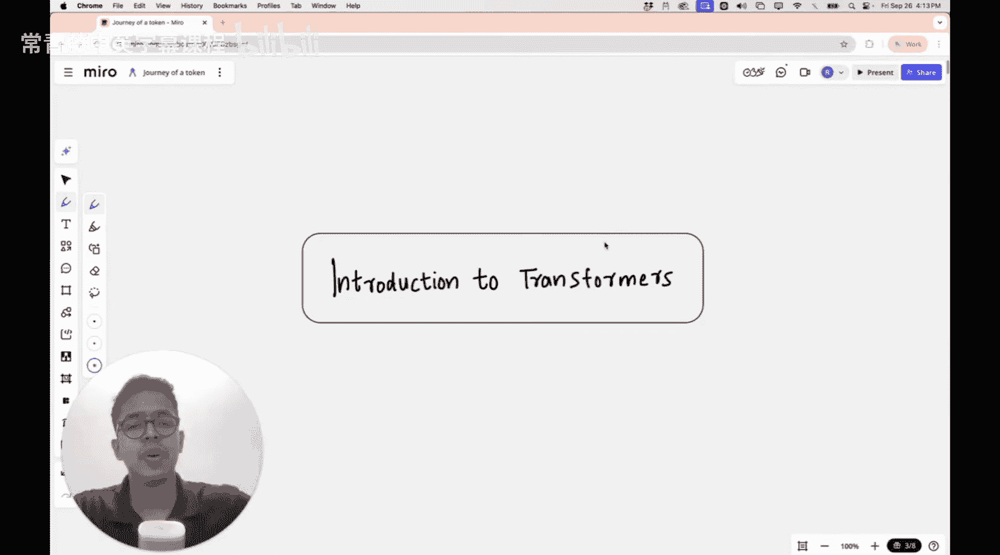
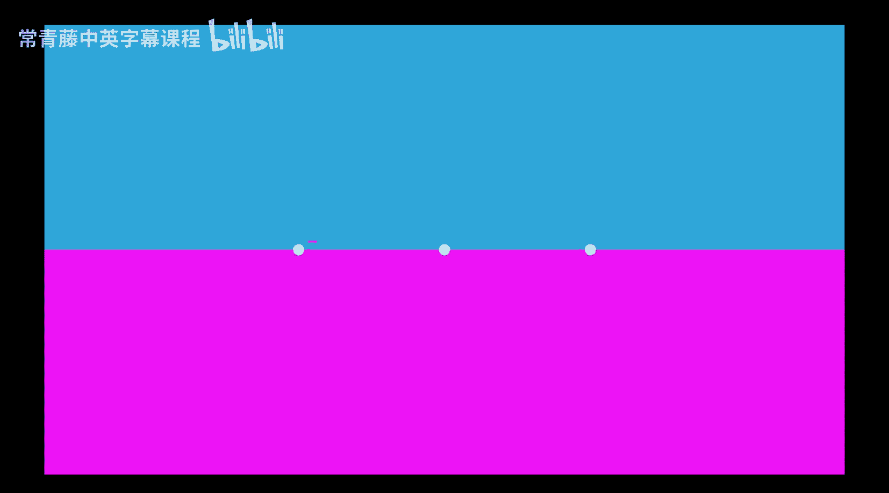
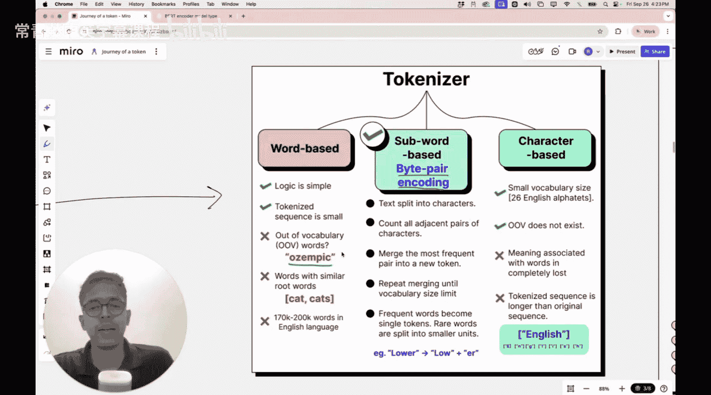

# Vizuara【中英⚡多模态LLM中的Transformer｜Transformers for Vision and Multimodal LLMs】 p09 P16 Transformers architecture mastery ｜ Full 7 hour compilation [BV1X9zuByEuF_p9]

Hi， welcome back to a new lecture from the Transformers for Vision series in the last lecture we discussed why transformers are needed to capture long range dependencies within images which CNNs struggle to do。

And this is the first time in this lecture where we will be diving deep into the actual architecture of a transformer。

We will be discussing from the context of large language model rather than vision transformers in the current lecture。

 however， whatever we learn today will also be translated directly to when we discuss about vision transformers in the future lecture。

So the way I have arranged today's lecture is completely beginner friendly。

 you don't have to know anything about transformers yet。

And we will be tracking or we will be trying to understand how a transformer works from the perspective of an individual token。

 I will define what is a token and we will look at thisken token's journey to see how the transformer operates。

I'm pretty sure all of you are familiar with this paper， attention is all you need。

 which came out in 2017 and this is the paper that revolutionized the field of artificial intelligence as we see the hype today。

This paper has 200，000 plus citations from Google， and in this paper they propose for the first time the idea of self attention。

Which we will discuss in this course。And this changed the way people。

Implemented natural language processing。So transformer was the main part of this paper with self attention introduced in it and then later various other variants came there was flash attention and there are many other modifications that happen to transformers later but the base model remains the one that is proposed in the attention is all unit paper so let's see what is a transformer architectural and how exactly it works。

Be prepared to dive in feel free to take notes if you want to pause the video and rewatch some sections。

 feel free to do that but。You know， stay very focused because well be actually discussing how exactly each individual module in the transformer works。

😊，This is probably the most famous figure of transformer architecture that currently exists on the internet。

I have overlaid two things on top of the image， this slight red color。

Box with some text and notation so I added it myself。

 but what you see inside is the transformer architecture diagram which was there in the attention attention is all you need paper。

So in today's lecture， we will not be looking at this entire architecture because this architecture consists of two parts。

 one is encoder。😊，And another one is decoder。So encoders are found in models like Bt so BRT Bt is basically an encoder only architecture。

 decoders are found in models like GP so GPT is a decoder only architecture so if you understand how decoder works you can basically understand how GPT or cha GPT works so our focus in today's lecture will be on a decoder only architecture so this part we won't be having a look at however don't worry if you understand how exactly this works you understand how the entire transformer architecture works rest of the things are very simple。

So this is where we start。Now the problem is this diagram right。

 although it captures everything it is the most famous diagram for beginners it' is not very friendly because there are so many things going on。

 there are so many terminologies， so many arrows that connect different modules so unless you have a very specific perspective or some unless you have some prior experience it's difficult to read what's going on in this diagram which is why I will show you different version of the same diagram which I have constructed and I will walk you through the same decoder architecture as I walk you through the different modules of the decoder only model。

So what happens in a large language model？A large language model simply makes predictions of the next word。

So you can open chat repeat and ask is B？Decoder only model， or rather encoder only model。

Then you see the way it answers it prints one word at a time。

 so basic task that a large language model performs is called next word prediction。

And once you have the next word， this you can add to the already existing words and now you have another input the CAs at on the mat。

 and then you can try to predict the next word and then add it to the existing sequence and do this iteratively to produce a long。

 big response。So the input or the prompt is the sentence or sequence which you give。

Model is the large language model， it could be GPT， it could be any other model。

And output is output at one time is the next word that is predicted。

 and this process is repeated to produce entire paragraphs。

So if we can understand how this next word prediction happens inside a transformer architecture。

We can basically understand how a shared GPT model or how GPT model works。

So now let's see how this entire simplified diagram works in reality。

So here what I am showing you is。A simplified or modified diagram that shows decoder only architecture。

So when I say decoder only。What I mean is the right hand side of the above figure。 So this figure。

 this right hand side has bunch of things。 samee thing I have。Drawn in a slightly different way。

Now I know that here also there are a bunch of things going on which is probably not very beginner friendly。

 which is why I won't be asking you to look at this whole thing at once。

 we will look at this entire architecture in Shas。So focus on three main parts。

 we can divide this entire architecture into three parts the first part is this part where input is taken care of。

 basically input is transformed into some format and what is the input input is the sequence the cat sat on the。

Then the second part or the second block is called the transformer block。

And then the third block is where output is produced where the next word prediction happens。

So we will be looking at only one of these blocks at a time。

 so first we will keep our focus on the input section。

 then once we understand it fully what happens to the input we will move on to transformer block and then once we understand fully what happens here we will move to the output section。

So we will attack this architecture。😊，In a very sequential manner。

So ignore everything on the right hand side， ignore this and and and this for now。

 don don't think about 2 and3， let's just think about what happens to the input once you feed it。

What happens in this input part of the transformer？So now we are focusing just on this part right。

 and you can see that three things are written。First is the input sentence。

Second is the tokenized text。Then I have written something like token embedding。And positional emy。

What are these things， what is a token？What do we mean by token embedding。

 What do we mean by positional embedding。Right this part。

 you might probably know this is something called as like a prompt。Or input。 the cat SAT on the。Now。

 if we understand each of these things which I labeled as ABC separately。

We can understand what this input section of the transformer architecture is doing。

So let's consider an input first what happens to this sentence is it is split into words。

So you can think of each word as a token。That is a simplified way to say。😊。

In actual transformer architecture， you will not be splitting a sentence into words like there are words。

 there are sub words， and there are other characters also that can form a token。

But here for the purpose of simplicity， you can say that this sentence is split into five tokens。

The cat。Set。On the。So these are the five tokens。And we will just focus on one token so that we can track what happens to that token as it goes through the transformer architecture。

 so we will focus on the catch token， which is the second token in this sequence。

If you are interested to know how exactly this tokenization happens。

 so this splitting of this input into tokens is called tokenization。The tokenization。

 one of the ways in which you can tokenize is called byte pair encoding。

People did not come up with byP andcoding randomly， there were other options too。

 you could tokenize based on just words as I just showed you the CA satAT on the。

 so you could have simplyified tokens， logic is very simple wherever you identify a word。

 convert that as that word as a token。The problem with this is if some new words are introduced into the vocabulary。

 let's say this is the name of a like a drug o Zic。

