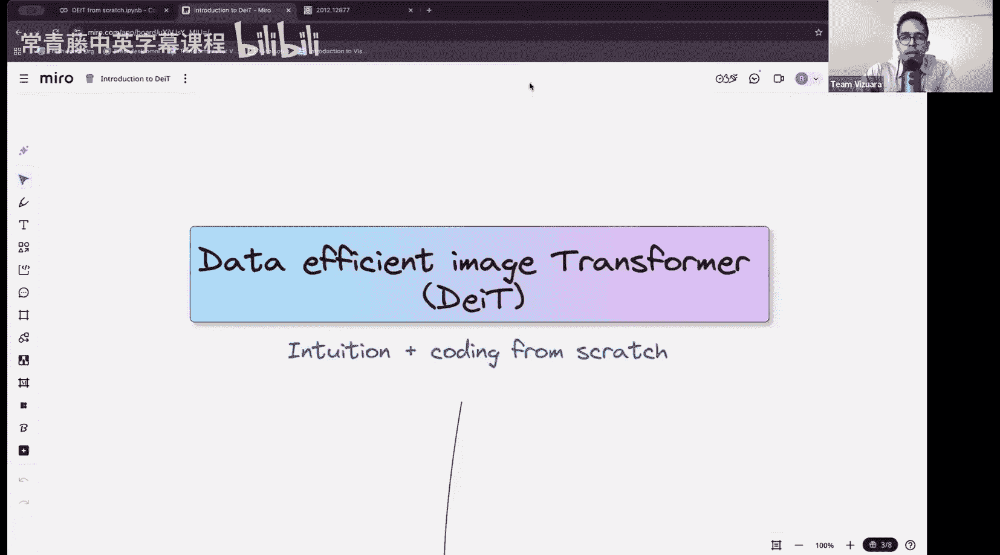
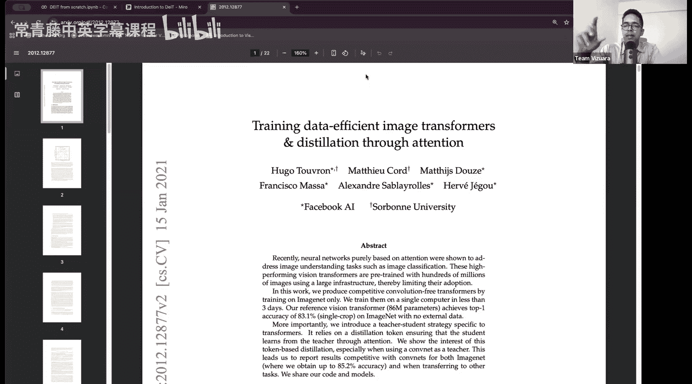
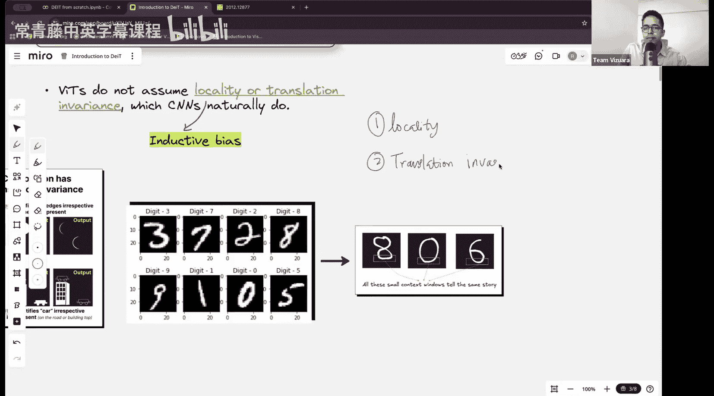
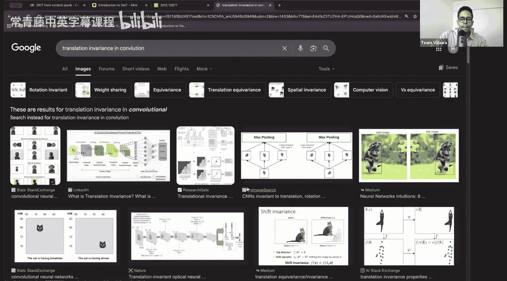
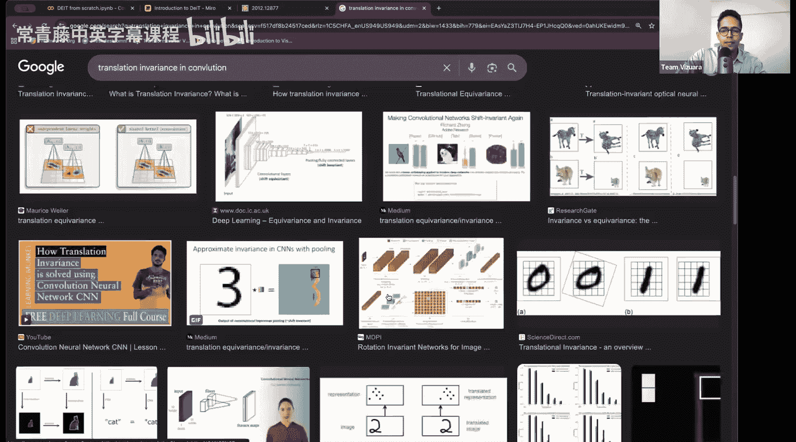
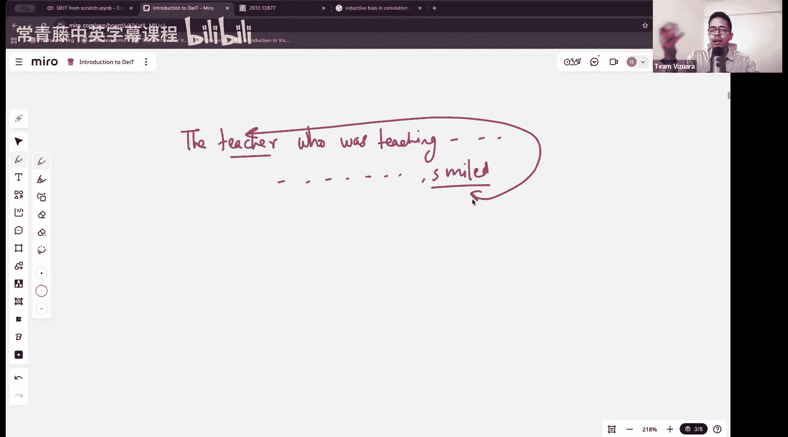
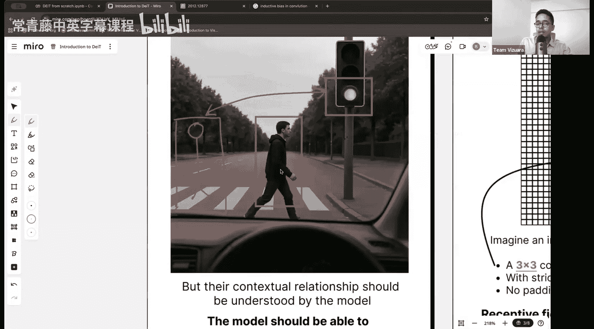
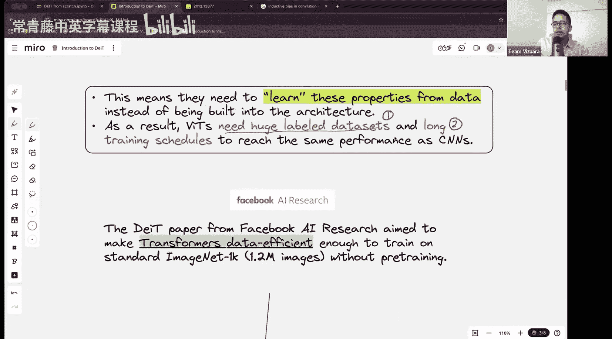

# Vizuara【中英⚡多模态LLM中的Transformer｜Transformers for Vision and Multimodal LLMs】 p10 P17 Coding DeiT Data Efficient Image Transformer from scratch [BV1X9zuByEuF_p10]

You can see my screen and hear me all right。Awesome， thank you。

So welcome to a new lecture today we'll be learning about data efficient image transformer and first we will understand the intuition behind。

What was different about this model and what other models is a data efficient transformer most similar compared to and in the second part of the lecture we will be building one from scratch。

So。We have already covered vision transformer， so the good thing about today's lecture is if you understand vision transformer and it's coding properly。

 data vision transformer， you will feel very much similar because 95 percentage of the things are very similar with respect to what vision transformer did。

But data transformer did something amazing， which made it significantly better in terms of training efficiency compared to a vision transformer。

One announcement that I have is we have migrated the website to a newer platform and in this process。

Around maybe five to 10 percentage of the students are not able to get access to their existing courses in their dashboard。

 so what you can do is you can just drop an email I'm just putting it in the chat。

Just drop an email here。Just mentioning about the courses name and that you are not able to have access。

 we'll fix it。All right， so now let's look at data efficient transformer。

 this paper was published in around 2021。

And it was from Facebook AI research， so the paper title is training data efficient image transformers。

 so this DEIT is data efficient image transformer， so it is for images it is making use of transformer architecture。

And it has a few more things， so the other main idea that was introduced in the paper is distillation。

You may have heard of the concept of teacher student model。

 so we will look at it in detail today what exactly is a teacher student model in deep learning and how that idea is also known by the term knowledge distillation and how this knowledge distillation is utilized in data vision transformer for making it significantly better compared to vision transformer。

So if you think about vision transformer， the main problem with vision transformer。

 number one problem was that it required huge amount of data。

The data that was used for training the base vision transform model was a 300 million image data called JFT dataset。

 which you will see in their paper。But this JFT paper， JFT data mentioned in the paper。

 it's not a publicly available data， it's Google's own data。So this was a problem。

Second problem was that the number of parameters。In there。

State of the art model in visionion transformer if I am not wrong， it was around 600 million。

So it was not a very small model， 600 million parameters around 300 million images。

In the training data。And it also required multiple days of training using multiple GPUs。

 so computationally it was very expensive， but the vision transformer which was trained using all of these resulted in Sota state of the art at that moment。

And it actually overtook what convolutional neural networks。

Managed to accomplish up until that point So you know that 2012 to let's say， roughly 2020。

Or around 2021， those were the years when CNNs completely dominated deep learning or computer vision。

 but then around 2020 when vision transformer was introduced。

 transformer architecture started becoming popular。

So the reason why we are discussing about data efficient transformer is that it is the next logical succession since we already know how vision transformers work。

So CNNs had something good going on for them， mainly called as inductive biases。

But now we have models with billions so yeah so in the context of images and in the context of the speed with which you can operate this is not a language model。

 this is a email based model so 600 million model compared to let's say data efficient transformer with only 84 million parameters it is large。

Today there are even bigger models， but the whole idea here is that how do you train a reasonably good model？

With low number of parameters with less input data。

 basically small training data size and still achieve something close to state of the art so this was a problem that researchers were trying to solve。

So in CNNs， they have something called as inductive bias that most two famous inductive biases are locality。

And second is translation invariance or translational equivariance。

There is a very nice g which I want to show you if you search。

And if you go to Google imagess。

Not sure if it is popping up right away， let's。Let's search inductive bias。

I'm not sure if it is showing up， let me check if I have I can find it on my own mirror board。

It was a very， very nice g， which would have been nice to show you anyways， we'll check it。

 it was showing up until yesterday。But basically translational invariance is the idea that it doesn't matter where spatially in the two dimensional space where your feature is located in an image。

 your CNN will capture it so if you have a big image。

And let's say you have a CNN which can recognize circular features。

 it doesn't matter where this circular feature is located， it will capture it because CNN operation。

 the convolution operation covers the entire X Y dimension as it goes from top left to bottom right。

So the bias， the reason why this is called inductive bias is that。Inherently。

 the operation of convolution is making some assumptions。

 it is assuming that features are locally present。And features irrespective of in which locality it is present。

 those features can be detected using certain type of filter。

But we have discussed this in probably the beginning part of this course that this is not necessarily always a good thing。

 for example， look at this example here if you are in a self driving car。

And let's say there is a person who is crossing the road despite it being a green signal for the cars。

The pixel where the person is present may be the person is here。So person is over here。

And red signal pixels are over here， so the actual physical distance between the pixels where the person is and the pixels where green signals shown they are actually far apart。

😊，But still in this context of the image， those two sets of pixels are highly correlated。

So there has to be some sort of global attention mechanism。

 a mechanism where irrespective of the pixel distance in the image。

 you should be able to make meaningful things out of your that full context and only then let's say in this case you will have a self drivingriv car which may work based on certain architecture it should not run over the person just because you have a green signal。

So this is one reason why people were so interested in bringing transformer architecture to images because。

In Transformer， it doesn't matter what is the length of the sentence that you are inputting as long as it is within your context window。

One famous example that we discussed in the early part of this course is。

 if you have a sentence that looks like the teacher who was teaching。Who was。

Teaching a difficult concept。To the students， Im not writing the whole thing smiled。

So here the mild action is performed by the teacher， not by the students。

 but the words these two tokens are far apart they are。One， one is at the right at the beginning。

 one is at the end， but still the attention scores between those two tokens should be high enough。

For teaching your model that actually teacher and smile are very closely related to each other。

So same concept applies to images when you convert your images into patches and patches into tokens。

 it doesn't matter the physical separation between the patches。

 you can learn relationships between the far apart patches so this was the reason why people people were pushing towards transformer based architecture。

But the problem was that in vision transformer， as I mentioned， you need huge。

