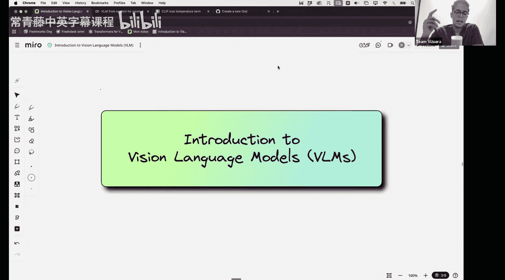
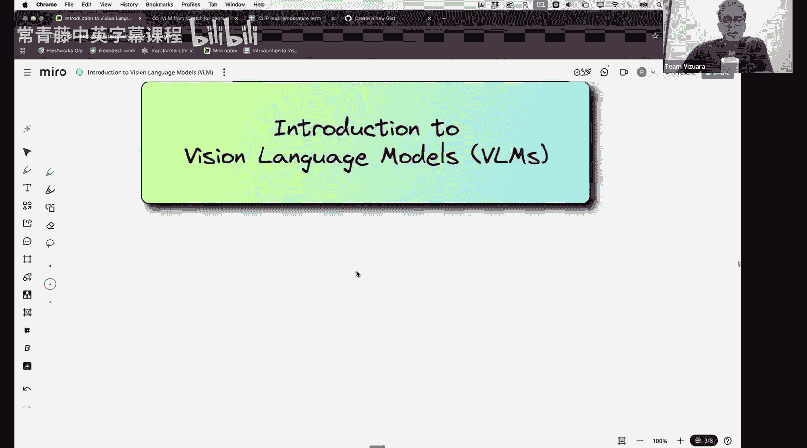
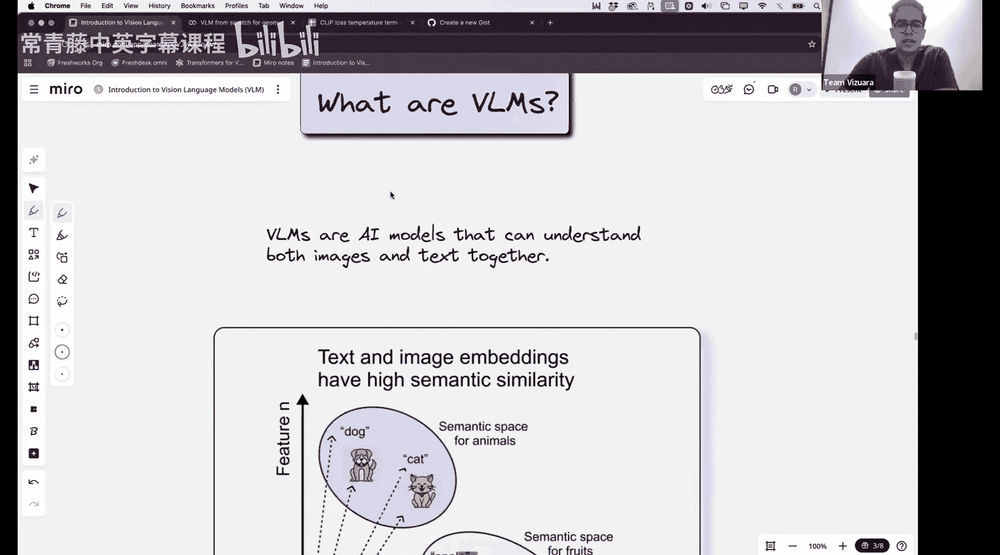
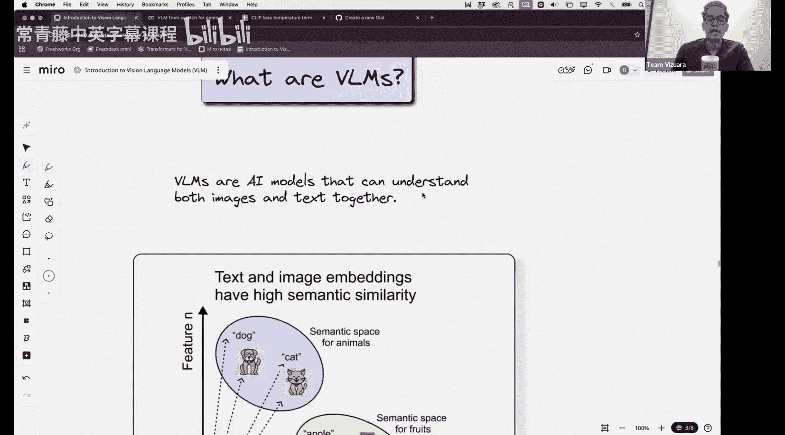
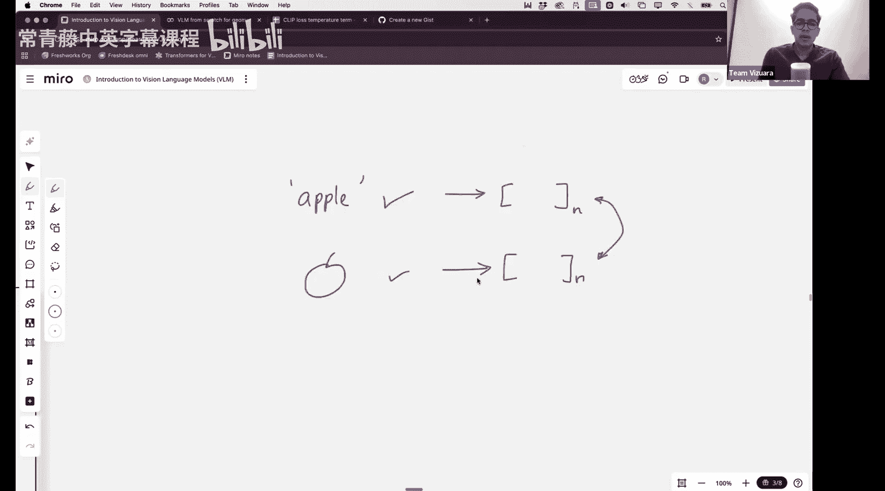
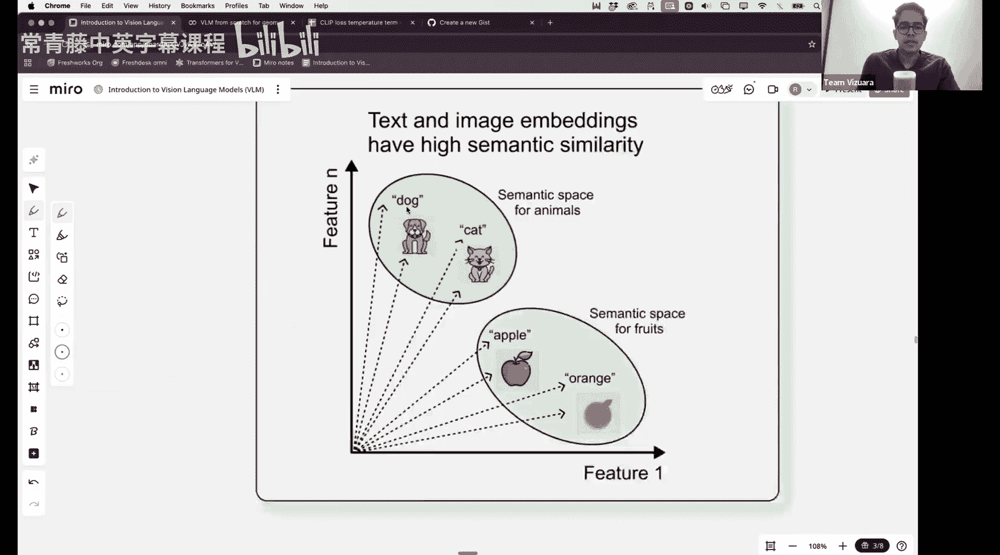
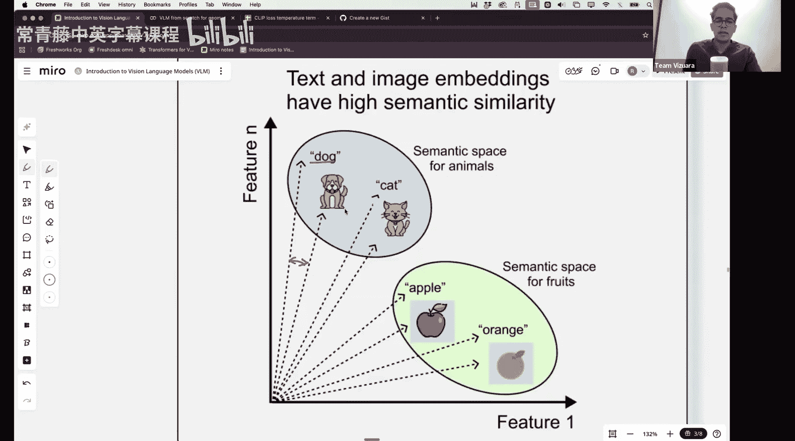
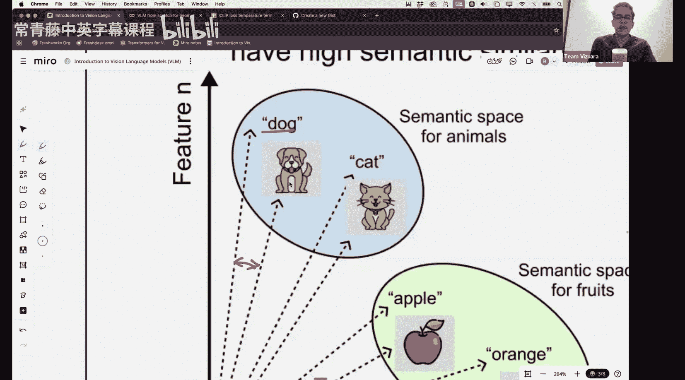
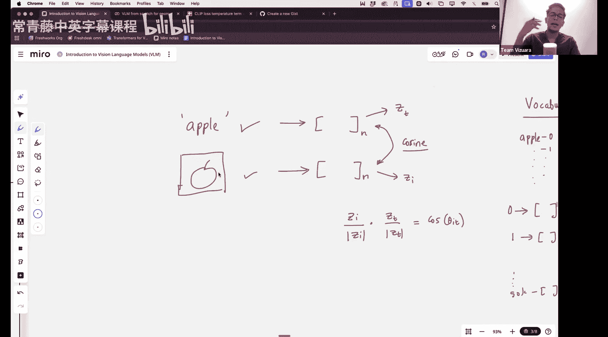

# Vizuara【中英⚡多模态LLM中的Transformer｜Transformers for Vision and Multimodal LLMs】 p11 P18 Build NanoVLM from scratch [BV1X9zuByEuF_p11]

And you can see my screen all right， if you can confirm， that'll be great。Okay， thank you。

So welcome back to a new lecture from Transformers for Vision we'll be building and before that we'll be understanding about vision language models today。

After learning about VLMs we will also build a nanoVLM completely from scratch in the last lecture we looked at building emission vision transformers from scratch so some of those ideas will be very beneficial for you here in understanding the architecture。

And this is， of course， under the category of multimodal LLMs because in vision language models。

 you have two modalities， the modality which carries vision and the one that carries text。

So now let's look at what are VMs？

Ideally， VLms should be able to process text and image data。

Together， so if I write。

A word apple。Or if I show you the image of an apple。In human brain。

 we process both of these kind of similarly， both of these are represented by the idea of Apple inside our head。

So how does that happen？RightSo somehow BlM should understand that this。

And a picture of an apple both mean the same thing。Now we can think of this in multiple ways。

 but one of the simplest ways to think of representation is how did we represent text？

In a large language model， what was each token becoming in a large language model if you can answer in the chat？

Each token was represented using dash。It was basically a vector right。

 so each token was converted into a mathematical multidimensional vector。

So we can think of a similar idea here， somehow convert apple into a vector。Of n dimensions。

And somehow convert this image of the apple also into a vector of the same dimension。

 same number of dimensions。And then。Figure out how to make these two representations。

Close to each other or similar to each other。So if you look at this image。

 it very nicely captures this whole idea。

So this is the vector of the text dog， this is the vector of the image dog。

They should be very similar， ideally they should be close to each other because this is a semantic space。

 multidimensional semantic space and each area of this space when you are pointing a vector to that area。

 it has a specific meaning。So in general， you can think of vectors corresponding to animals pointing to the seman space for animals。

 vectors corresponding to fruits like apple orange pointing to another direction in the space。

But what we want is we want the vector emiting of the text of dog and image of the dog to be same。

And this we have discussed many times in this course。

 how do we quantify similarity between two vectors if the dimensionality is the same？

We take cosine similarity， correct， we can take the dot product。And constructors cosine similarity。

 so if these two were unit vectors， so let's say I call this as vectors then corresponding to text P。

And this I call as vector Z corresponding to image I。And if they if they are not unique vectors。

 I can just do divide by magnitude of I and take the dot product of Z I with Z T。

And divide by magnitude of t， and this will basically be cosine of theta I where theta I is the angle between image and text representation。

And if the vectors are very， very similar， the angle between them will be close to zero。

And that would mean cosine of 0 will be 1 if the vectors are not at all similar。

 they will be orthogonal， then cosine of 90 degree will be close to0。So this is the idea。

Now you have already learned one way to convert your。Text into vectors in large language models。

How do you convert text into vectors in later language models， what exactly did we do？

If you can note down just the very first step， what was the very first step， How did we convert。

Text into like a word in a sentence， how did we convert that into a vector？Yes。

 we need tokenizer for sure， but。We first need a dictionary， right， we need a vocabulary。

So our vocabulary will have all the possible tokens。That the model， language model will encounter。

Now if for simplicity we say that the tokenization is each word is one token in reality that's not the case in reality each token can be word or sub word。

 but if we simplify and say that each word is a token。

 then the vocabulary will consist of all the possible words。Now， this vocabulary。

 let's say the first word is apple。Then there are a bunch of other words last words will be something else now each word will have an ID ID number zero ID number one etc。

 and we also discussed that GPPT3。Had 50，000， around 50，000。Tokens in its vocabulary。

So it was like a relatively big vocabulary model。Now， each of these tokens。

Are represented by one vector， so token number0 will have a vector associated with it。

Token number one will have a vector associated with it。

 token number 50k will have a vector associated with it。

The dimensionality of this vector will depend on what your model is。

 so one of these was 768 dimensional model it was the h GPT3 model was 768 dimensional vector。

And you can have any number of dimensions。So now if you are presented with a sentence like。Apple。Is。

えふ。Something like this。Then the first thing you do is you will divide this sentence into tokens or corresponding token ID。

 so let's say the token ID of the first word is zero。Let's say the token idea of this is。350。

 let's say this is。诶。Maybe this would be zero that just 10。And let's say this is something like 100。

 something like this。Then we look at our vocabulary or diary to see what is the vector vector associated with token number 10。

 what is the vector associated with token 350， what is the vector associated with 000 and so on。Thus。

 we will get four vectors of 768 dimensions。And each of those vectors will correspond to one token。

So this is how we got vectors associated with。A text。

And then one more thing which we did was we added position embedding。

 so if the first token is set position zero， second token is set position one。

 third is set position two。Position  three and so on， we added position em to get the final。

Vectctor embeddings corresponding to all input tokens。

And only then we pass all of this through multi head attention to produce context vectors。

 so this will go through multi head attention。This will pass through multi attention。

 each tokens will produce one corresponding context vector and that context vector also had same dimensionality as that of the input so if this was 768。

Those was also 768。So we went through this process to produce vector associated with your text input。

No by。Slightly different logic， how can you convert your image into a vector？

So text conversion to vector is something that you are familiar with。

How do you convert your image into a vector？One example you already know from the last picture in vision transformer。

 you knew how to convert image into a vector。What did we do， we divide an image into patches。

Each patch was converted into a vector which was the token then on top of that you added position embedding。

 then the position embedded tokens were passed through a transformer to produce the final context vectors。

RightSo that is one way another ways you can pass the image through a convolutional neural network without any attention mechanism or anything。

 you just pass it through convolutional neural network to increase the number of channels of the image and decrease the spatial dimension originally the spatial dimension will be can you please prevent from drawing on the screen？

Otherwise， Ill have to remove you。I'll share the screen as now。So。

Each image at the starting will be three by three sorry 32 by 32 by3。

 something like that of dimension， so xy spatial dimension will be 32 by 32 and Z number of channels will be3 RGV。

And as the image passes through each convolution layers， the spatial dimension will start to shrink。

 which I will show you in a moment。And number of channels will increase at some point。

