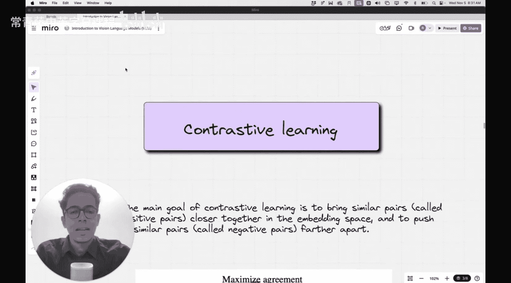
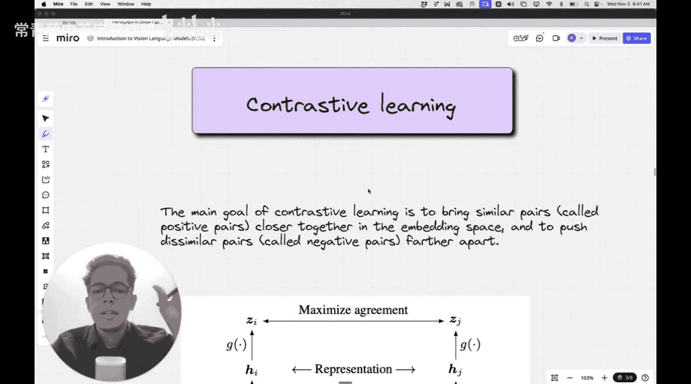
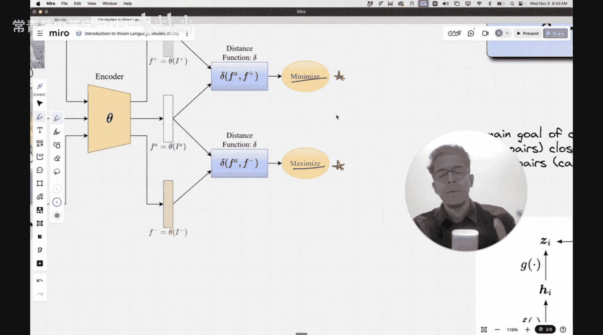
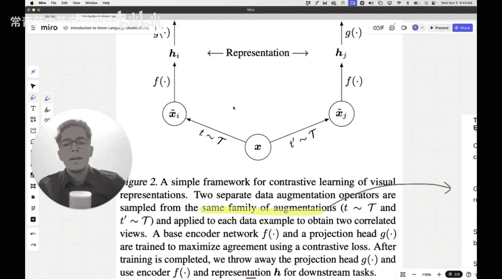

# Vizuara【中英⚡多模态LLM中的Transformer｜Transformers for Vision and Multimodal LLMs】 p12 P19 Contrastive learning for Vision Language Models [BV1X9zuByEuF_p12]

Hi， welcome back to a new lecture from Transformers for Vision series In today's lecture we'll be discussing about contrastive learning the main reason why I wanted to introduce this topic in a separate lecture is because of its importance in models like clip so C was probably the most famous vision language model that utilized the idea of contrastive learning this paper is cited highly in the last lecture we briefly discussed not about the paper about the existence of the paper and one of the co-authors you might recognize by name Eliliakver so this paper came out from OpenAI and at the moment it has 4546000 citations。

But the idea of contrastive learning itself for images。

 it was popularized by this paper which came out slightly before this so the contrast clip paper which was contrastive learning for vision language models was introduced in 2021 but one year before that there was another paper which introduced a simple contrastive learning framework and this paper has almost 27。

28，000 citations now and this paper really revolutionized the way the idea of contrastive learning was implemented for image text data or just image dataset。

So let's see what does contrastive learning simply means and the idea is simple。

 the mathematics is also simple but its implications is very huge and that is one of the reasons why the clip paper clip model became so popular so we'll be briefly discussing about clip paper also today although entire paper review we have to put it for some other lecture because the paper is very long but we'll see what does contrastive learning mean and why is it so important for vision language models so with that let's get into the lecture。

Before I move forward， let me briefly discuss what we saw in the last lecture in the last lecture we discussed about basics of vision language model。

 a basic vision language model will have an input embedding for text so this diagram is what we essentially had a look at last lecture we will have an image encoder for image inputs we will have a text encoder for text inputs and optionally there will be a fusion block now this fusion block can be a transformer architecture itself so it can be a combined attention between concatenated image and text embeddings or you can have cross attention where queries in the text attend to key and value in image or query attends to key from image and then that is taken as a dot product after taking softmax with the values from image or vice versa query will be there in the image keys and values you consider from the text。

So this is what we essentially discussed in the last lecture if you want to go through the basics of vision language model in detail I highly recommend you to watch the previous lecture and here is an example of how VLM workflow looks like so first your input image will be converted using the image encoder into visual embeddings each embedding is a vector and then the text encoder will convert your text input into a vector and ideally these two vectors should have if they are in the common representational space they should have vectors that looks similar so this image that we looked at in the beginning this was called joint embedding space or joint representation where this image that is like a doc running towards the camera and the text that says happy dogg running towards the camera if you convert those into vectors and if you are just drawing the tip of those vectors by these dots。

These two dots， one is the green one is the image representation in vector format。

 red one is the text representation， they are both very similar the cosine similarity between those two vectors will be very very high。

There was one more diagram which we discussed in the last lecture and here you can see that it's an n dimensional space where we are just showing two dimensions and in general vectors have semantic meaning so vectors for。

Animals， let's say dog and cat they will point towards a similar or common semantic space for animals vectors for apple。

 orange etc ce， they will point towards the semantic space meant for fruits and the cosine similarity between vector embedding of dog text and vector embedding of dog image will be very high they will be very similar those two vectors so this is essentially what we discussed in the last lecture but we did not discuss too much about what kind of losses can we construct based on this vector embeddings are we going to compare the embeddings directly and that is one way in which you can do as you can see in this image。

So this image shows probably the simplest version of vision language model also known as dual encoder。

 so you will have an image converted to image embedding using image encoder。

 text will be converted to text embeddings and then you compare those two embeddings to construct a loss。

And this loss function， this can be like a clip style loss or contrastive loss。

 which we are going to discuss in today's lecture。And another example that we discussed was。

calllled as early fusion where before you have an attention block your both embeddings will be combined。

 it will be fused into one single representation in that one single representation you will have image as well as text data so whatever comes out of the fusion block will be a joint representation following this joint representation you may have just a multilayer perceptron which is a straightforward forward neural network or you have a transformer block。

That learns attention weights based on the joint representation and then finally if we are trying to do let's say image retrieverie well you will do a softm classification where。

The output is for corresponding to this image， this is the best caption from your dataset set or you can have visual question answering or you can have image captioning。

So all sorts of language plus vision tasks are possible so this is in a nutshell what we discussed in the last lecture about vision language models and in today's lecture now let's see what exactly is contrastive learning。

The main idea behind contrastive learning is to maximize the similarity between what we call as positive pairs and minimize the similarity between negative pairs。

 but basically it should be as dissimilar as possible。

So let's see what this means from the contrastive learning paper itself。

 so if we just Google contrastive learning and just look for images。

There is one nice image which shows this idea perfectly。So have a look at this。

 let me copy paste this image。So just have a look at this， okay。

 so this is my anchor meaning the image that I am considering right now。

 the middle image of this dog。This top image is just an augmentation of this image。

 so this is also you can as a human you can see that it's exactly same image it except it's black and white。

And this is called as a positive pair， so these two images are now positive pairs because you are performing some sort of transformation to construct this positive image。

On the other hand， if you consider these two images。

 it is these are negative pairs because this is a completely different image it' is not the same animal。

Now， what you want to do is you want to construct a distance function。

Between these positive pairs and negative pairs and your end goal is to minimize the distance between positive pairs and maximize the distance between negative pairs so then the anchor image will be fixed and then anchor image will be compared to bunch of negative images anchor image will be compared to positive image and you want to maximize the distance with positive pairs and minimize the distance between or vice versa you want to minimize the distance between positive pairs maximize the distance between negative pairs this is in very simple terms what we are trying to accomplish Now if you look at the contrastive learning paper I'm not talking about the click paper I'm talking about this paper for contrastive learning they have a little bit intimidating kind of diagram here in figure two which I have pasted here。

What this is showing is very simple， you start with your anchor image and from your anchor image。

 you construct。Positive pairs by performing transformation so transform emissions they are representing as t prime or T so these are two different transformations to produce two transform versions of the same image Now what are some examples of transformations one could be converting the color scale from RGB to black and white or gray scale one could be random rotation one could be random flipping you could be you could be imagining random cropping so I'll come back to this figure two but let me show you some examples of transformation that are discussed in the paper so this is the original anchor image cropping and resizing so here you crop out one portion and then zoom in to resize it back to let's say 224 by 224 or whatever here you are cropping and flipping flipping horizontally here you are converting to black and white here you are changing the color the whole color itself。

This is a rotation or you are eliminating some portions by adding an overlay rectangle with a certain color。

 adding Gaussian noise， adding Gaussian。