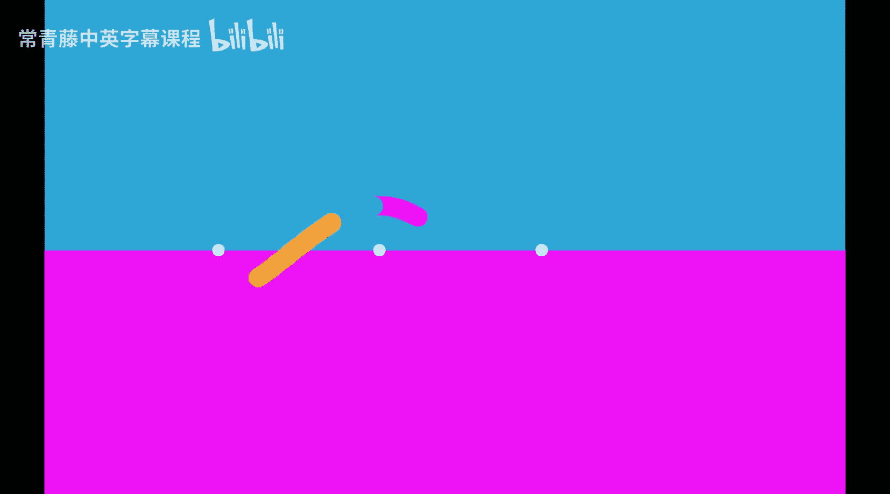
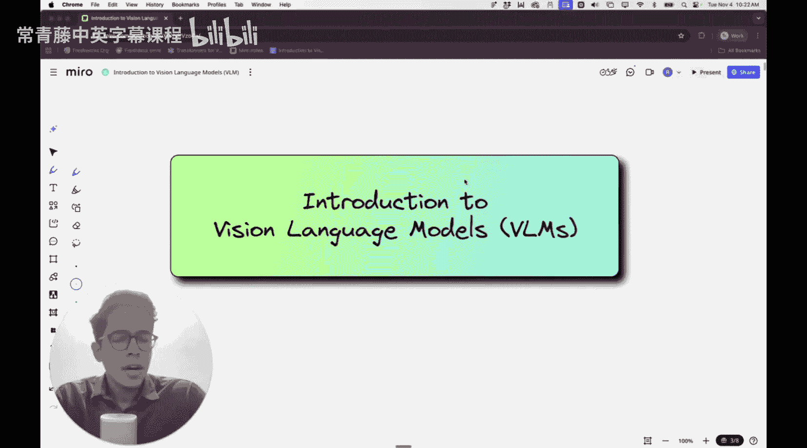
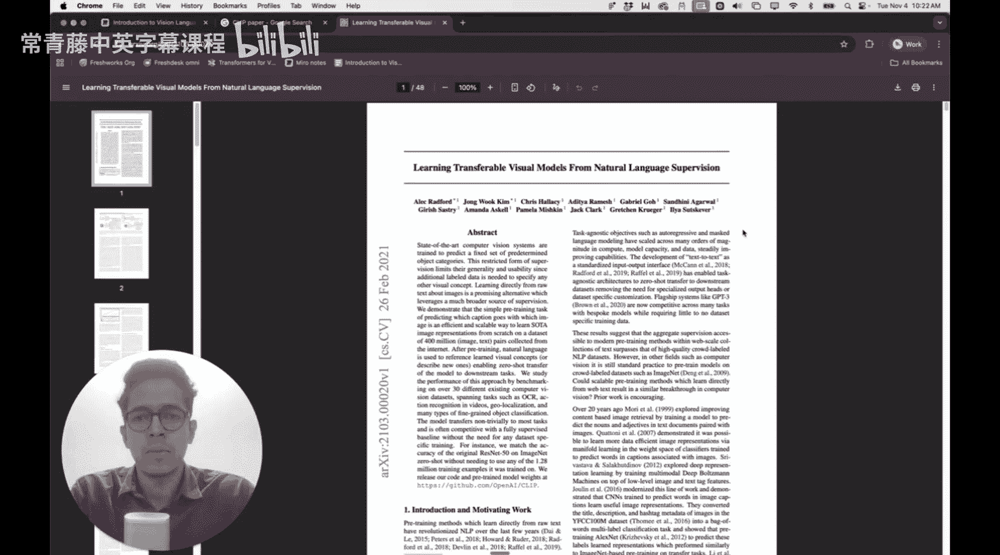
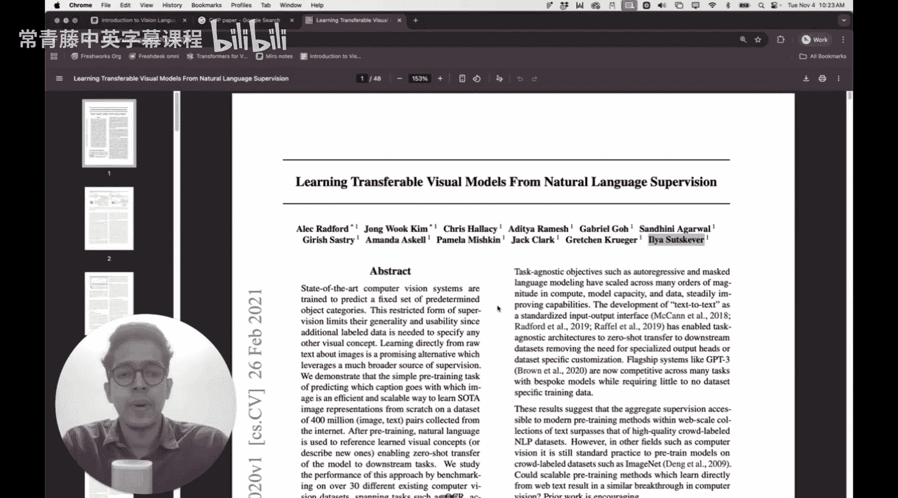
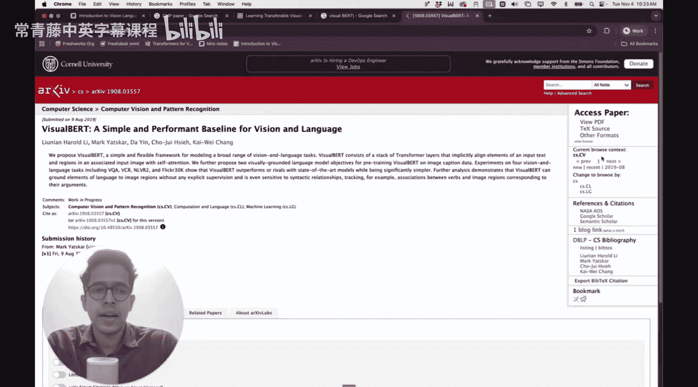
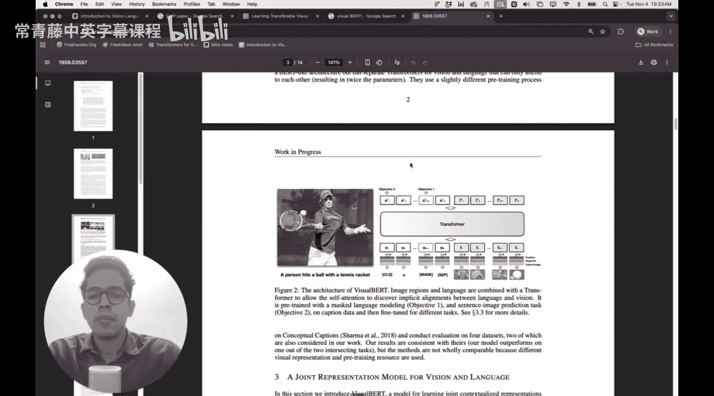
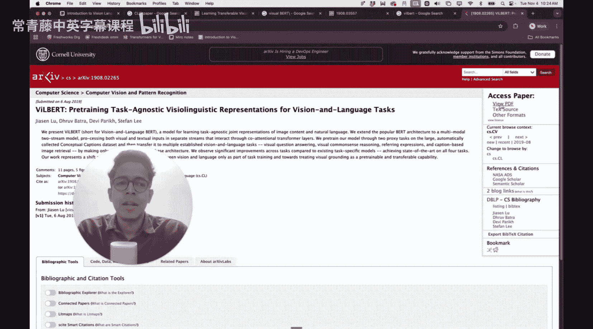
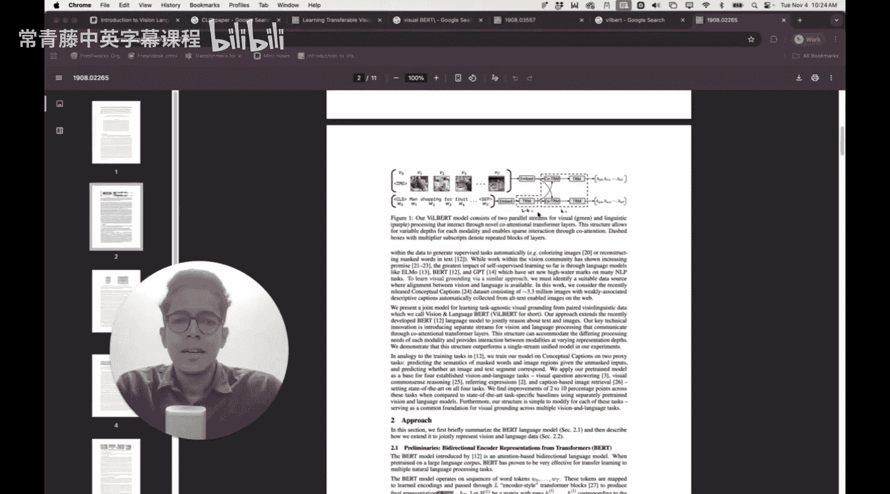
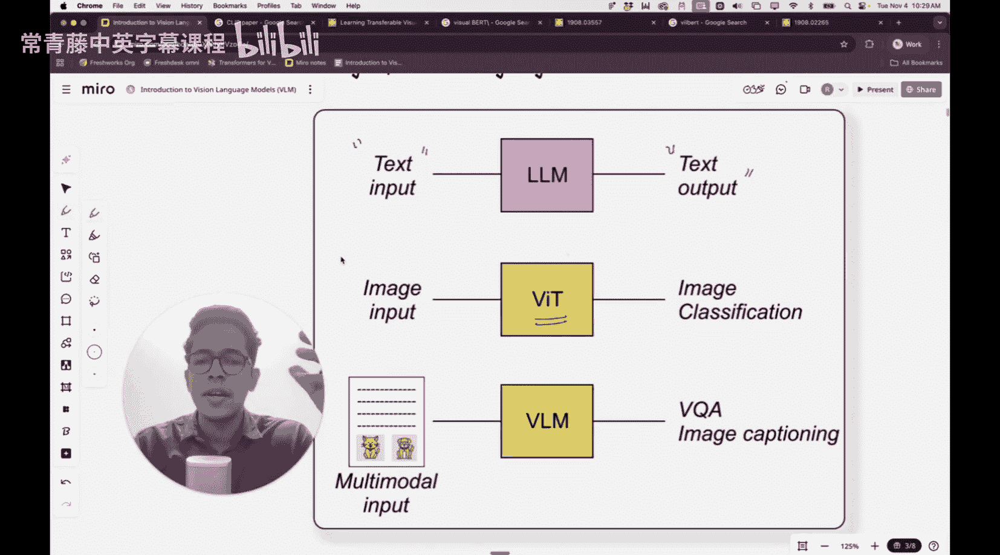

# Vizuara【中英⚡多模态LLM中的Transformer｜Transformers for Vision and Multimodal LLMs】 p13 P20 Introduction to Vision Language Models (VLM) [BV1X9zuByEuF_p13]

Hi， welcome back to a new lecture from Transformers Forion series。In today's lecture。

 we are for the first time in this series going to look at multimodal LLMs。Or specifically。

Introducing large language models in the context of not just text based data。

 but also vision based data and the simplest vision based data are images。

So I initially thought of introducing some other model architectures before coming to vision language models。

 but I thought it will be a very nice segue because in the last lecture we have looked at vision transformers in detail。

The only downside of vision transformer which we discussed the specific architecture which we discussed in the last lecture was that it could not handle text。

 we were inputting images by converting image into patches and those patches were tokenized and then using the tokens。

We were trying to perform an image classification and for this we relied on the classification token。

In vision language model， the architecture allows you to。

Create embeddings of both text based data and image based data and you know that most of the real life data sets are multi model。

 meaning there are different modalities it could be audio text。

 visual etc and the visual itself can be images it can be videos where videos are converted into frames。

And the tasks can range from， let's say， captioning an image。

To visual question answering so you ask a question to a model based on what you see in a particular image and the model has to respond。

In all these cases， vision language modelsers are very useful。Now VLM is a very broad term。

 it does not mean one specific architecture， but when we usually say vision transformer。

 we generally tend to think about the vision transformer architecture proposed in the paper by Google。

But in vision language model， when we， when we talk about VLM， there are many。

 many different architectures， of course， there are papers with。

Higher and lower citations that is a different thing but there is no one single architecture that specifically describes what is a VLM there are many different architectures so in today's lecture we will see what are some basics of vision language models and how does it form a multimod LLM。

So with that， let's get another lecture。😊，🎼。

One of the most famous vision language model papers might be the clip。

Paper。

Introduced by Open AI。So this is the paper it has around 46。

000 citations when you type C paper paper paper clip also comes。

Clip paper introduced the idea of contrastive learning。

 contrastive learning as an idea was introduced before C paper itself。

 but here they use the idea of contrastive learning for constructing a vision language model。

This is a slightly long paper 48 pages total if you count the appendix also and I do plan to conduct a detailed review of the clip paper later。

 but I just wanted to let you you know be aware of the existence of this paper and you can see that Elias Sa scver is one of the。

Authors of this paper and he was part of the previous open AIT。

Another paper which was famous was visual B where they introduced。

An augmentation to the birdt architecture so birdt architecture was primarily for text and these guys showed how you can extend the very similar birdt architecture for learning representations from images so this was the architecture they propose I'm not going to go into the detail of this I will tell you what visual language model can look like if you have both input text and image input but this was another paper which had around 2500 citations and another paper is called Wilbert which was sort of like an extension of visual B both papers came out around the same time I think Wilbert came first and then came visual Bt so maybe we should not call Wilbert as an extension of visual Bt but here they。

Use something like。

I don't think cross attention is the exact right word。

 but what they constructed was they had attention mechanism independently applied for Vi stream and image stream。

 but the only difference was that the query of the image stream was attending to the key and value in the text stream and the query in the text stream was attending to key and value from the image stream。

This was the architecture。If you don't understand fully what all these things mean。

 don't worry about that， my intention is not not to scare you or anything。

 it is just to show you the existence of various different architectures that are there and all of these are different types of vision language models。

So when you hear the term vision language model， don't think about the model architecture immediately。

 it can be many different things but rather think about what it can accomplish。

 it can take text data， it can take image data and perform something and it can be task specific also。

😊，So now， let's see broadly。what VLM like the idea behind VLM， what it is trying to accomplish？

The basic idea is the following， let's say I write the word apple。

Or if I show you the image of an apple。Both of these things mean the same thing。

When you form an image of an apple in your brain， the image can be formed as a result of looking at this text of an apple or as a result of looking at the image of an apple。

At the end of the day， both of these， this text and image both are represented in your brain in very similar way。

Now we don't know how the brain represents exactly a text and an image。

 but the basic idea behind vision language model is that if we are converting。Text into tokens。

 which are vectors。And similarly， if we can convert images also into tokens which are vectors。

A vector corresponding to the text of an apple and a vector corresponding to image of an apple。

 they should have very high similarity， very high less secosine similarity or semantic similarity。

This idea is being displayed very nicely in this image。

 so just have a look at this image where I have just plotted two axes of course that is the maximum I can plot but let's say it's an n dimensional space and that' is the reason why I mentioned feature 1 and feature n on the second axis。

😊，Now， there are a bunch of vectors here。This vector。

Is the vector corresponding to the image embedding of a dog this vector is the vector corresponding to the text embedding of a dog so dog as a text is converted into an embedding here dog as an image is converted into an embedding and ideally those two embedding should be close to each other in this space。

And same thing applies for CAT， the text embedding and image embedding in the same dimensional space。

 they should have very high similarity。The ideally the magnitude of vectors should be kind of similar。

 the cosine similarity should also be high。If you have text of Apple and image of Apple。

 they should have good similarity。Same for orange now if you look at all these vectors all these are embeddings which are created either from text or from images of fruits so all these embeddings should in general point to a semantic space which is meant for fruits so that is what I am showing you through this green color ellipse。

And all these four vectors were created from either the image of these animals or text of animals。

So these four embeddings should in general point into the semantic space which is meant for animals。

 which is denoted by this blue color ellipse。So somehow the text embedding and image embedding should capture same meaning if we are considering that those two embeddings belong to the same dimensional space。

 we can call this as a shared feature space。Now。In usual AI setup。

 especially what we have discussed so far in the course。

 we have looked at large language model and there we only considered text based input and we were trying to make next word predictions。

 so the CAat on the next word prediction will be met。

So input was text which was tokenized and then tokenized text was used for constructing attention weight matrix。

 and then attention weight matrix was finally used for creating probability distribution of what the next word could be and the output was a text。

 basically this is one token which you picked from your dictionary or your vocabulary。

In the previous lecture we discussed about vision transformer and in vision transformer the input was an image and we converted image into tokens by creating patches each patch was one portion of the image and these patches were non overlapping so each patch dimension was roughly 16 by 16 it depends on the exact architecture。

But we have also coded one vision transformer from scratch in the last lecture。

And there the patch size was 7 by7， and image image size was 28 by 28。

 so each image was getting converted into 16 patches。

And these patches plus a classification token were all converted。

