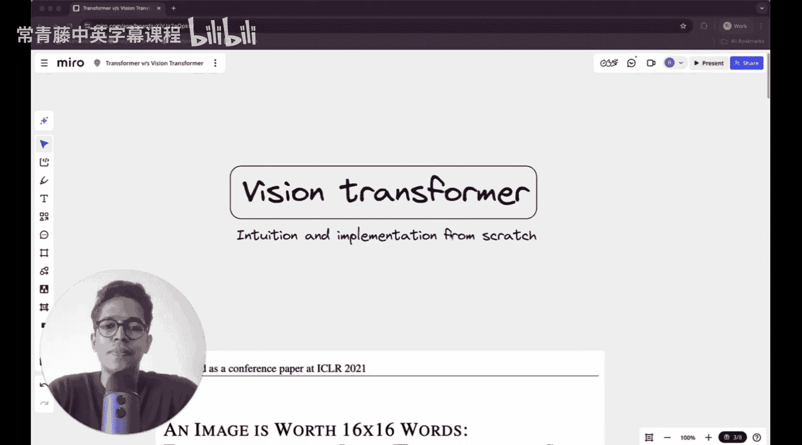
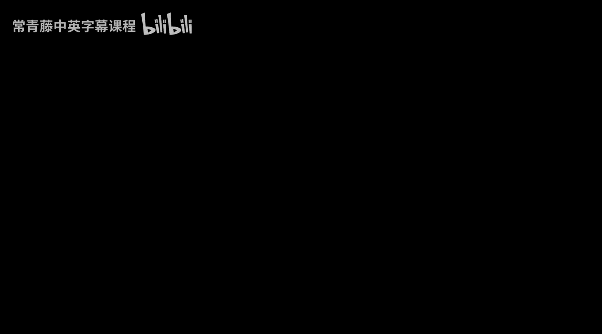
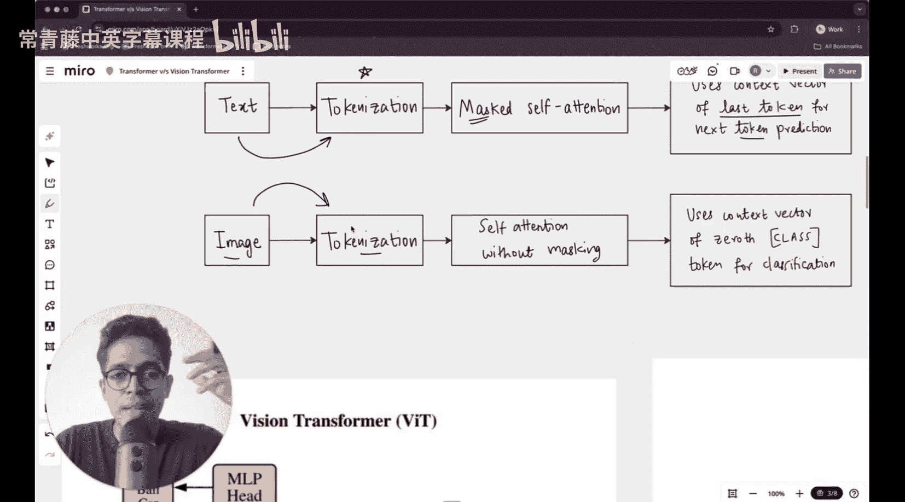

# Vizuara【中英⚡多模态LLM中的Transformer｜Transformers for Vision and Multimodal LLMs】 p15 P22 Build Vision Transformer ViT From Scratch - Intuition and coding [BV1X9zuByEuF_p15]

Hi， welcome back to a new lecture from Transformers for Vision series I'm so happy today because for the first time in this series we are going to look at vision input into transformer so far we have looked at the intuition behind how a transformer works attention mechanism we have looked at the journey of a single token in a large language model so we know how Transer works for textbased data now we will see how it works if the input is like an image so in today's lecture we will be focusing on vision transformer which was introduced by a very famous paper which we will discuss initially in this lecture so first we'll understand the intuition behind how transformer works for vision and then we will implement a vision transformer completely from scratch in Python so let's get into the lecture。

😊。

So this is the paper that introduced vision transformer title and image is worth 16 by 16 words。

 this paper also came out from Google， the original attention is all union paper also had come out from Google so you can clearly see that Google is doing a lot of seminal research in AI。

And what this paper did is they extended the capabilities of transformer while making very minimum modifications to the original architecture proposed in attention is all unique paper。

😊，So they just wanted to see how the capabilities of vision transformer can be compared against convolutional neural networks because convolution as an operation is really good at capturing。

😊，2 dimensional features in images because the convolution filters themselves are two dimensional。

 but that is not the case in how transformer treats tokens because tokens are like sequences and then position embedding is added so the two dimensional position information is not。

Available by default maybe it can be it can be considered as a trainable parameter but by default it is not available to the transformer so many of the advantages that CNNs enjoy because of the convolution filter is not available for a transformer based architecture so this paper in fact talks about all of this like how the reliance on CNN is actually not necessary。

Especially if you have large scale data set and they showed that computation wise for large scale models vision transformer is even more efficient compared to convolutional neural network the paper is an amazingly written paper I have conducted a detailed review of this paper on as part of a different CD so I highly recommend you to check it。

😊，And in fact in past I had conducted one lecture on coding a transformer from scratch but that the context of that lecture was very different。

 it was not for transformers for vision series but right now the context is really perfect because we have discussed everything with respect to Transer and now we are ready to fully understand how images are treated。

So let's first try to understand the difference between how text is treated and image is treated in a transformer。

 one more thing which I wanted to mention I just forgot is this paper at the moment of my lecture recording it has almost 76076k plus citations。

 which is a huge number for a paper that was published in around 2020。😊。

This paper got a widespread recognition and then following this paper。

 so many different approaches emerged for using transformer for various vision related tasks。😊。

But here this vision transformer is used for one specific task primarily which was image classification。

 it was not for a bounding box drawing like object detection or semantic segmentation。

 it was primarily for classification。😊，So let's see the difference between how text is used in a transformformer and how image is used。

So text， you have a sentence which is tokenized and these tokens are。

Basically vectors onto these vectors you also have position embedding added right so tokenizing process tokenization process takes care of converting text into tokens then tokens into input embeddings and input embeddings contained or they are added the initial text embeddings are converted to input embeddings by adding the position embedding。

Once you have position embedding。😊，In models such as GP you have something called as mask selfat so why this masking is needed is because as we had discussed earlier in the series if you are trying to predict the next word the current query should not see the future tokens meaning current query should not pay attention to future token so if we had a sentence like。

The cat。Set on。The mat。If this was this sentence was considered as an next word prediction task by GPT and let's say the input is just the CA sat on。

 that's it last two tokens are not available and let's say they are to be predicted so provided these four words GPT has to predict the next word and provided the input forward words plus the predicted one word it can predict the next word。

And now look at the context vectors that are created you will have one context vector associated with the one context vector associated with cat of course here I am simplifying by assuming that each word is a token that is not the reality in by pair andcoding for example the token could be word subward etc or it could be even a character but let's say for simplicity purpose each word is a token so you will have one context vector associated with each of these words or each of these tokens and what is done is the context vector associated with the last token。

Is used for。Making the prediction on what is the next word。

 So now the context vector of on will be used for making the prediction of the next token。

 Let's say that next token is the。So here， when we are constructing the context vector。😊。

And let's say our query is on。Then all the words in the sequence are keys， so the cat sat on。

 all of them are now keys。And。In fact， if you look at the whole sentence here。

 including the input and prediction， there are a lot of keys， the CA sat on the mat。

 all of them are keys。But the thing is the query should not pay attention to keys that are about to come in the future。

 so on should only pay attention to the CA sat and on。

SAT should only pay attention to the cat and sat。Because on will only after。😊，You know， the Q set。

So to predict the next word。😊，The current query has no way of attending two tokens in the future。

 so this is called as mask self attention which we have discussed in detail in the last lecture。

But this masking was one of the important features of GPT like architecture where it was a generative model it wanted to generate text。

😊，This this kind of a masking was not needed for B， although it had a different type of masking。

 so B was bidirectional embedding so basically it will have a mask token that looks like this the。😊。

Mask。SAT on。😊，Matt。So Bt also used transformer， but here the task was not next for prediction it was to predict what the value of this mass token was and to construct the context vector。

The attention was paid to every single。Tokens in the sequence。

 not just the previous tokens because here the purpose is not an expert prediction。

But if you were to consider GPT which is a generative model。

 we have masked self attention and then finally we use the context vector associated with the last token for predicting the next token or next word。

😊，Now think about how this next word prediction looks like， it is a softmax distribution。

 so if in your dictionary you have 50k words or 50k tokens。

 you will have a softmax distribution which can look something like this。😊，This is the first token。

 second token， third， etc cetera up to 50，00th token。

One of the token might have the highest probability alert。

 so let's say this one has 80% probability and remaining tokens add up to 20% probability to be the next token。

So now。If you think about this， this is almost like a classification task where the number of classes are 50k。

😊，If it was a 10 class classification you will have a probability distribution spanning 10 different classes if it is a 50k classification you will have a softmax probability distribution spanning 50k classes that is exactly what happens in GPT because it has a certain dictionary size the only thing that GPT has to say is which token among the available 50k tokens in the dictionary has the highest likelihood to be the next token right and that is very very similar to classification now what does vision transformer do vision transformer does something very similar it。

😊，Inputts an image。And then it performs tokenization on the image。

 I will come to the details of how exactly this tokenization happens。

 but think about you somehow converting your image into a bunch of tokens， tokens are vectors。

 just like how you convert your text input sentence into tokens where the tokens were again vectors。

😊，But here in the image， your task is not to predict the next token you are not trying to predict the next word or anything like that you are not trying to predict the。

😊。

