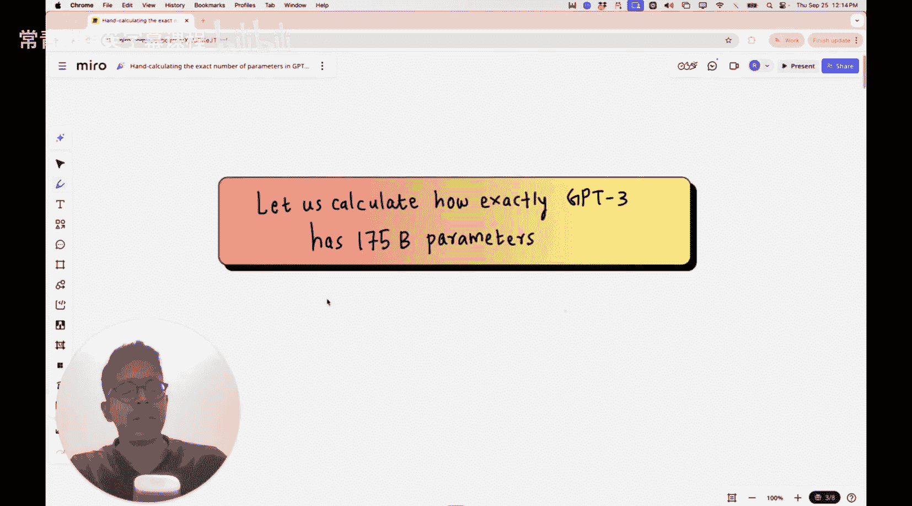
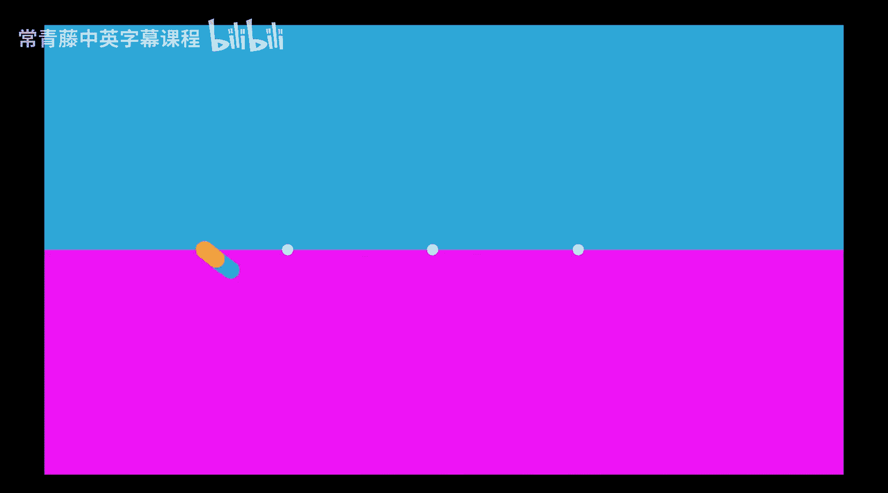
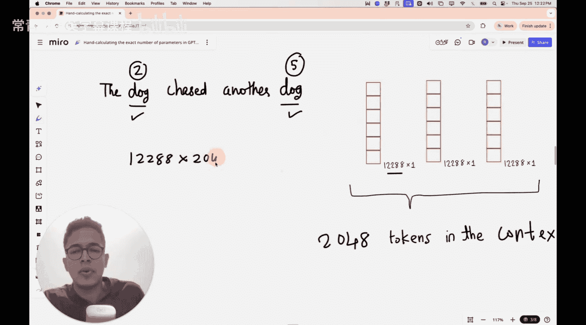

# Vizuara【中英⚡多模态LLM中的Transformer｜Transformers for Vision and Multimodal LLMs】 p16 P23 Let us hand-calculate how GPT-3 has a total of 175B parameters ｜ Transformer [BV1X9zuByEuF_p16]

系い。Welcome back to a new lecture from Transformers for Vision。In this lecture。

 we will be doing a very specific thing， which is hand calculating how exactly。😊。

Did GPT3 get 175 billion parameters？This exercise will give us a fairly good intuition about the architecture of the LLM itself。

😊，And we will also have a fairly good idea how these parameters are distributed inside that architecture。

How many are there in the input part of the neural network。

 how many are there in the transformer layer and how many are there in the output part？

If you don't know the architecture of a large language model。

 I highly recommend you to go through at least one video that explains the architecture in detail because here I will not be going into all the details of the transformer architecture because that will make the lecture very long instead I will assume that you have some basic knowledge about the large language model architecture。

 you have some basic knowledge about the transformer block etc。And then from there。

 I will walk you through step by step on how exactly to calculate these parameters。

And don't worry if you have forgotten how exactly the architecture of NLLM looks like。

 I will give you a brief recap so that you can refresh。

Now you might be wondering how is GPT3 architecture relevant for vision based tasks？

The reason why I am explaining this to you is so that you can carry forward the same intuition that you get from this lecture also to the cases where you talk about or you learn about vision and transformers。

 So that's the reason why I introduce this lecture。 So let's first look at the architecture of the。

LLM itself。

So this is the overall graph architecture。Don't worry by seeing multiple blocks。

 I will divide it into meaningful chunks。So the first block， so if here you can see one。😊，2，3。

We can look at the entire LLM architecture in three blocks。

 first block is the part that deals with input， so you give an input or a prompt。

And some things happen to this input。Where it is tokenized and a position embedding is also done。

 so I will explain what these means， but just you know keep it in your mind。

Then you have transformer block where you have two layer normalizations， these two blue blocks。

 you have dropout happening at two locations， you have a feed forward neural network。

And you have the main guy， which is the multi head attention。

So this transformer block will be repeating 96 times in series in the GBT3 architecture。

 that is one thing， this is one place where you will hear the number 96。

Another place where you will hear the number 96 is in the number of heads inside this multi head attention。

 which is 96 heads in parallel so these296 are two different numbers so please don't confuse between them。

Then the last block is the output block where the final prediction of the next word happens in the large language model。

Which has a normalization layer and an output layer。

Now what we want to calculate is how are these 175 billion parameters distributed in these blocks individually and also into these individual modules。

 how many billion parameters are there in each of these， let's try to calculate。😊。

So we will start very systematically， let us look at the input part。

AGP 3 with1 hundred75 billion architecture models。 I mean， sorry。

175 billion parameters have the following architecture。 It has 96 layers。 What does this mean。

 It has 96。Transformer。Blocks。In cities。The token， which could be a word。

 which could be a sub word are。Represented using vectors of 12，288 dimensions so each token。

It is represented by a vector of these many dimensions。And within each transformer layer。

 you have bunch of things and one of the most important things is the multi head attention。

So each multi head attention has 96 heads。😊，So 96 heads make up one multi head attention inside one transformer block。

And inside this。Multi head attentions， each of them take care of 1 by 96th of the dimension of your input token。

 which means 12288 divided by 96 equal to 128 so the tokens are represented not in a 12。

288 dimensional space inside these attention heads。

 but rather it is represented in a 128 dimensional space inside the attention heads。

 individual attention heads， and then they are concatenated back to create the 12288 dimensional token back。

Similarly， you have a feed forward neural network over here。This one。

 this feed forward neural network， what it does is it projects the token， the transform token of 12。

288 dimensions。Into。A space with four times more size so whatever is the input dimension in this case it's 12288 you multiply that by4 so you are projecting it back in projecting it into that dimensional space and then you project it back so that is what is happening in the feed forward neural network I will explain the exact number of parameters when we calculate it I'm not talking about the parameters yet I'm just giving you the architecture。

Related numbers and then we can calculate the parameters later。

Then you have a dictionary with a vocabulary size of 50，257。

 which means that many unique tokens exist in your vocabulary。And each token is represented by a 12。

288 vector dimensional vector， please note and context length。

 the number of tokens which you can feed to the GPT3 architecture is 20，048。Sorry， 2048 my bad。

 so this is the general GPT 3 175 billion architecture。😊，Now， based on this information。

 let's try to calculate the number of parameters and finally all of that should add up to 175 billion。

Let's start with the vocabulary。So as I mentioned the input token is a vector of 12，288 dimensions。

 so this is dimension  one dimension 2， etc cea up to 12288。

 so this is the input token I mean this is one token。The vocabulary consists of 50，257 such tokens。

And there are numbers inside each of these， right， each of these are numbers that are trained。

Trained so that you can have a good representation of each tokens， so let's say one word is a token。

 then the word cat， maybe this is the token corresponding to the word cat。

This is the token corresponding to the word let's say zebra， there are sub wordss also。

 I'm just simplifying it here。So how many parameters are there in this vocabulary？You will have 50。

257。Multiplied by。12288 those many parameters will be there and what is this number lets calculate using calculator 500257 multiplied by 12 to 88 this is 617。

55 million。So six， this will be 61，7。55。Million， so these many parameters are there in our。

Input embeddings because the vocabulary sizes this much。😊，Now。

How many tokens are there in our context window？Our context window size， as I mentioned。

 is not the entire vocabulary， it's only 2048 tokens。And each token of of course， it is 12。

288 dimensional vector， which means the total number of parameters。

 trainable parameters to construct。A position em。Because what you would be doing is you won't be taking the token value directly and using it。

 you take the token value from the dictionary yes， but on top of it you add a position embedding why is position embedding important let's say the dog。

Chased。Another。Dog， so here。The dog word or token is appearing twice。

 but this is appearing in the position number two and this is appearing in the position number 5。

So there should be some difference in the way this dog is represented and this is represented and that's why you have to add some information about the position to your input em。

😊，And。How many such position embedding vectors do you need？

You will need as many as there are number of tokens in your context window。

 so context window is 2048， so you will need that many position embedding vectors。

So what would this be the number of parameters， 1，2288？Multiplied by 2004。

