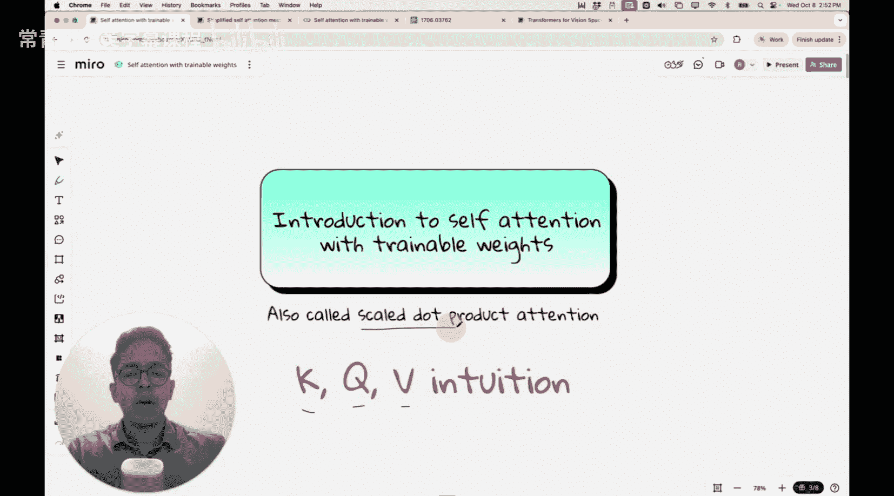
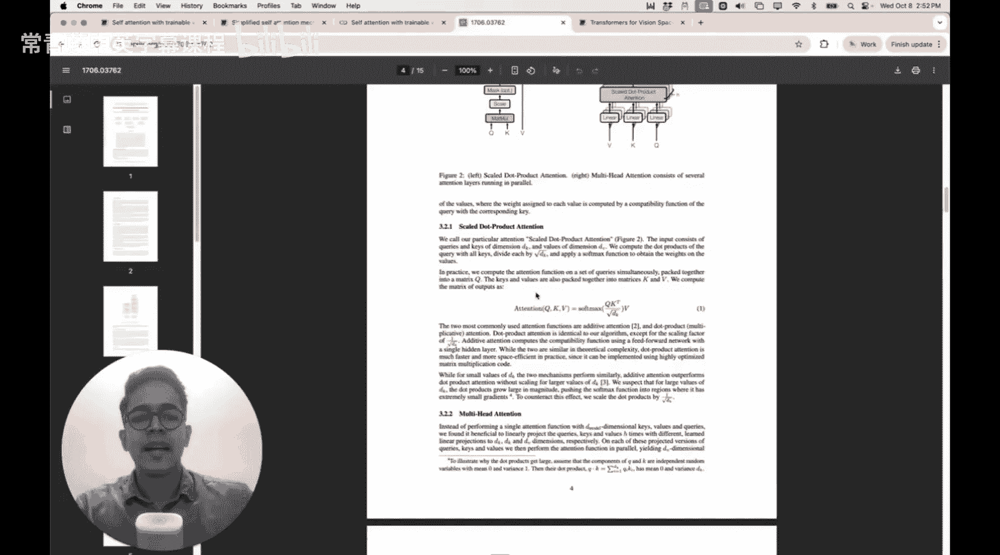
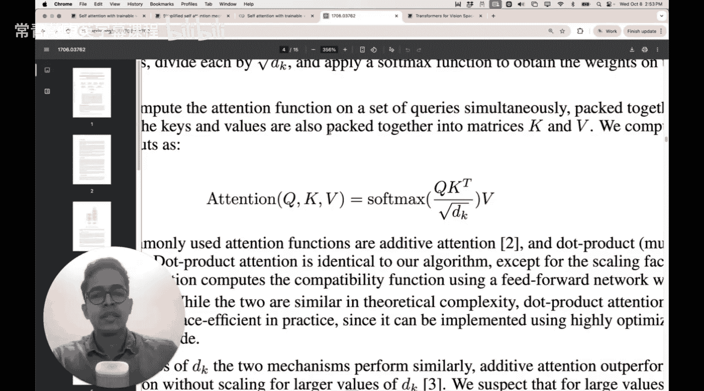
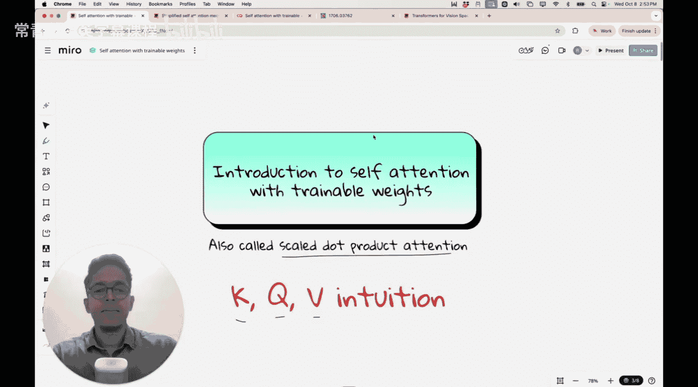
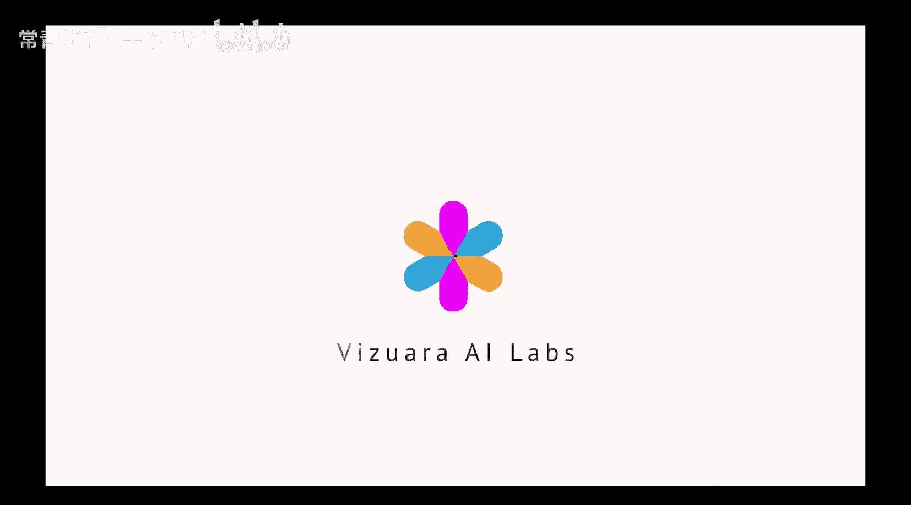
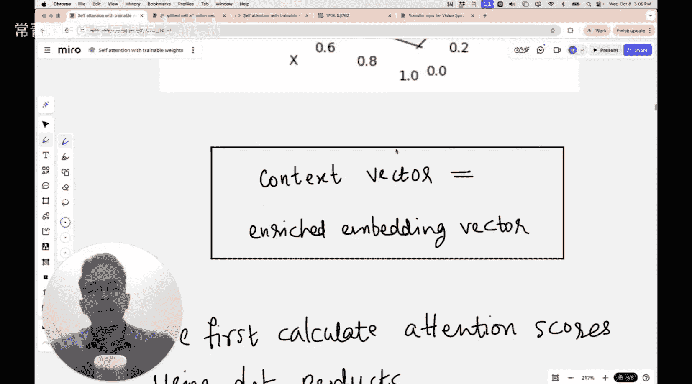

# Vizuara【中英⚡多模态LLM中的Transformer｜Transformers for Vision and Multimodal LLMs】 p20 P27 Q, K, V intuition ｜ Introduction to self attention with trainable weights [BV1X9zuByEuF_p20]

Hi， welcome back to a new lecture from Transformers Forvision series in today's lecture we will be diving deep into the self attention mechanism。

 but unlike last lecture where we implemented a simplified version of self attention mechanism by just taking the dot product between the vectors。

This time we'll be implementing self attention with trainable weights。

And when I say attainnable weights， I specifically mean the weight matrices associated with key query and value。

So these are terms which you will find in the context of large language models。

 so I hope to give you a good amount of intuition about what is key， what is query。

 what is value etc。The self attention mechanism that is used in LLMs like GPT is also called as scaled dot product attention。

So by the end of today's lecture， you should also understand what is the intuition behind this equation which was mentioned in the attention is all you need paper。

Right now it may look a bit intimidating to you， but don't worry by the end of the lecture。

 I guarantee that you will have a fairly good understanding what exactly this equation is trying to tell from an intuition perspective。

So with that， let's get into the lecture。😊。

So first， let's take a step back and try to understand what all we have been discussing in this course so far。

In the lecture before we discussed about simplified self attention where we constructed attention scores by using dot product between the vector embes。

 and even before that we started our discussion by going through bandana attention which was introduced in 2014。

So as we know， Bno attention was used primarily in the encoder decoder architecture in neural machine translation。

Where every single。Hidden state in the decoder has access to every single hidden state in the encoder。

 so these H1 H2 h3 are hidden states in the encoder。

And all these states were accessible in the decoder。

 which was not the case before by the of attention。And because of this。

 instead of relying on one single context vector which comes out of the encoder。

You can rely on every single hidden states and you can construct relative importance that the decoder should pay to each of these hidden states。

That way you are taking off the pressure that you were putting on the final context vector。

If you don't remember the encoder decoder architecture from recurrent neural networks。

 don't worry it's not our relevance for today's lecture， but I just wanted to give a brief recap。

If you really want to understand how Bno attention came into picture in 2014 in the context of neural machine translation。

 you can go back to the lecture in which we discussed about how RNNs started with encoded decoder architecture and then eventually attention mechanism came into picture。

Now， in self attention， however。What we were trying to do was something different。

 we had one input sequence。And let's say this is our input sequence， bring big and work for it。

We wanted to construct context vectors corresponding to every tokens in the input sequence。

For simplicity， we are now thinking that each token is one word。

 although in reality in models like GPT， it uses byte pair encoding。

 so one word is not necessarily one token， there could be characters and sub wordss。

But here for simplicity， what we want to do is in this sequence， you have one。😊，2， three， four， five。

6， so there are six tokens。And for every single token。

 we want to produce a corresponding context vector。

If this was a neural machine translation task in the encoder decoder architecture of NMT。

 we would have just produced one context vector at the end of the sequence at the output of encoder and we were hoping that that encoder that context vector will embed whole information present in the sequence。

 but with the advent of self-atten mechanism， we don't have to do that anymore we can calculate how much each word in the sequence。

Should pay attention to or should attend to every word in the same sequence so that that's the reason why the name self attention came into existence。

So in today's lecture， we'll be considering。These tokens as three dimensional vectors so that we can easily plot like this。

In the previous lecture where we implemented a self attention in a simplified fashion。

 we had contexts， we had input and beddings like this。😊，Dream， big。And work for it so dream。

 this is the original input em writingdding for dream。This is the embedding for big and work for it。

Now to calculate how much attention dream should pay too big or how much let's say。

 work should pay too big。What we did was we took a dot product between these two vectors and based on the magnitude of those dot products。

 we constructed attention scores。So if there are six words。

And if we consider big as the query query meaning the token that we are currently looking at。

 we can construct six attention scores， one between big and green， one between big and itself。

 one between big and and。😊，Then， big and work。Big and4 and then begin it。 Now。

 these attention scores are not normalized。 So what we discussed in the earlier lecture was that we normalize these attention scores such that they add up to one。

So we were using softmax function for normalizing such that the six attention scores corresponding to any query。

 so in this case if we consider our query being big。

There will be six attention scores corresponding to every single key。So let's say this is 0。1，0。2。0。

2。0。1。Through a point。3， so that'll be 4 plus 156789 and then this will be 0。1。Now。

 if you add up these numbers， there are six numbers。And if you add up these， it will be 1， so 0。

1 plus 02 plus 0。2 is 0。5， 。6。7。78。8。9， and then one。

So you can view this as percentages our sentences dream。Big。And。Work for it。Now。

 what this means is dream should pay 10 percentage attention。To big。

 I mean big should pay 10% attention to dream， big should pay 10% day 20% attention to itself because this is 0。

2 big should pay 20% attention to an etc。So by having these normalized attention scores。

 we can have intuition on how much percentage attention each query is paying to every single key in the same sequence。

 So this is how normalization of。😊，The attention scores lead to something called as attention weights。

 so these numbers which resulted from softmax calculation。Are called attention weights。嗯。

Now to construct the context vector what we did was we multiplied the original input vectors。

 so dream had an original input vector which was this guy big had a vector for dream big and work for it。

 so each input vector so if I denote these vectors like this。

You can scale these vectors using these attention weight。

 so you multiply the vector with the corresponding attention weight and then you add them up。😊。

That is how you get the context vector for， let's say the word w。😊，Similarly。

 if you take the row from the attention matrix， which are the attention ways corresponding to any particular query。

You can take attention weighted sum of the input vectors to get the context vector。

So now if we plot the context vector here， this this was the context vector for the token big。

 which we got at the end of the previous lecture。But you must have noticed one thing。

 we know that in large language models， training the model is a big deal。

 But here in this attention calculation， in this self attention calculation。

 there is no training involved。 There are no。Wes that are trainable。

The dot product is simply taken between the vectors which we already have so after tokenization we have the vectors corresponding to tokens and then there is no more trainable weights involved we are simply taking dot product to get the attention scores then we are normalizing it using softmax to get attention weights then we are taking weighted attention。

Of keys corresponding to any given query to get the context vector for that particular query。

 so this is what we were doing in the last lecture。

If you want to really spend some time on simplified self attention and if you are watching this lecture for the first time in the series。

 please go back to the previous lecture just to spend some time on simplified self attention so that you can get much better intuition on are taking why we are interested in constructing a context vector。

In very simple terms， context vector is very important because it has much better meaning embedded in it。

 so it is much more enriched。😊。

