# Vizuara【中英⚡多模态LLM中的Transformer｜Transformers for Vision and Multimodal LLMs】 p21 P28 Introduction to self attention ｜ Implementing a simplified self-attention ｜ [BV1X9zuByEuF_p21]

Hi， welcome back to a new lecture from Transformers for Vision series。Today。

 for the first time in this series， we will dive deeper into the concept of self attention。

To simplify our understanding， we will be considering self attention mechanism without any trainable rates and I will explain what this means。

So first we will be trying to understand what exactly is self attention and how do you calculate this attention scores so that you can get a context vector。

 this is what we discussed in the RNN lecture earlier。

And we will also be implementing the same in code so that you can have a better numerical understanding。

 so let's get into the lecture。

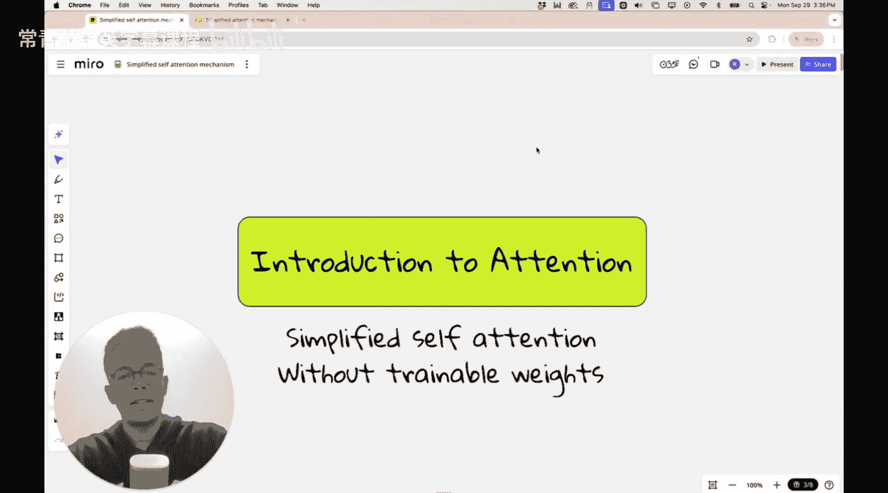

🎼Yeah。

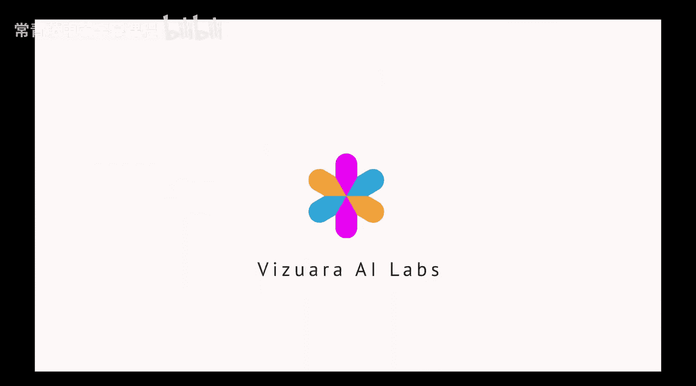

In the earlier lecture we discussed about neural machine translation。

 which was using an encoder decoder architecture。So we discussed about this short sentence translation example。

 so if you have an English sentence which says this is a car。

 it's a small sentence which has only four words。

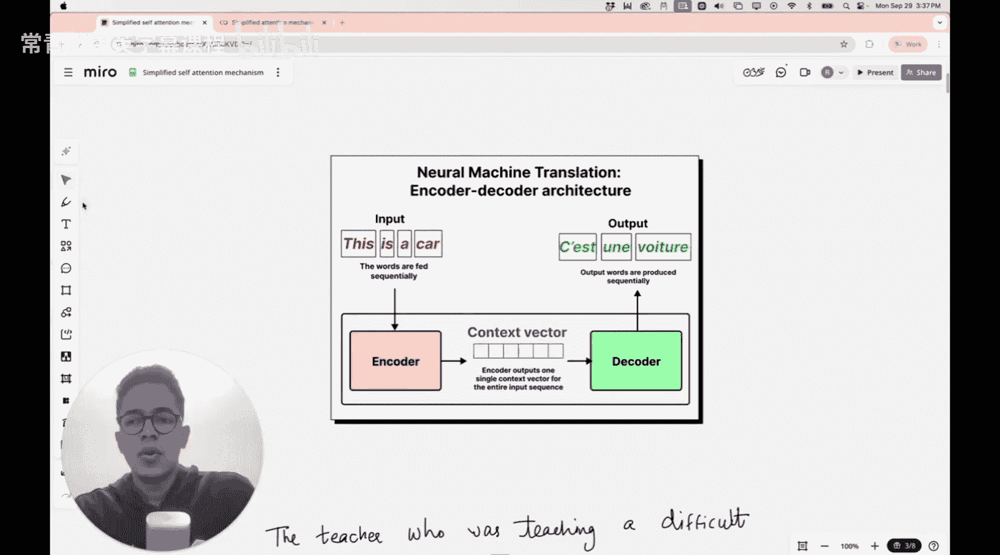

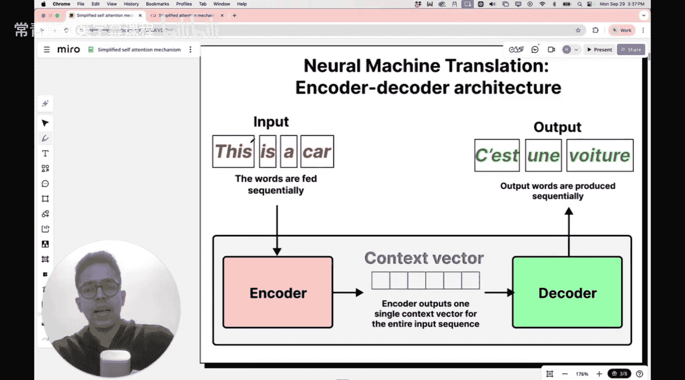

And this sentence as a sequence will be the input into the encoder。

Encoder will simply output the context vector and this context vector is expected to carry the entire meaning or the entire context in the input sequence。

 so it is carrying a lot of pressure。And then this context vector goes into the decoder as an input。

 and both encoder and decoder are RNN's recurrent neural networks。

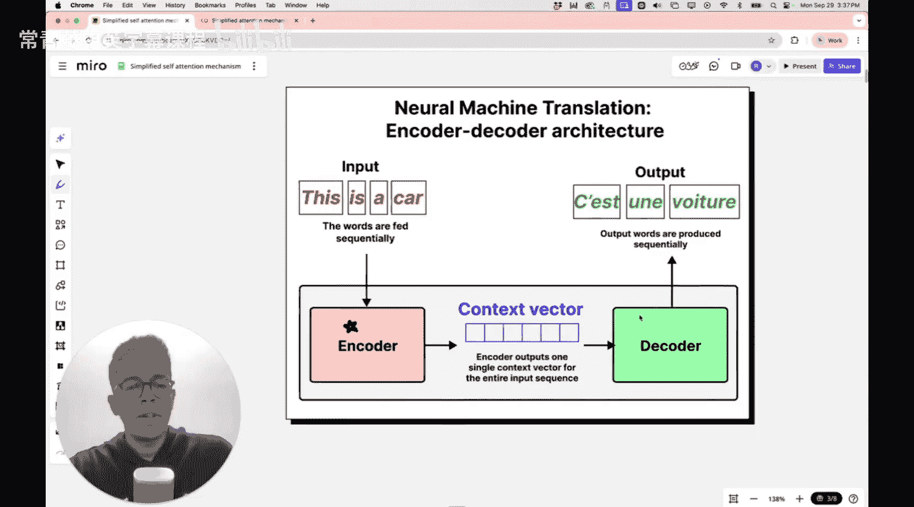

And then decoder will output the output sequence， so if you are converting an English sentence into French。

 it will output the corresponding French equivalent。

We discussed about the details of the architecture of encoder and decoder。

But we also discuss one thing that this kind of model struggles with long range dependency。

What is a long range dependency？

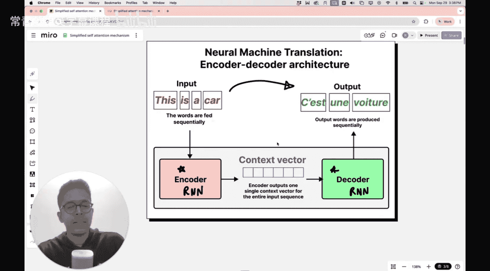

Consider this bigger sentence， the teacher who was teaching a difficult concept to the students smiled。

 so you have teacher here， you have students here and you have this action of smiling。

So looking at the sentence， how will you teach a neural network that it is actually the teacher who has smiled。

 not the students？Because here the big sentence in this big sentence。

 the word teacher is at the beginning and the wordm is at the end。

 so there is definitely a long range dependency between the word smile and the word teacher。😊。

And smile has to pay a lot more attention to teacher than to students because students did not smile。

 although these are two words that are。Really close to each other。

So this was a problem in RNs because this whole long range dependency and this attention that each word has to pay to the words in the same sequence。

 this was difficult to teach to a recurrent neural network in the absence of attention mechanism because you simply had one context vector as the output。

😊。

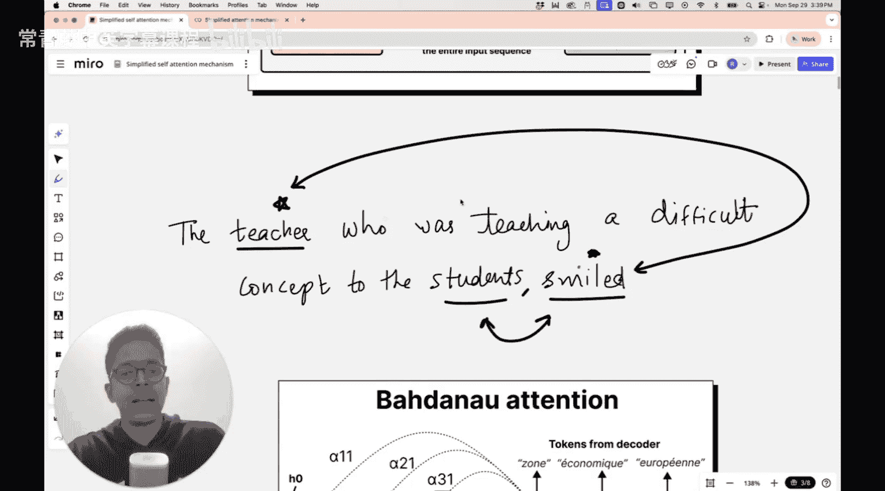

Although there are hidden states， multiple hidden states in the encoder architecture。

 those hidden states were not accessible to the decoder。

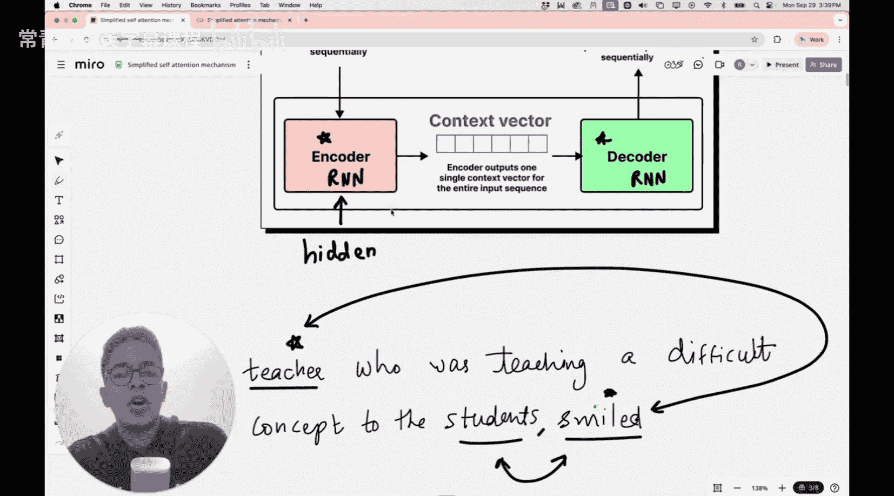

And then we discussed in the last lecture that in 2014， the concept of Bano attention was introduced。

😊。

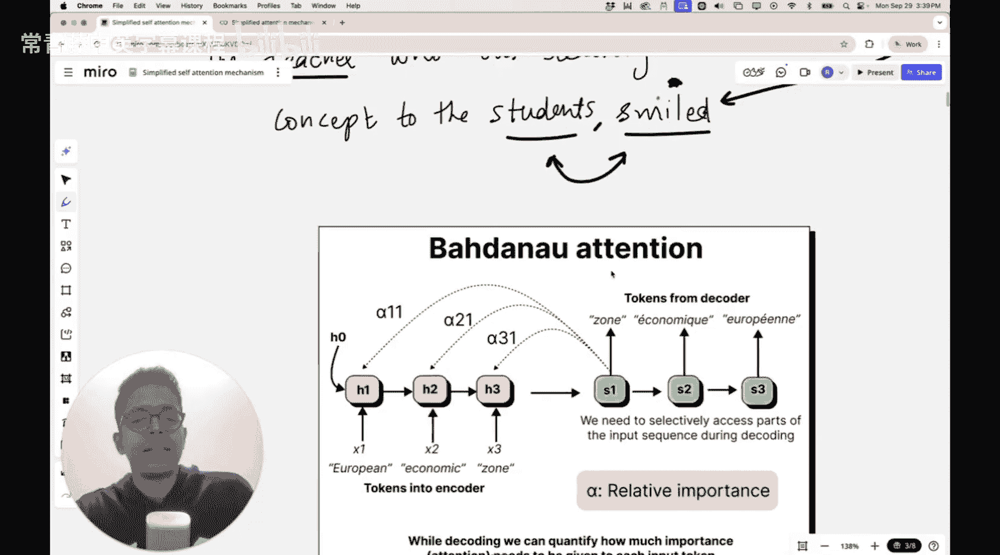

Were every hidden state in the output or at the decoder？

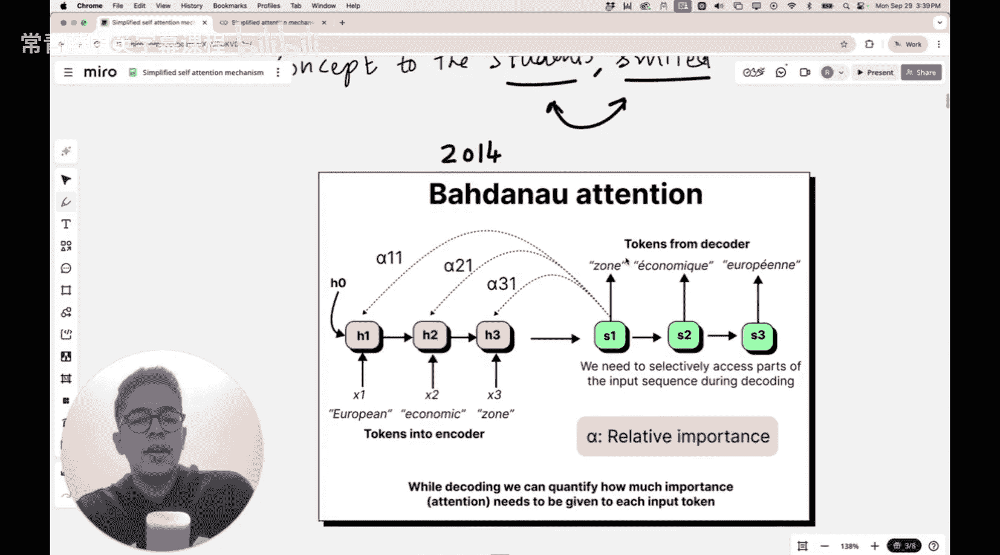

Can get access to every single hidden state in the encoder。

 so h1 h2 h3 are hidden states in the encoder S1 S2 S3 are states in decoder。

So whenever you are considering one particular hidden state in the decoder。It is having access。

 especially the first decoder hidden state is not just having access to the context vector。

 so context vector is of course here， but context vector is not the only thing that the decoder gets access to。

 it also gets access to all the previous hidden states。And because of this。

 you can say that the word European。😊，Which ended up creating the hidden state h1。

 you can pay alpha1，1 that much weightage to that word and alpha 21。 so11 means youre looking at the。

First hidden state of the encoder and first hidden state of the decoder Al 21 means or you don't want to call this as hidden state necessarily you can save the first sequence output coming out from the decoder Alpha 21 means you are looking at the first hidden state from encodeder and the first item from decoder and so on So to produce this output。

Call zone。This mechanism can pay attention。On a weighted basis to each hidden state in the encoder。

So this is what Bano attention enabled a recurrent neural network to do。

 it could assign relative importance to every word in the sequence。

 not just looking at the final context vector。😊。

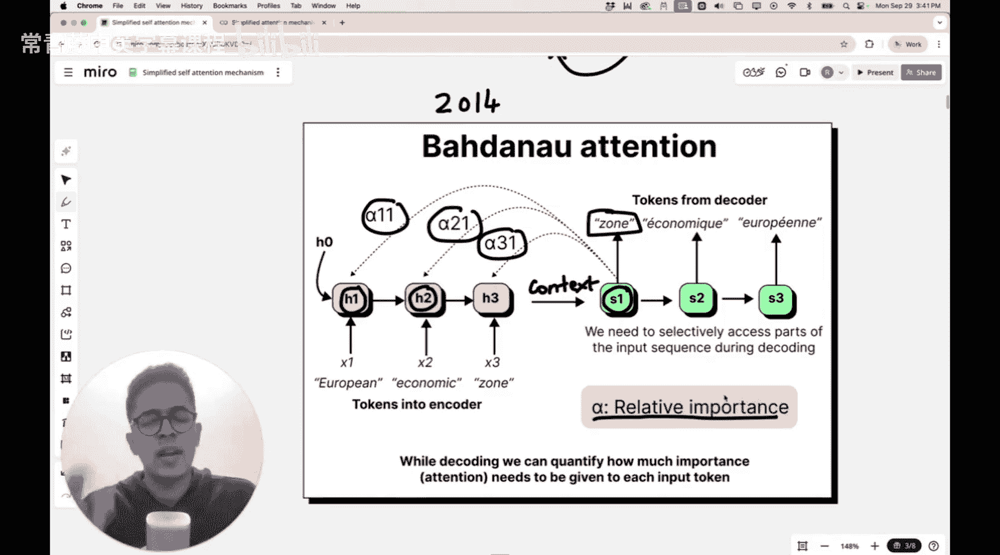

Although we discuss this and although we compared Bano attention to self- attention so it's very similar。

 Bano attention is about you have two different sequences。

 one at the encoder and one at the decoder and Bno attention creates attention scores or attention weights between words in the input sequence at encodeder and words in the output sequence at decoder so this matrix need not necessarily be like a square matrix because there is no guarantee that the number of words in French is same as number of words in English right so this matrix can be like a non- squarere matrix。

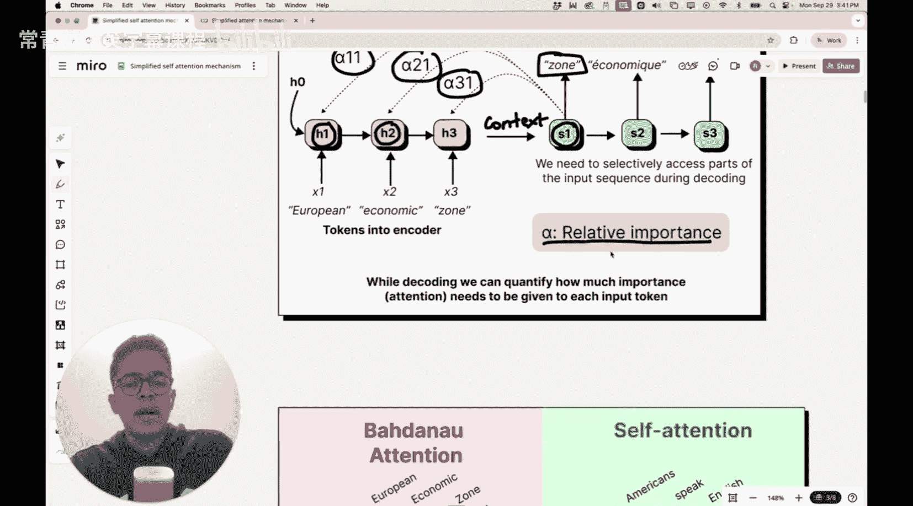

But in self attention， it generalizes the concept of Bano attention where it says， okay。

 I don't have to compare between input and output sequence。😊。

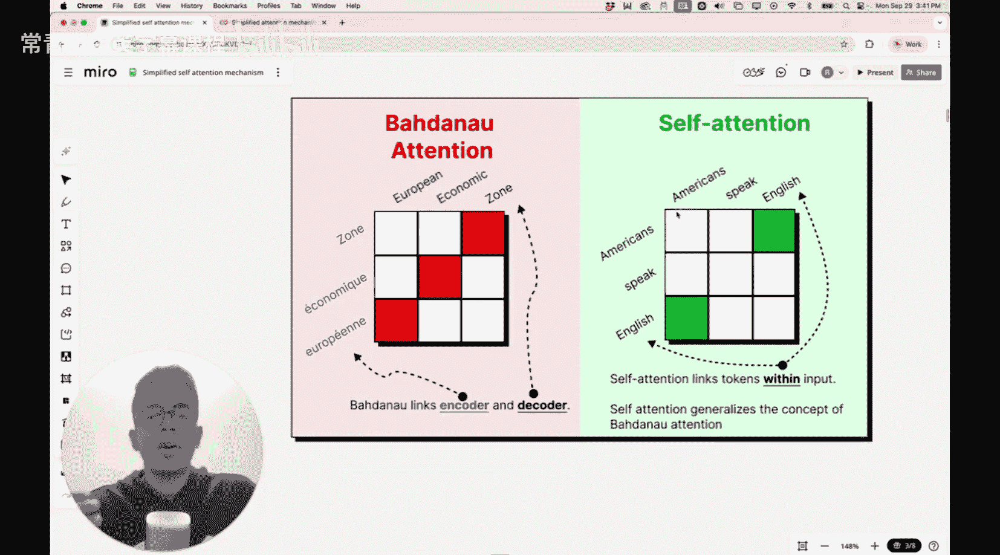

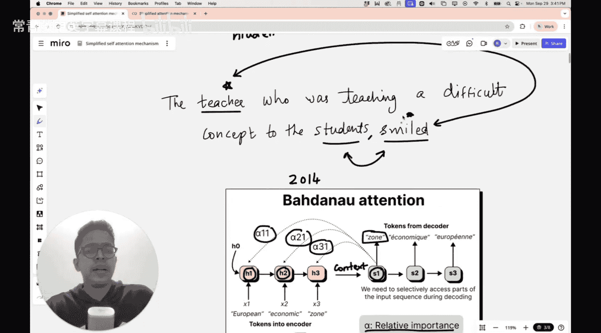

Just given a sequence within that sequence is there itself the words are paying different levels of attention to each other。

 so smiled this wordats to the word teacher logically it should attend to the word teacher more than it attends to the word students。

😊，And when I say at， it's a fancy way of saying it it should pay more。

 I would say it should pay more importance to。

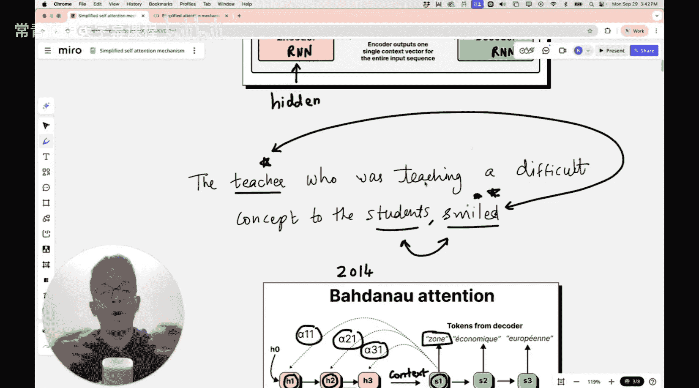

So， this was the concept of self attention and self attention matrix looks like a square matrix。

 so if it is these three words Americans speak English。

 then you can figure out through self attention mechanism how much important should this word English pay to the rest of the words in the same sequence。

😊。

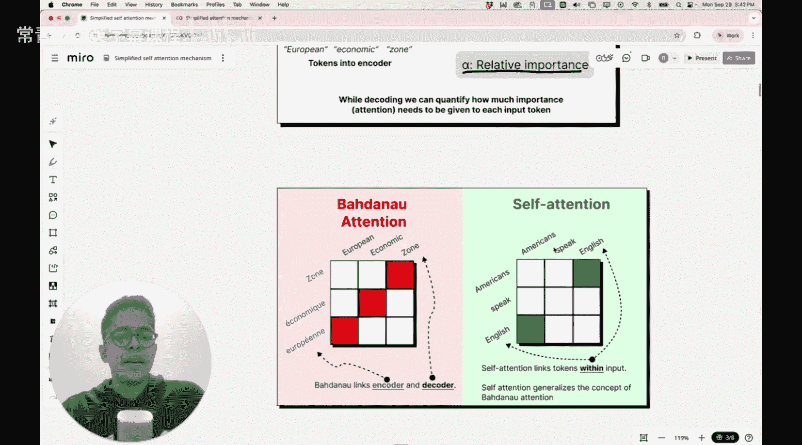

So you are looking at one sequence and self attention is attention matrix or attention scores or attention weights。

 I will explain the difference between score and weight。😊。

Self attention will create those numbers and it will help you identify how much importance each word is paying to the other words in the same sequence。

😊。

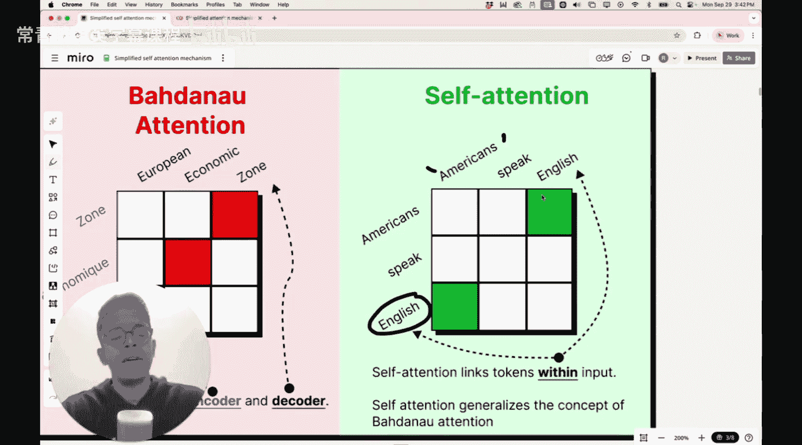

Now we stopped at this point in the earlier lecture but we did not dive deep into how this attention or self attention scores and weights can be calculated in the first place and that is what we are going to do right now。

😊。

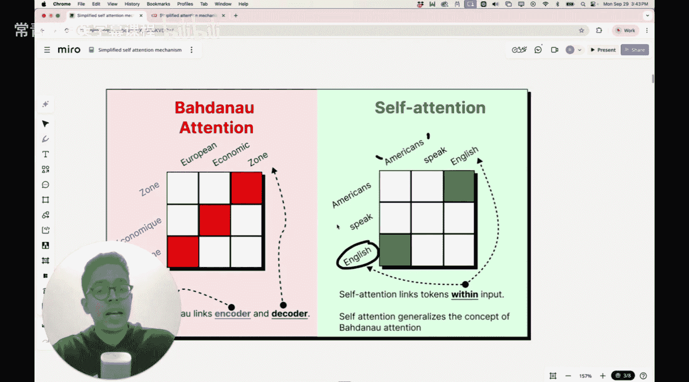

So just to recap on the attention mechanism types that we'll be covering。

 but no attention is something that we have discussed。

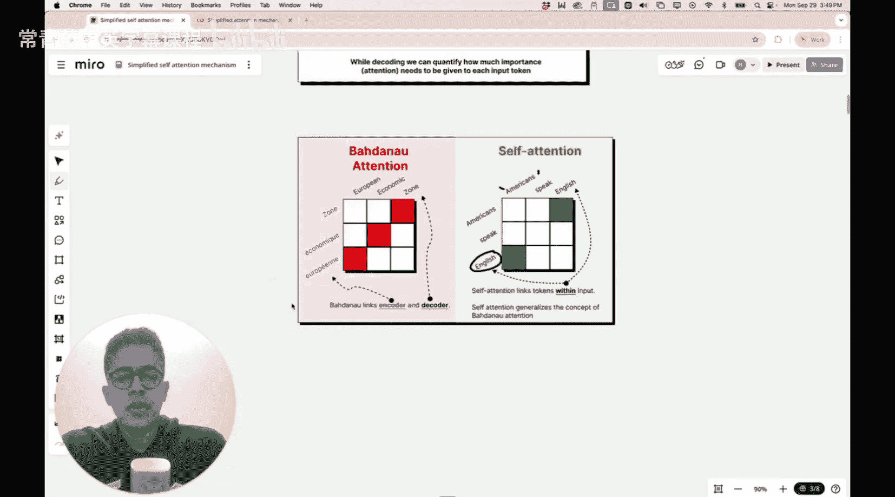

Simplified set attention is something that we are going to discuss right now and that will make you understand how fundamentally attention mechanism works。

And then the actual self attention mechanism which is implemented in GPT involves trainable weights in today's lecture we are assuming there are no weights to be trained so we will assume a much more simplified version of the self attention mechanism without losing any understanding but self attention lecture which will be the next one will cover the actual trainable self attention mechanism in detail。

😊，And GPT actually has two more concepts called masked self attention and multi head attention。

 so both of these concepts are very important to understand and well be covering those as well。

And they are derivatives of the original self attention idea， and once you understand self attention。

 it will be much more easier to understand mass self attention and multi head attention。

So in today's lecture， our focus will be entirely on a simplified self attention mechanism。😊。

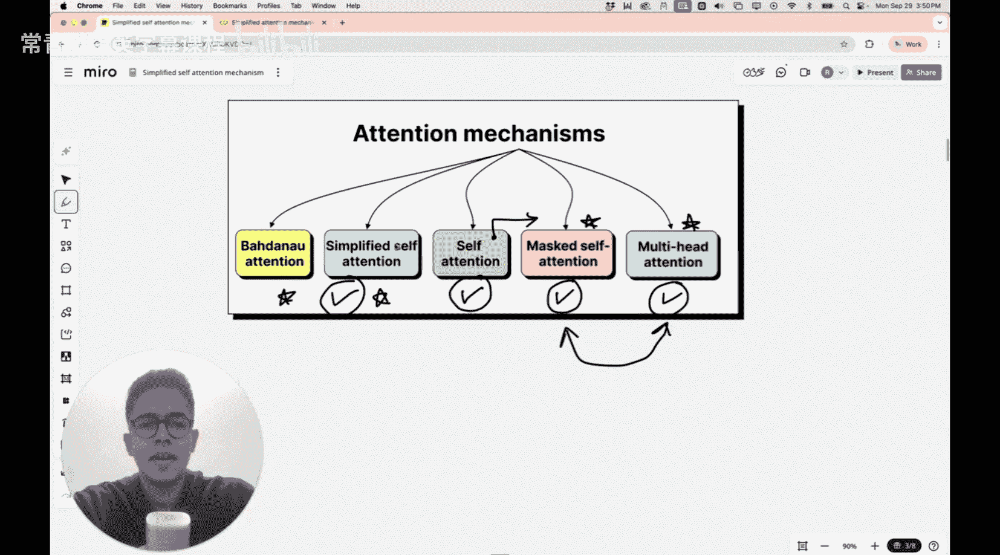

So now let's go back to the idea of self attention。

 let's say we have a sentence like dreamam big and work for it。Now， the question is。

 if you are considering one word among this sequence， let's say the word big。

The question that we are asking in self attention mechanism is how much attention or how much weighttage should this word big pay to every words in the same sequence。

 it will include itself。So big will be looking at itself。

 big will be looking at dream and work for it。

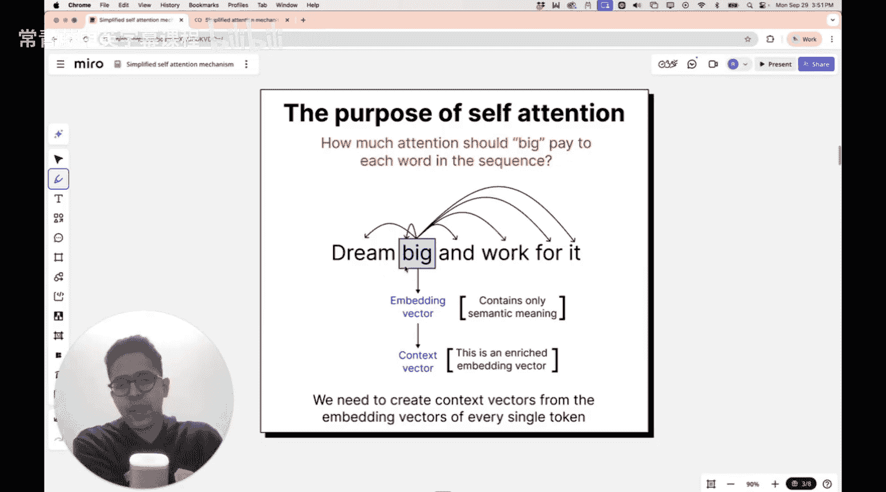

Now in the RNN lecture which was before， we also had a brief discussion about how words are converted into vector embeddings。

 so words are represented in a vector space in an n dimensional space。

 so it is represented using numbers which is an abstract mathematical representation。

 it is not in a language of English or French， it is in the language of mathematics。

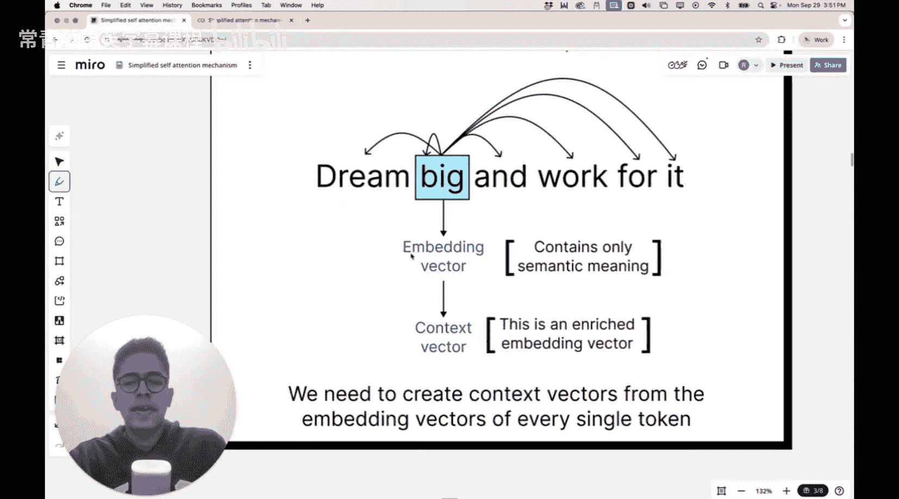

Now， the question is the word big will have a certain vector em。😊。

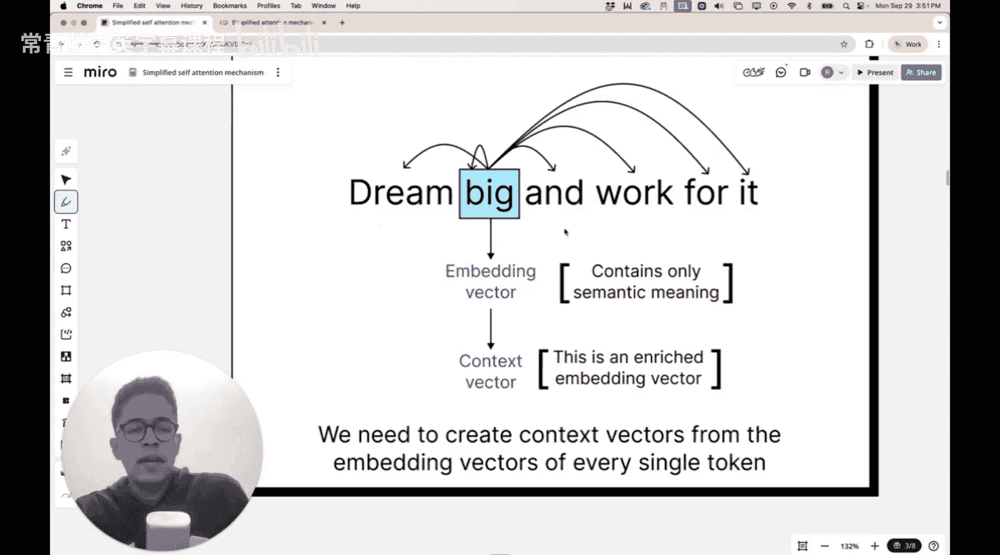

The word dream will have another vector embedding and work for it。

 each of these words have their own vector embedding。

And if you remember what we discussed in the last lecture。

 these vectors that correspond to the word are not random。

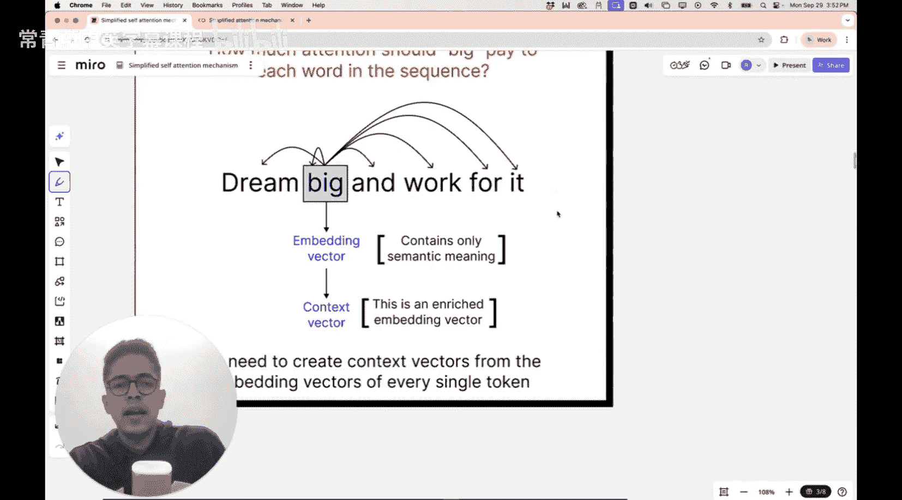

Those vectors carry meaning， so let's say these two are the vectors for apple and orange。

Not from this sentence， but。I'm just showing you an example。Then these could be the words for a dog。

And cat。And in general， you can say that the words that carry similar semantic meaning may point to the similar semantic space in the n dimensional space。

 so this could be a space or semantic space for fruits。

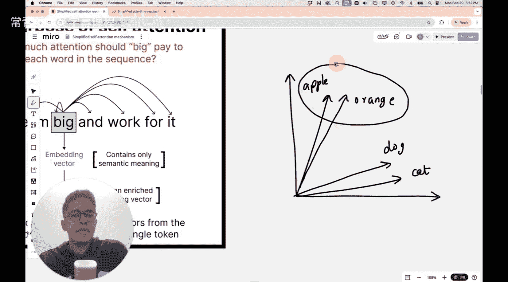

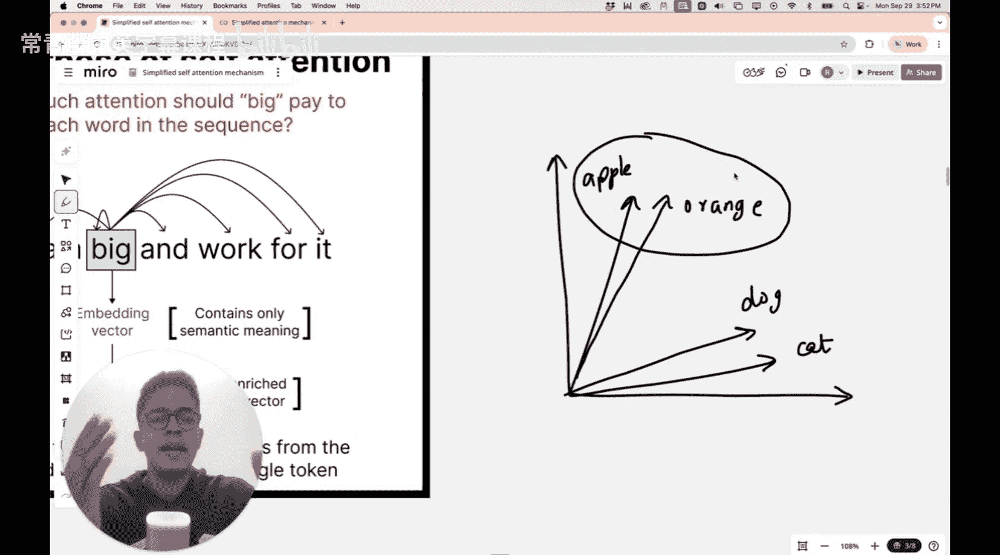

And where these two vectors are pointing in。

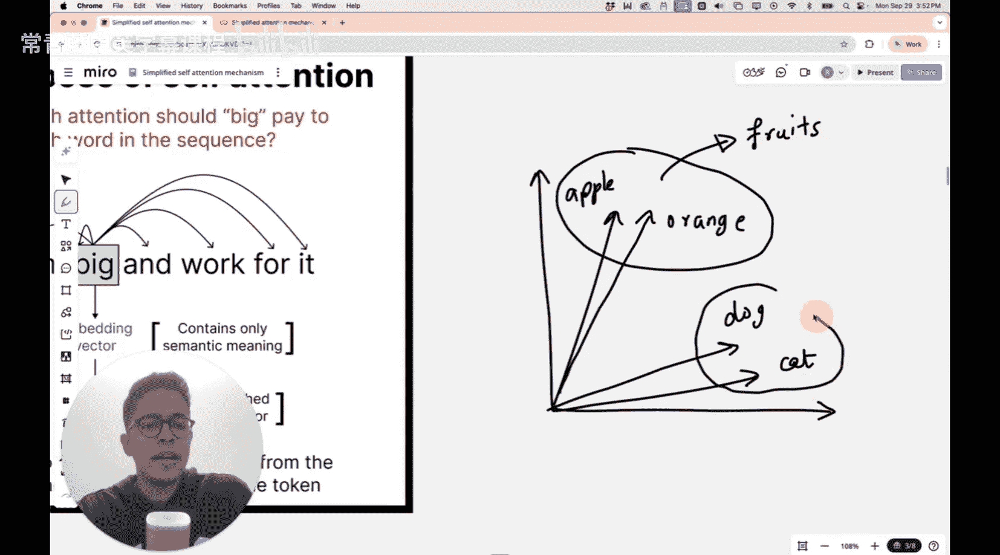