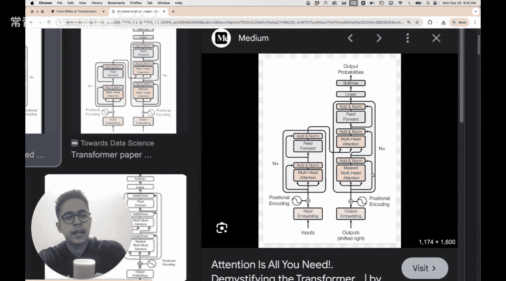
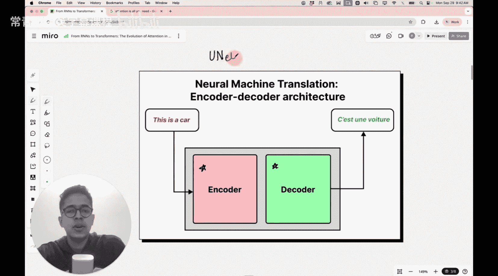
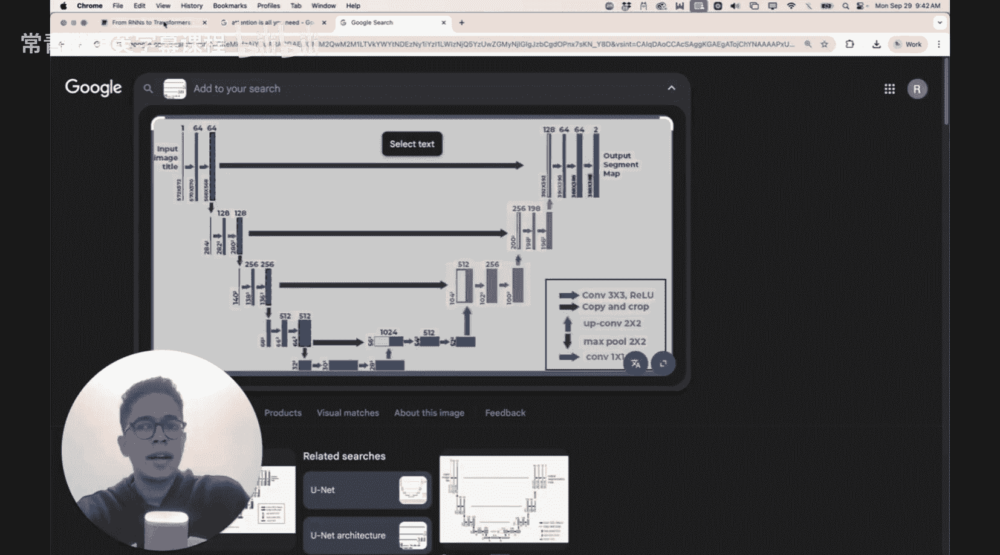
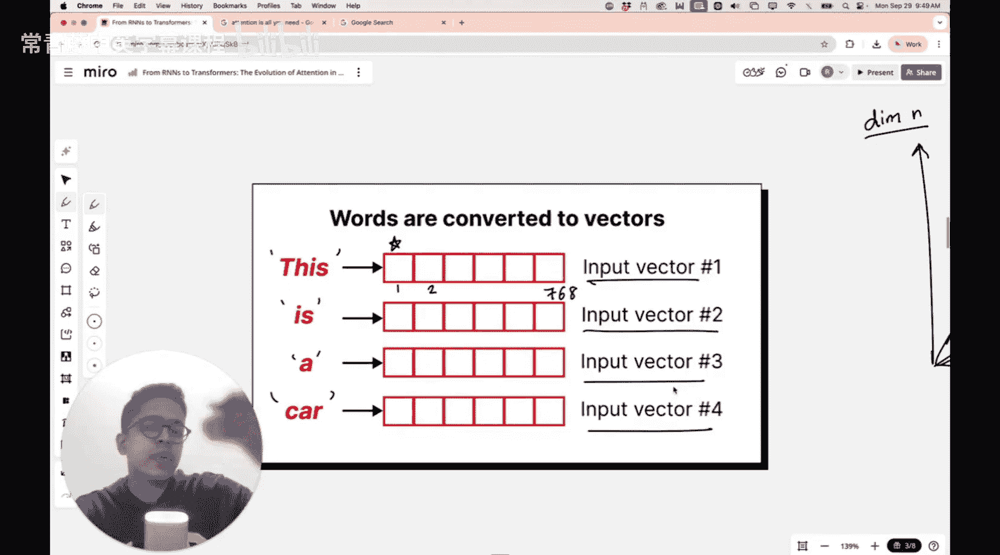

# Vizuara【中英⚡多模态LLM中的Transformer｜Transformers for Vision and Multimodal LLMs】 p22 P29 From RNNs to Transformers - Introduction to attention mechanism ｜ Transforme [BV1X9zuByEuF_p22]

Hi， welcome to a new lecture from Transformers Forion。

Today we will discuss about the evolution of attention mechanism。

 how we went from encoder decoder mechanism in recurrent neural networks to B of attention which was introduced in 2014 and then from there in 2017 self attention mechanism was introduced in the paper attention is all you need。

And attention mechanism has revolutionized not just natural language processing。

 but also computer vision。In the previous lecture we discussed how long range dependency can be captured very well by using attention mechanism in big sentences or big paragraphs where the first word in the sentence and the last word in the sentence could be highly correlated although they are far apart same phenomenon can happen in images where a patch of pixels。

 let's say the top left corner and a patch of pixels at the top at the bottom right corner can be highly correlated and you want to capture that long range dependency and attention mechanism is the mechanism which can do that for you。

So this lecture has a very important context in the current course， so let's get into the lecture。

🎼Yeah。So you might have heard of this term sequence to sequence models where you can input any kind of sequence。

 it can be words， words from sentences， it can be just letters。

 or it can be features in an image and a sequence to sequence model can convert this into。

Another sequence so this was primarily at least in the beginning used for language translation because translation is simply converting one sequence into another。

 so this is a sentence this is a car， it's a sequence of words converted into the French version。

So this sequence to sequence model for neural machine translation was very popular and it indeed worked very well for small sentences。

It of course had some issues when you had large long sentences。

 which we will discuss why in a moment。But let's first try to understand how did this sequence to sequence model work。

 what was underneath inside this sequence to sequence model part。

So this neural machine translator was basically an encoder decoder architecture。

 you will come come across these two terms also in the context of transformer。

 the transformer architecture mentioned in the attention is all you need paper had an encoder decoder architecture。

 so if you open the paper，Attention。

It's all you need， and if you look at this figure。The left hand side is encoderon architecture like what you see in birth models。

 the righthand side is decoderon architecture which you will see in models like GPT so here also you can see the encoder decoder architecture you will see something like this also in the model called unit so unit was a semantic segmentation model and in unit also you will see similar encoder decoder architecture where you are converting an input image or you are encoding an input image into smaller spatial dimension and more number of channels and at the decoder so this is the unit it's named so because its shape is like a U and the left arm of the unit is encoder the bottom part is the bottleneck and this right arm is the decoder so the idea of encoder decoder architecture will you will come across this idea in many different contexts。

And the input to the encoder is this English sentence。

 this is a car output from the decoder is the French translation of that。

 I don't know how to pronounce this really well so I' will not attempt it。

So now let's see what is there in the encoder and what is there in the decoder and how does encodeder communicate to the decoder because something has to go from encodeder to the decoder for decoder to provide you the final translated output so let's see how this works and once we understand how this works we will also understand what was the shortcoming of this kind of a model and how。

Attention mechanism evolved as a natural consequence。So。😊，Let's focus on just the encoder parts。

 so here I am isolating only the encoder， let's forget about decoder for a moment。

What the encoder does is given an input sequence and why do I call this as a sequence because you can consider a sentence as a sequence of words or a sequence of tokens however you want to split it。

 but let's say for simplicity you are splitting a sentence into words so this is a car will be this is a car so a sequence of four words。

So these words are input into the encoder sequentially。And at the end of this sequence。

 what the encoder outputs is something called as context vector， so this context vector。

Is one single output vector and why do I call this as a vector because it has n number of dimensions so let's say it has 768 dimensions this number is not exact I'm just giving an example then basically what this vector is doing is whatever information is contained in this input English sequence。

This one single vector is trying to capture the entire context of that sentence or the entire meaning that is there in that sentence in just one vector。

So this context vector came out as the output from the encoder and then what you will do is you will feed this context vector。

Into the decoder。Alright， so the input sentence does not go directly into the decoder it is。

Encoded into the context vector format and then the decoder will try to convert this context vector into the final target language if it is French。

 it will be looking like this three words in French。

These output words are also produced sequentially just like how input was coming in sequentially into the encoder。

 so if there are three words， it will be produced one after the other。

 but to produce these three words your input into the decoder is just this one single context vector。

So now you can imagine what is probably happening here you have an input sequence in one language。

 you are converting it into an abstract representation in the form of context vector。

 then that abstract representation you hope to capture some meaning in the input sentence but this abstract representation is not in any language it is in the language of mathematics。

 it is just numbers and then from that abstract representation which is the context vector you try to convert it into your human the other human language which is French。

So this is what decoder does so you can think of encoder converting or input into another space。

 another vector space， and then decoder converting it back from that vector space into your French language。

😊，So this is a simplified version of how encoder and decoder works now we have to go it in into detail one more level okay what exactly does encoder do to produce this context vector。

So。This is the next question， how do you go from this input sequence in English to this context vector。

 which is a mathematical abstract concept。How do you go to this So what is done is first your words are converted into vectors so words this。

I。A car So these individual words are converted into four input vectors。

 Now these are again mathematical representations of these words this is a car will have four different vectors。

And usually these vectors carry in meaning so we can draw something like the feature space。

 so let's say there are 768 dimensions for this vector so meaning this is the first element second element like that 768 element 768 is a number just that was used in GPT2 that's the only reason I'm mentioning that number here it can be anything right depends on the word word2 vector conversion。

But let's say the idea is that this is dimension 1。Of the vector， this is dimension n。

 the value of n can be anything， and then you will have a vector pointing in this direction。

 maybe this is apple。You will have a vector pointing here， this could be orange。

So now these two vectors are pointing into kind of similar regions in space that carry same semantic。

Meaning so this is the semantic space for， let's say， fruits。So these vectors。

 when you are encoding the English word into a mathematical vector。Those directions。

 the vector directions will carry certain meaning。On the other hand， if you have two vectors。

 let's say one for dog and one for cat。Now， these two vectors are pointing into another direction of space for semantic meaning or this semantic space。

Maybe for animals。Right so if you generally look at the vectors for cat， dog or other animals。

 it will in along certain dimensions it will point to some region of the space whereas some other vectors for fruits may point to some other direction of space along along some dimensions。

So this is the idea of converting words to vectors。

 so words carry meaning right for humans words carry meaning。

 but just like that these vectors also carry meaning it it encodes the semantic meaning of those words。

 they are not random numbers。Now， once you have these four vectors。You have input vector 1。

 input vector 2， 3，4， right now you have a。

