# Vizuara【中英⚡多模态LLM中的Transformer｜Transformers for Vision and Multimodal LLMs】 p24 P31 How transformer took over computer vision？ CNN's struggle with long range de [BV1X9zuByEuF_p24]

Hi， welcome to a new lecture from Transformers for Vision series。

Today we'll be discussing how transformer architecture can do some things in a superior manner which CNNs cannot do。

So the lecture is to lay the foundations for you to understand why you are learning about transformers in the context of vision related tasks。

We have a lot of models to discuss in the future lectures starting with Bi transformformers。

 and even before that we have to discuss about transformer architecture itself。And even before that。

 let's briefly discuss in today's lecture， what are some limitations of CNN which transformer can successfully overcome？

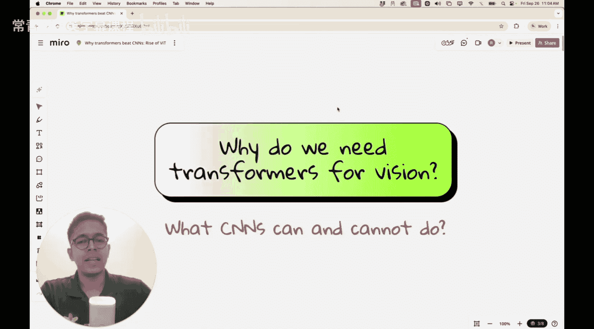

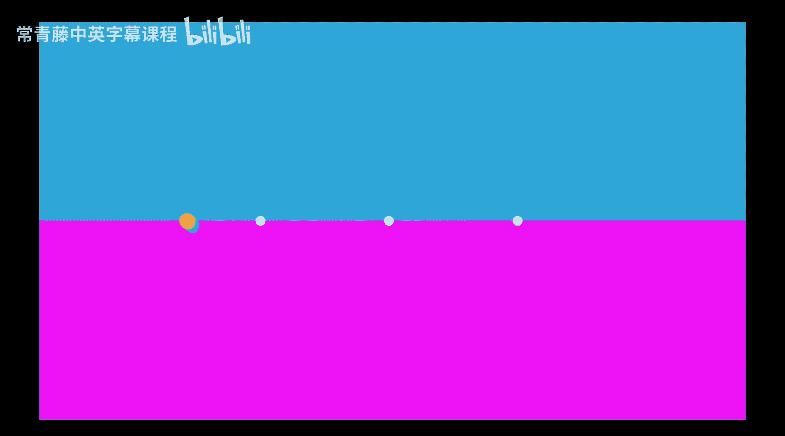

🎼，So before going into that， let's briefly recap the three eras that we discussed in the last lecture before 2012 before the advent of Alexnet。

 there were handcrafted features which were passed through machine learning models like SVM。

 etcter and then came the CNN revolution。 So these years were golden years for convolutional neural networks and then now since 2020 since the in since the。

Introduction of vision transformers by Google， we have now transformer based architectures performing pretty much all vision tasks。

So before going into the limitations of CNN， we should understand why convolution as an operation is so good。

😊，What are its strengths when it comes to abstracting features from images？So CNNs。

 there are many famous ones， Alexnet， VGG， ResNe， etc。

 but what I'm showing you here is like a general convolutional neural network architecture。

 which captures the essence of what it means to have a CNN architecture in your deep learning pipeline。

You will have an input image。And that will pass through bunch of convolution and Ra operations。

 Ra is the activation function rectified linear unit。There could be polling operations。

 this could be max polling average polling some polling etc。

 which can reduce the xy spatial dimensionality of the image so as you can see in this representation itself you can see the width and height of these images are decreasing so here the width and height is decreasing here it is even more decreasing while the channel depth is increasing channel depth is the Z stack the depth of this stack。

So， as the。Initial image passes through these layers， it will get transformed into tensesors。

Of smaller and smaller spatial dimension and deeper and deeper Z channel stack。

And finally what is done is the input image， which was like an RGB image。

 is finally converted into an abstract representation as a vector， so this is just one vector。

 the values inside these nodes。And those values。Can represent whatever is present in the image for the task at hand。

 so if your task is a multiclass classification task。

 this vector will be trained in such a way that during batch propagation。

 the values in these convolution filters will get modified so that the final vector representation will enable you to perform the multiclass classification。

So just understand this one single thing you are effectively somehow creating a more abstract representation of an image in a smaller space。

 Why do I say smaller space the number of。😊，Varis or the numbers that you require to represent images will not necessarily be now 224 by 224。

 so if the input image is 224 by 224 by 3 because you have RGB channels。

 this vector could have a much lower dimension than that。

So effectively what you are saying is whatever information was there in these numbers。

 how many numbers were there there were 224 by 224 by 3， these many numbers。

 whatever information was there in these numbers is converted into a bit more compressed format in these vectors and then that format is used for final classification。

Now the question is。Why do we use convolutional neural network why not just a feed forward neural network。

 what is a feed forward neural network you will have input so if you have images the input image can be converted into a flattened layer so you will have RGB then RGB like that if you have 100 pixels you will have 100 multiplied by 300 such nodes。

And then these can pass through multiple hidden layers of a neural network without any convolution operation。

 and finally， it can come out in a vector format， and then you can apply。

Classifier head and softm operation， right So this is like a。

Set of layers in the neural network that are fully connected， but there is no convolution operation。

 so these。Neural networks are actually not really good at representing images you require convolution operation inside the neural network。

For image related tasks due to some reason， so what are those reasons let's try to understand that if you understand that reason you will also understand the reason why CNNs are inadequate for some things which transformers can do much better。

So just to in case you are wondering image is made of pixels so these squares are pixels and then each pixel can have three stacks。

 each pixel that you see consists of red green and blue channels so you can have image constructed just out of red channel green channel blue channel right so this is basic representation of an image。

Now。How exactly does convolution operation help you extract features so that those features can later be converted into the feature vector feature vector is the last vector which we saw how do we do that？

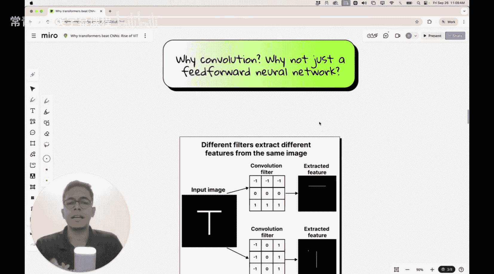

So consider this image an image of the alphabet T。😊。

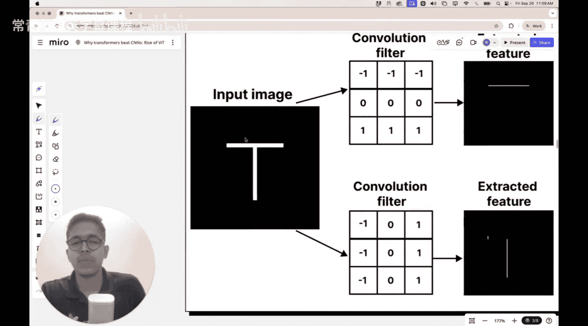

If we use a convolution filter like this with all the top row items being minus1。

 all these items being plus1， there is a nice intuition which you can think of which is intuition of a light array。

 so imagine that light rays are there passing from negative numbers to positive numbers so it's as if you have bunch of light rays coming here。

In this direction illuminating some edges of the projection of the shapes so imagine this t shape is likely projecting of out of the paper light ray are coming from top to bottom it will project the top edge right so the output image will look like this single line I hope you can see this line。

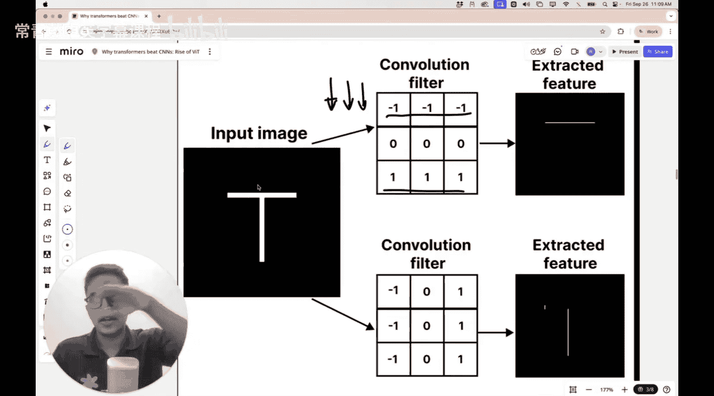

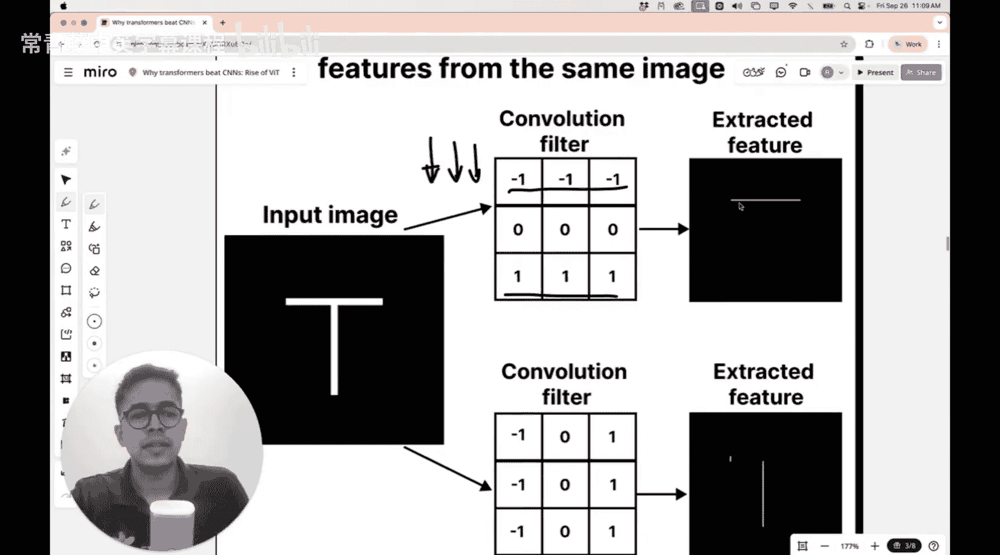

So this is one type of filter where you could extract features like horizontal edges if you want to extract features that are vertical edges you can use a transpose of a filter like this transpose meaning in the in the other direction so negative numbers are in left hand side positive numbers are on the right hand side and this is like right lighter is going from left to right which means it will illuminate any edges on the left side so here you can see two edges are illuminated one is this small edge at the top left corner of the t and then this main body of the t the left edge of the main body of the T。

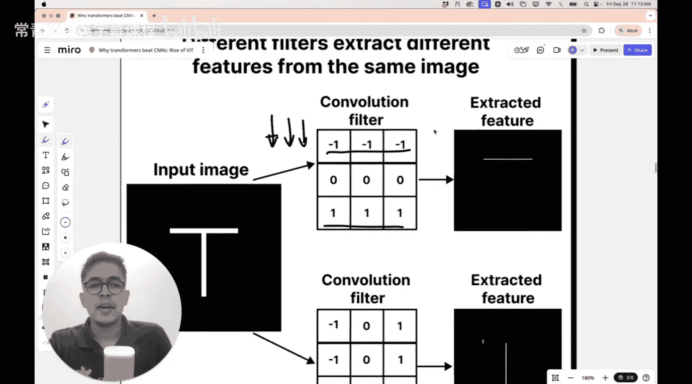

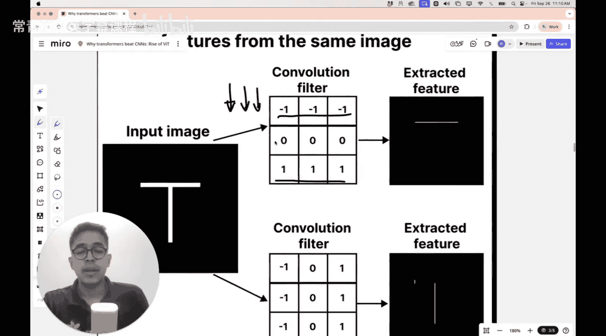

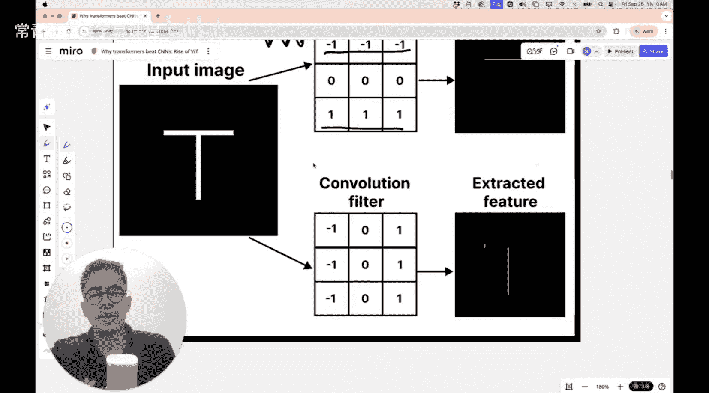

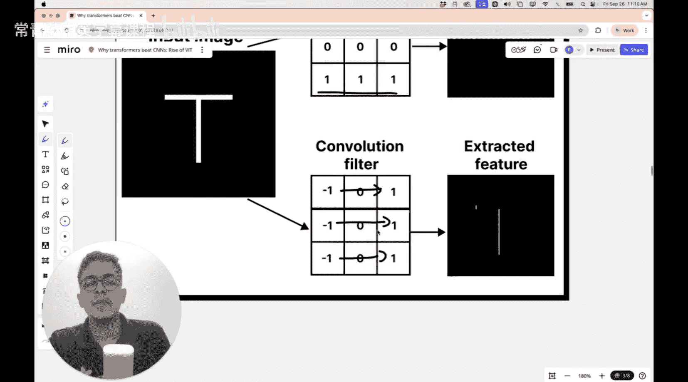

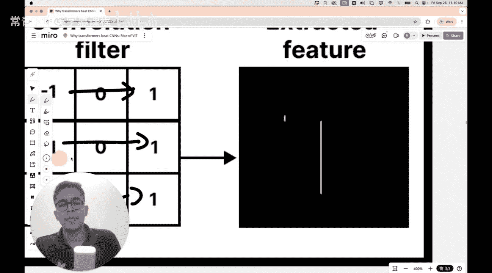

Now you understand how convolution filter can extract these features now these filters the numbers inside the filter will be defined based on how you perform the back propagation so during the training these numbers are trainable weights。

 these are not predefined it was predefined before 2012 when handcrafted filters were used for extracting features just like how I did right now but in a CNN these numbers are trainable weights trainable parameters。

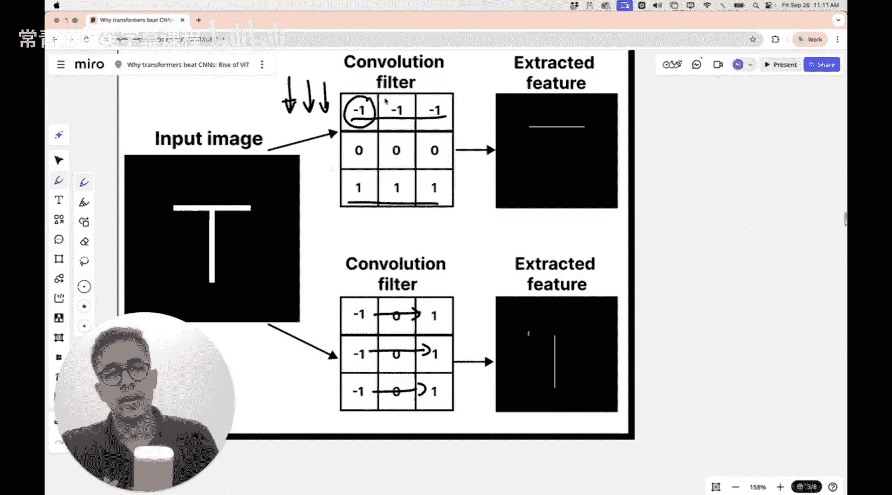

Then what do you do with this you extracted the features now this could be abstracted even further or compressed even further if you perform max pullinging operation the dimension if this is 32 by 32 you can compress it further to 16 by 16 so at the end of the day bunch of information that was present in this image and let's say this image is 64 by 64 and here these filters were applied with a stride of value equal to2 then eventually you are compressing the information present in this 64 by 64 image into some channels where the spatial dimension of the channel is just1 by 16th of that because along the x dimension your spatial dimension is reduced by one fourthth here also it has reduced by one fourth so combined this is just one by 16th of the original dimension so you have compressed whatever。

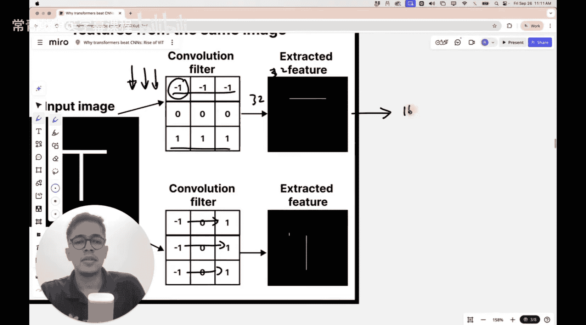

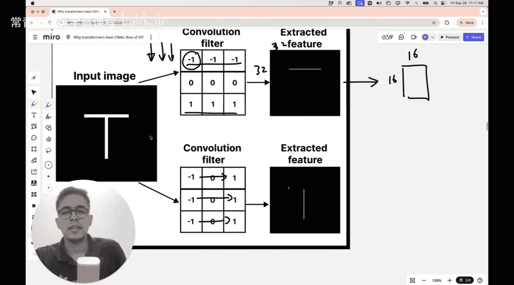

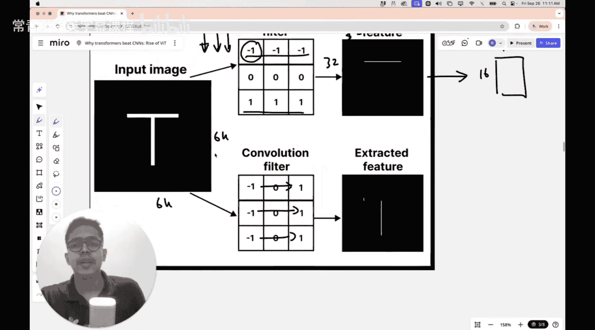

Information you require for the task by a lot。 So you are now creating an abstract representation of the image。

 and now this information， which is much more compressed and encoded， you can use to。

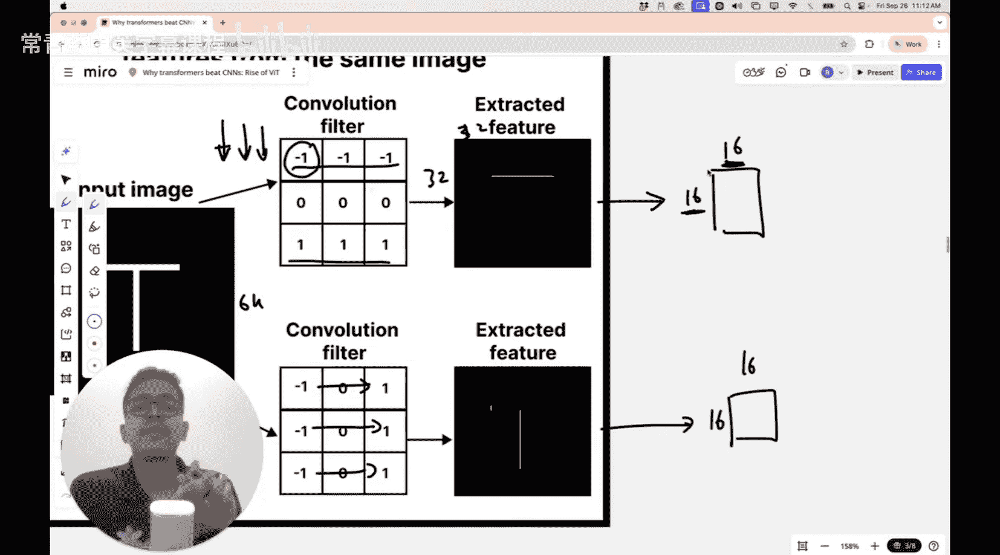

Perform classification， let's say you are classifying between letters T images that contain letters T versus let's say letters S。

 something like this if this kind of binary classification is what you want to do。

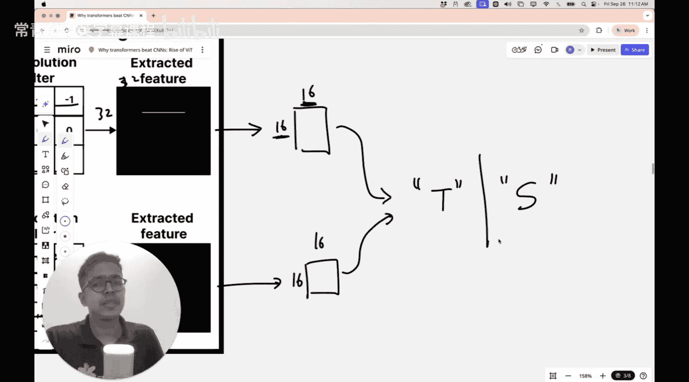

Something like this is what you will do you will not be using obviously handcrafted filters。

 but I just wanted to use these handcrafted filters to show its utility。

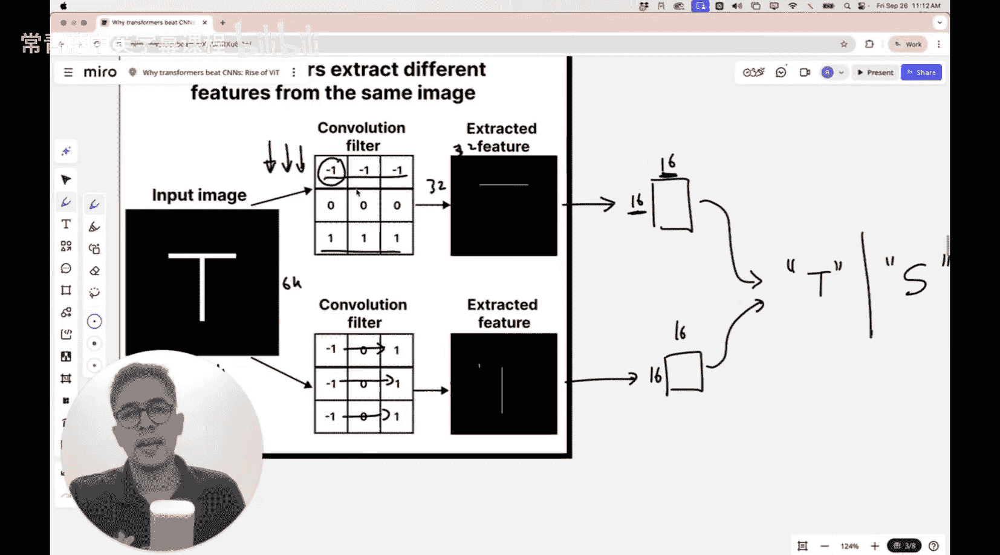

So， just understand this much filters are looking at bunch of pixels at the same time and because of that it can extract spatial information so this filter is a 3 by 3 filter it is looking at  nine pixels at a time。

So。You are essentially combining the information in nine pixels into one single pixel。

 that's how filters work。

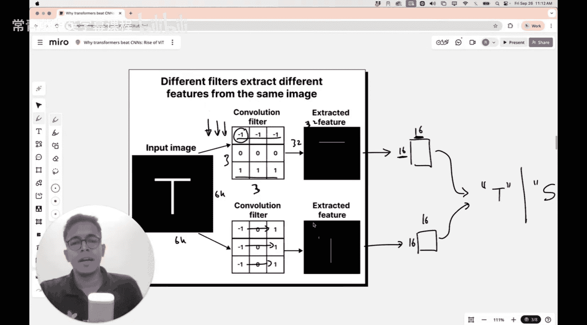

If you are not exactly familiar with how exactly filters work， here is another。😊，Explanation。

 so this is the input。This is the filter， this one in the middle is the filter。

And this is the output from the filter。Now just focus on this dark blue 3 by3 matrix。

 this filter and just this dark green。

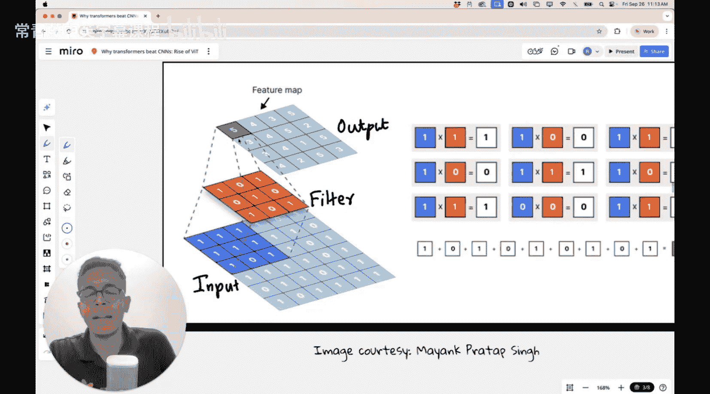