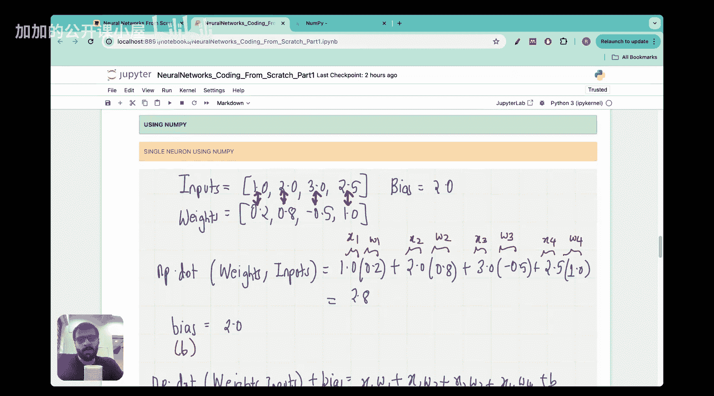

# Vizuara【中英⚡从零开始构建神经网络｜Building Neural Networks from Scratch】 p02 P2 Lecture 2 - The beauty of numpy and dot product in coding neurons and layers [BV1iEHPzGEpa_p2]

🎼Yeah。Hello， everyone。Welcome to this lecture in the neural network coding from Sctch series。Today。

 we are going to learn about。

Three things。First thing is how to use。