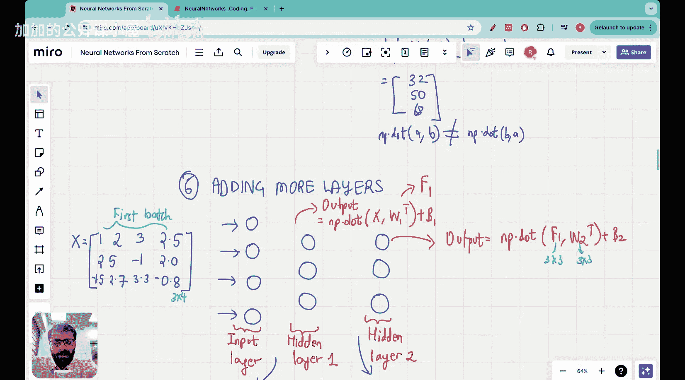

# Vizuara【中英⚡从零开始构建神经网络｜Building Neural Networks from Scratch】 p03 P3 Lecture 3 - Coding multiple neural network layers and stacking them together [BV1iEHPzGEpa_p3]

🎼Yeah。Hello， everyone。Welcome to the next lecture of neural Network from Sctch series。

Thank you for sticking with this series for the first two lectures you have already made it。

