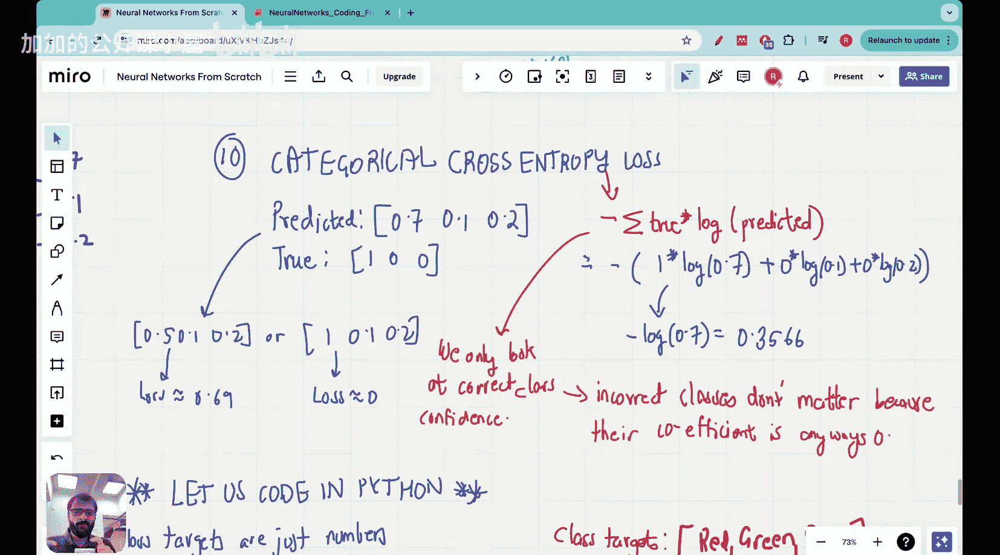

# Vizuara【中英⚡从零开始构建神经网络｜Building Neural Networks from Scratch】 p08 P8 Lecture 8 - Coding the cross entropy loss in Python (from scratch) [BV1iEHPzGEpa_p8]

🎼Yeah。Hello， everyone。Welcome to this lecture in the neuralural Network from Scratch series。

In the last lecture or up till now， rather， we have looked at how to code an entire forward pass in Python。

