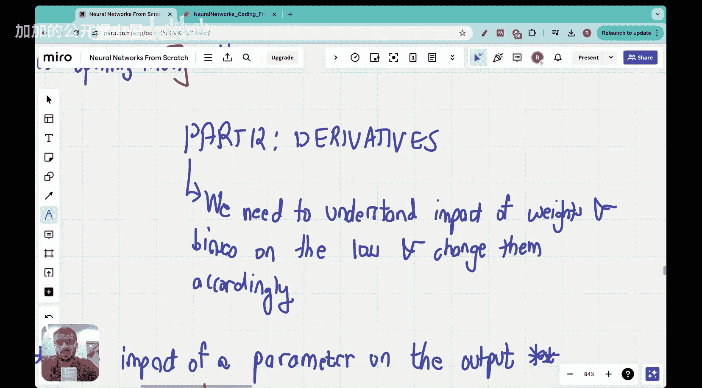

# Vizuara【中英⚡从零开始构建神经网络｜Building Neural Networks from Scratch】 p10 P10 Lecture 10 - Partial Derivatives and Gradient in Neural Networks [BV1iEHPzGEpa_p10]

🎼Yeah。Hello， everyone。Welcome to this next lecture in the neural networks from Sctch series。

In this lecture， we are going to essentially cover three things。

The first thing is derivatives。The second。