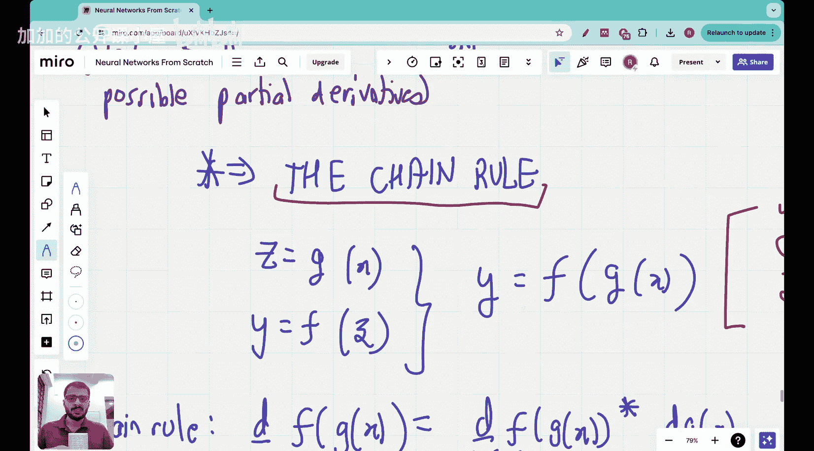

# Vizuara【中英⚡从零开始构建神经网络｜Building Neural Networks from Scratch】 p11 P11 Lecture 11 - Understand Chain Rule： The backbone of Neural Networks [BV1iEHPzGEpa_p11]

🎼Yeah。Hello everyone， welcome to this lecture in the neuralural Network from Scch series。

This is the second lecture on calculus in the previous lecture we looked at derivatives。

 partial derivatives and gradients。

