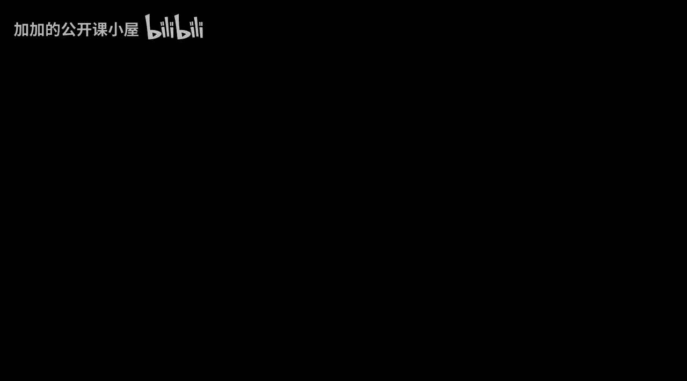

# Vizuara【中英⚡从零开始构建神经网络｜Building Neural Networks from Scratch】 p12 P12 Lecture 12 - Backpropagation from scratch on a single neuron [BV1iEHPzGEpa_p12]

Hello everyone， welcome to this lecture in the neural Network from Sctch series。

Today is a very important lecture because we have arrived at back propagation。

There have been multiple lectures in this series before。

