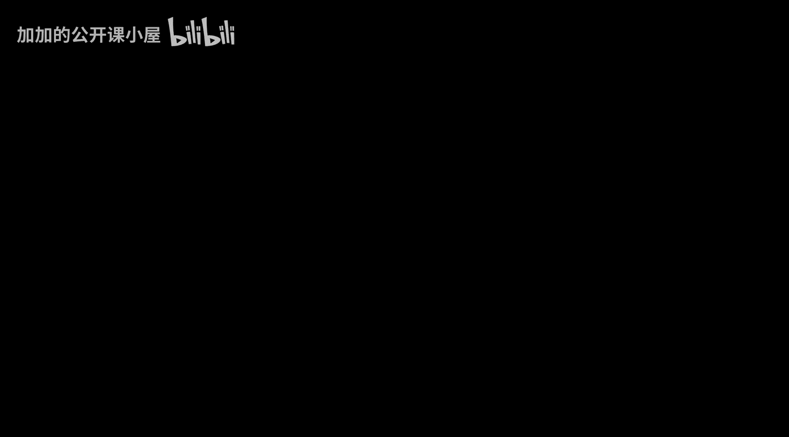
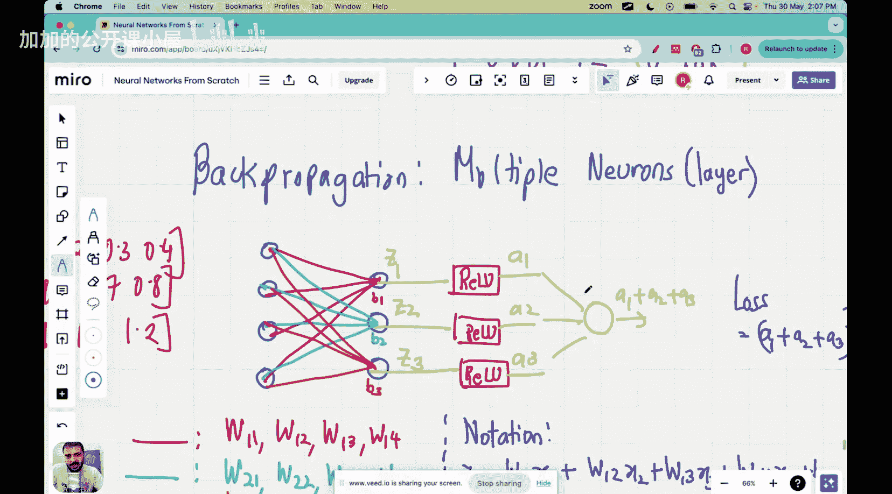

# Vizuara【中英⚡从零开始构建神经网络｜Building Neural Networks from Scratch】 p13 P13 Lecture 13 - Backpropagation through an entire layer of neurons： from scratc [BV1iEHPzGEpa_p13]

🎼Yeah。Hello， everyone。Welcome to this lecture in the neuralural Network from Sctch series。

In the previous lecture， we looked at a back propagation through a single neuron in this lecture。

 our main objective is to look at back。

