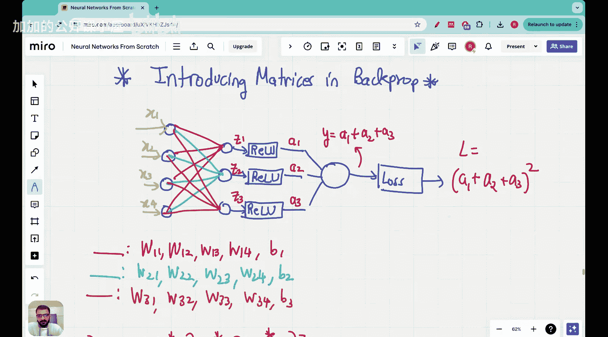

# Vizuara【中英⚡从零开始构建神经网络｜Building Neural Networks from Scratch】 p14 P14 Lecture 14 - Role of matrices in backpropagation [BV1iEHPzGEpa_p14]

Hello， everyone。Today in the neural networks from Sc series。We are going to introduce。

Metris in back prop。

In the previous lectures on back propag， we looked at。

