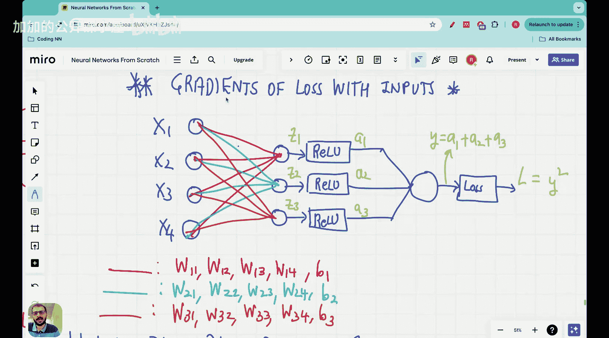

# Vizuara【中英⚡从零开始构建神经网络｜Building Neural Networks from Scratch】 p15 P15 Lecture 15 - Finding derivatives of inputs in backpropagation and why we nee [BV1iEHPzGEpa_p15]

🎼Yeah。Hello everyone， welcome to this lecture in the neuralural Network from Sctch series。Today。

 we are going to learn about how to calculate gradients of the loss with respect to inputs。

During back。