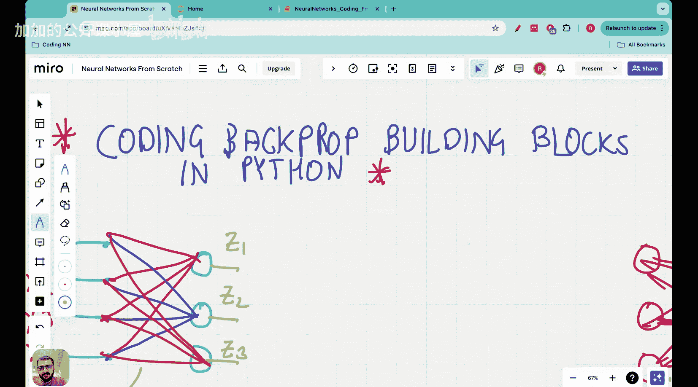

# Vizuara【中英⚡从零开始构建神经网络｜Building Neural Networks from Scratch】 p16 P16 Lecture 16 - Coding Backpropagation building blocks in Python [BV1iEHPzGEpa_p16]

🎼Yeah。Hello everyone， welcome to this lecture in the neuralural Network from Sctch series。

Today is a very important lecture because。

Today， we will be coding the back propagation building blocks in。

