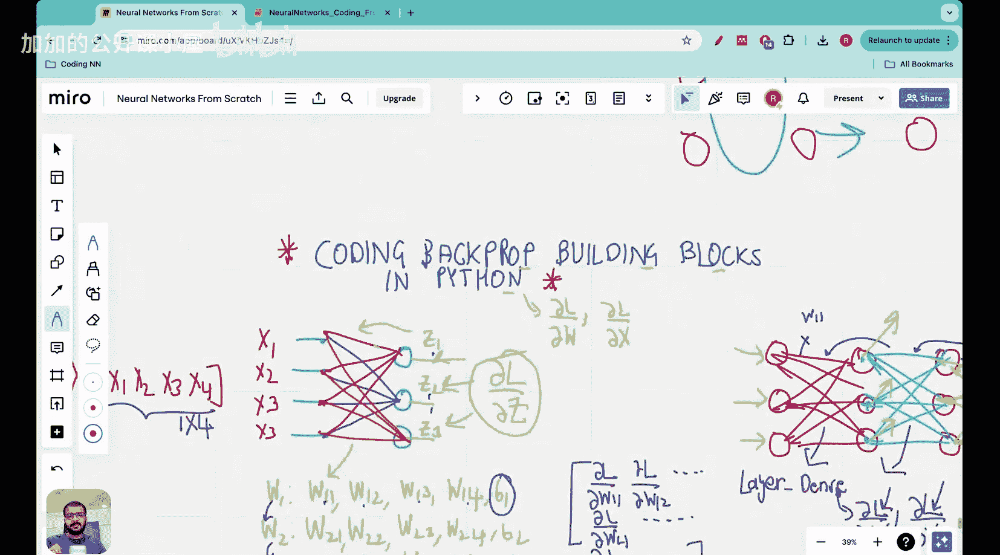

# Vizuara【中英⚡从零开始构建神经网络｜Building Neural Networks from Scratch】 p17 P17 Lecture 17 - Backpropagation on the ReLU activation class [BV1iEHPzGEpa_p17]

🎼Yeah。Hello， everyone。Welcome to this lecture in the neuralural Network from Sctch series。

In the previous lecture， we looked at coding the back propagation building blocks in Python。

In particular。