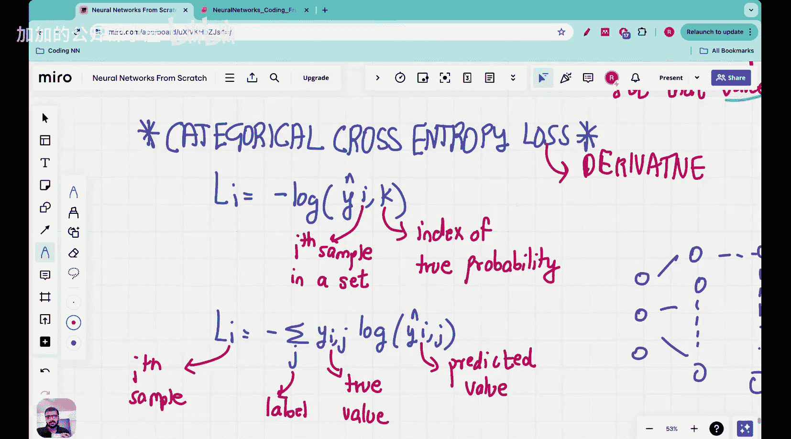

# Vizuara【中英⚡从零开始构建神经网络｜Building Neural Networks from Scratch】 p18 P18 Lecrure 18 - Implementing backpropagation on the cross entropy loss function [BV1iEHPzGEpa_p18]

Hello， everyone。Welcome to this lecture in the neural networks from Sctch series。

This is a set of lectures on back propagation up till now we have covered back propagating through layers。

And finding the gradient of the loss function with respect to the weights and by。

