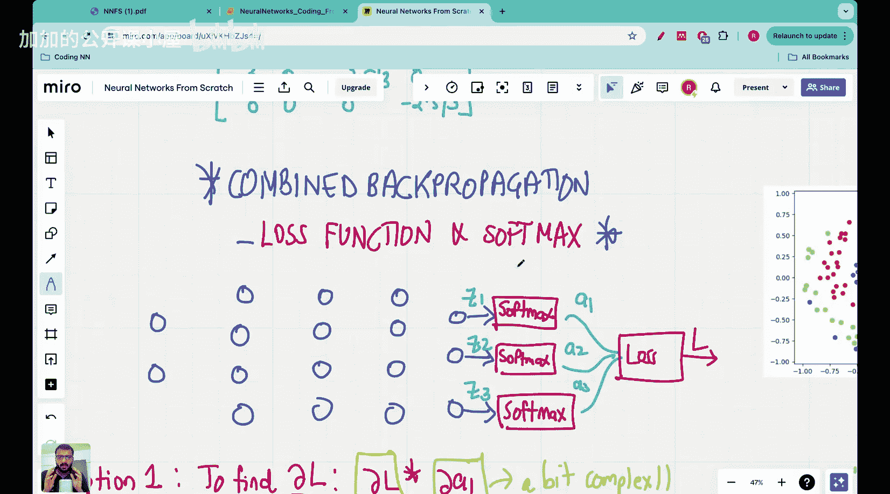

# Vizuara【中英⚡从零开始构建神经网络｜Building Neural Networks from Scratch】 p19 P19 Lecture 19 - Combined backpropagation on softmax activation and cross entrop [BV1iEHPzGEpa_p19]

🎼Yeah。Hello everyone， welcome to this lecture in the neuralural Network from Sctch series。

This is another lecture on the topic of back propagation in the previous lectures we have looked at back propagating through a layer and。

