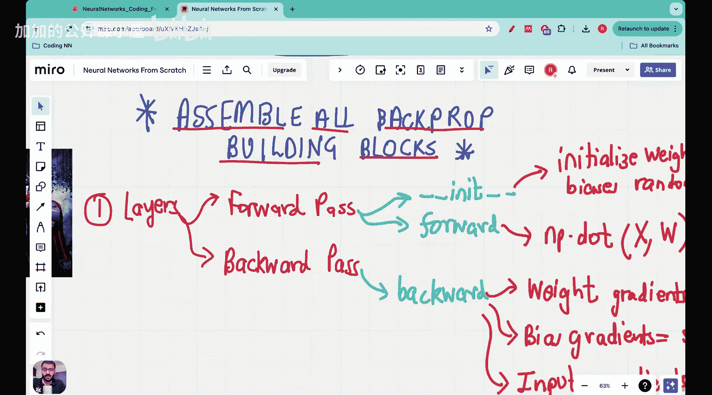

# Vizuara【中英⚡从零开始构建神经网络｜Building Neural Networks from Scratch】 p20 P20 Lecture 20 - Build the entire backpropagation pipeline for neural networks ｜ [BV1iEHPzGEpa_p20]

🎼Yeah。Hello everyone， welcome to this very important lecture in the neuralural network from Sc series。

This will be the last lecture in the back propagation part and in this lecture we will be assembling all the building blocks of。

