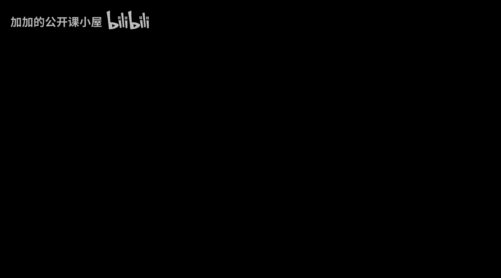

# Vizuara【中英⚡从零开始构建神经网络｜Building Neural Networks from Scratch】 p22 P22 Lecture 22 - Coding Optimizers in Neural Networks： Gradient Descent [BV1iEHPzGEpa_p22]

🎼Yeah。Hello everyone， welcome to this neuralural network from Sctch series lecturecture。Up till now。

 we have looked at forward pass。And we have looked at the backward pass。We have had。

