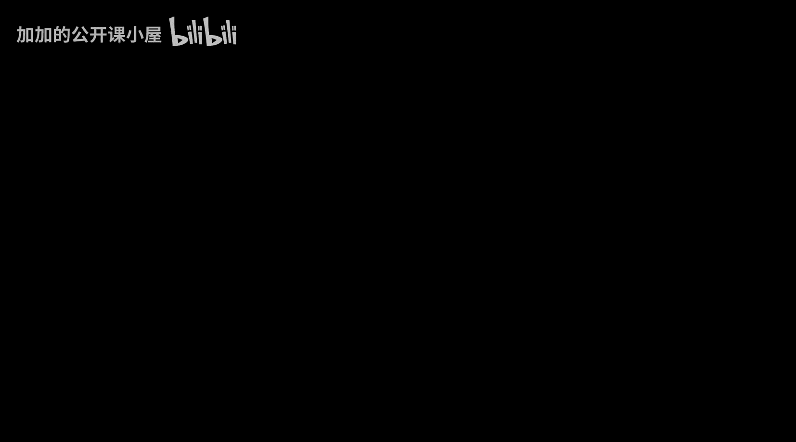

# Vizuara【中英⚡从零开始构建神经网络｜Building Neural Networks from Scratch】 p23 P23 Lecture 23 - Learning Rate Decay in Neural Network Optimization [BV1iEHPzGEpa_p23]

🎼Yeah。Hello everyone， welcome to this lecture in the neuralural Network from Sctch series。Today。

 we have a very important topic to cover we are going to be looking at learning rate decay today and why it is very。

