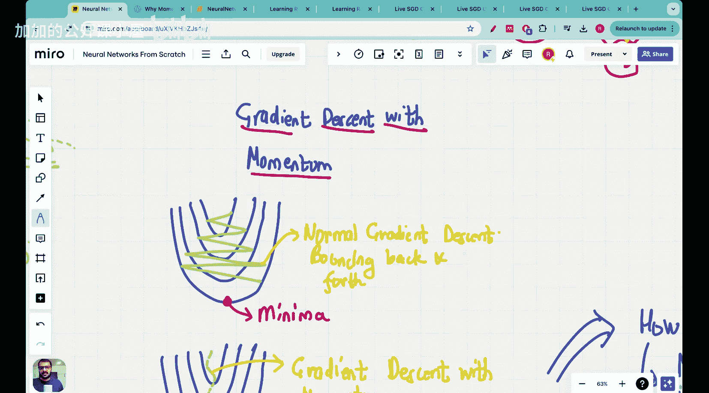

# Vizuara【中英⚡从零开始构建神经网络｜Building Neural Networks from Scratch】 p24 P24 Lecture 24 - Momentum in training neural networks [BV1iEHPzGEpa_p24]

🎼Yeah。Hello， everyone。Welcome to this lecture in the neural networks from Sctch series。Today。

 we are going to be looking at gradient descent with momentum。

In the previous lectures， we have looked at。