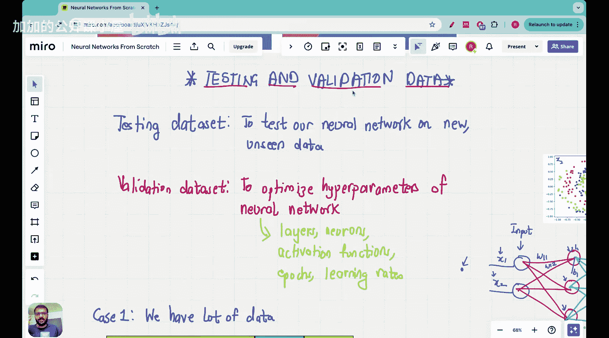

# Vizuara【中英⚡从零开始构建神经网络｜Building Neural Networks from Scratch】 p30 P30 Lecture 29 -K-fold cross validation in Neural Networks [BV1iEHPzGEpa_p30]

🎼Yeah。Hello everyone， welcome to this lecture in the neuralural Network from Sctch series。

Today we are going to look at the difference between testing and validation data in the previous lecture we looked at the importance of test data。

