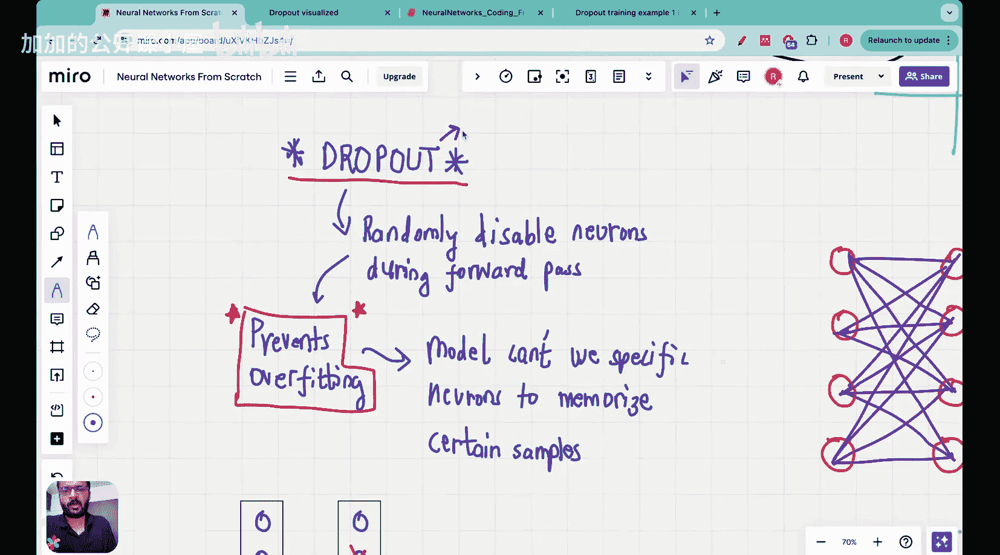

# Vizuara【中英⚡从零开始构建神经网络｜Building Neural Networks from Scratch】 p32 P32 Lecture 31 - Dropout layers in neural networks - Full code [BV1iEHPzGEpa_p32]

🎼Yeah。Hello， everyone。Welcome to this lecture in the neural networks from scratchtch series。Today。

 we will be learning about a very important concept， which is called as dropout。

In the previous lectures。