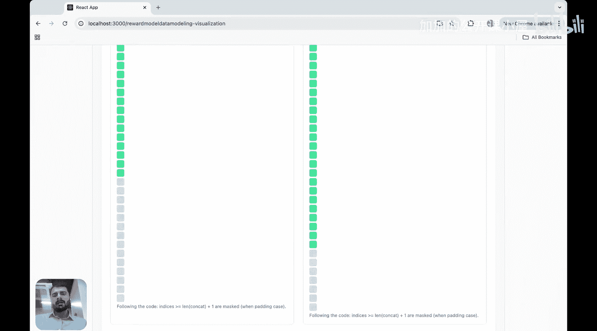
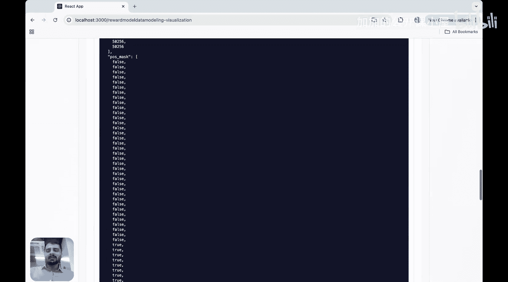
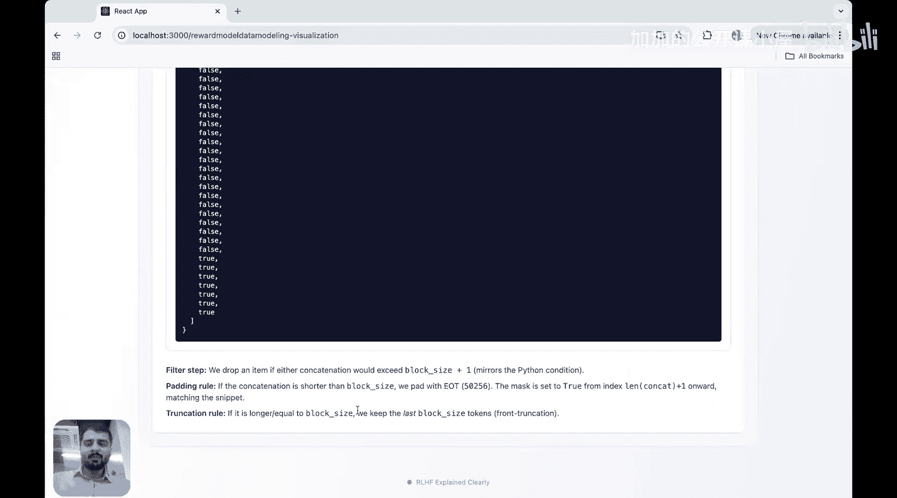
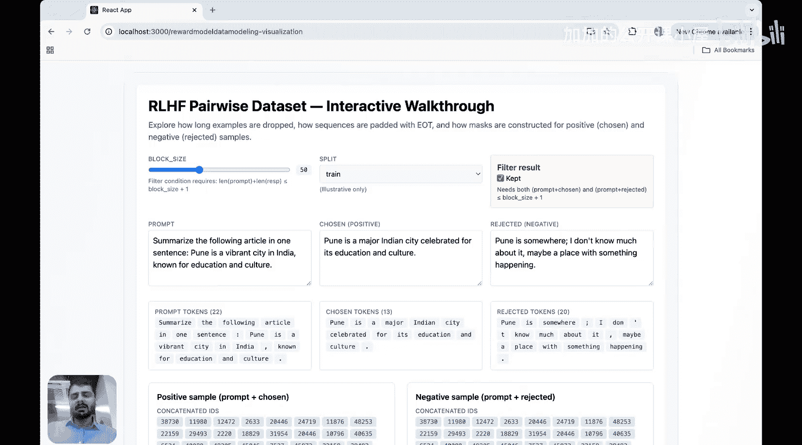

# Vizuara【中英⚡强化学习实践｜Hands on Reinforcement Learning】 p01 P1 RLHF Visualizer ｜ Hands-on Reinforcement Learning [BV1sdypBJEXw_p1]

Hello， everyone。I'm recording this video， too。Explain to you a new way to visualize the religious pipeline。

What I realized in the last several weeks is that there are a lot of components which are involved。😔。

In the relationship process。And it becomes very difficult to put。

All of these components in our memory to understand what's happening overall in the pipeline。

We might focus on one component， and then we might lose track of the other components。

And I have developed a tool， which helps us visualize。What happens to。

Tokens as they pass through the are pipeline。In this video。

 I am going to explain the RHF process to you。In a different way， through visualizations。

And Im not going to include any mathematical equations， derivationations or approved。

But I want you to。Visualize this entire process， to very clearly understand。

What happens to individual tokens。Inside an knowledge of pipeline。So let us get started。

 I have divided this video into。Two sections in the first section。

 I will talk about the reward model。 and in the second section， I will talk about。

The entire PPO training loop， which is at the core of a relative。

So let's start with the first section， which is the reward modeling。First of all。

 what is a reward model。Imagine that there is a reference data set where。

You have asked a lot of questions。And then。We have collected preferences of humans。

Where you have a chosen response and you have a rejected response。

This is very similar to in the earlier versions of Cha GT。

It sometimes used to provide us two responses， response one and response2。

 and it used to ask us to select the preferred response。So in a similar way。

 we can construct a data set。In which we have a prompt。

 we have a chosen response and we have a rejected response。Now。

 this is the data set that we will use and we will construct a reward model。

What is the objective of this， the reward model should score high for chosen preferences。

 and it should score low for rejected preferences， so we want to train a model to do that。

Before we see how exactly the model is trained。First， the data set itself is processed。

 so this is an interactive visualization which helps you understand。How the data set is processed。

In this reward modeling data processing step。So let's take an example。

The prompt is summarize the following article in one sentence who is a vibrant city in India。

 known for education and culture。There are two responses。

 UNe is a major Indian city celebrated for its education and culture。

The second response is boy somewhere。 I don't know much about it。

 Maybe be a place with something happening。So we can clearly see that there is a chosen response。

 which is the first one and there is a rejected response， which is the second one。Now。

 what to do with these chosen and rejected responses。The first step that is done is。

The prompt is combined with the chosen response， and the prompt is combined with the rejected response。

So we generate a positive sample， which is the prompt plus the chosen response。

And we generate a negative sample， which is the prompt plus the reject response。Now， next step。

 what we do is we convert。The entire completion， which is the prompt less chosen or prompt is rejected。

Into a set of tokens。For example， look at。The positive sample， which includes。

22 brown tokens and 13 chosen tokens。So overall， we have 35 tokens in the positive sample and in the negative sample。

 we have 13 plus 20， which is。33 tokens。Okay， so now what we have done is。We have。The it真 the。

Tokens as a series of numbers in this section， which is called as。Concateated Is。

So you can see here that has been mentioned。Now， one important point to consider is that。

The block size that we have chosen here is 32。Which means that we can only have a set of。32 tokens。

In one single completion。But you can see that this positive sample has 35 tokens。

So we cannot fit this entire sample within the block size。

So what we do is we simply get rid of the first three tokens。

Why do we get rid of the first three tokens and not the last three tokens。

Because the reward is going to be more sensitive towards what comes at the end。

 not how the sentence is starting。So that is why we choose to remove the tokens which come at the beginning if the length of the positive sample exceeds the block size。

That is exactly what we have done here。 We have o tokens 3，8，7，3，0，1，1，9，8，0 and1，2，4，7，8。Now。

 the question that you might have is。What happens if we increase the block size？So let's take。

 let's increase the slider to a value of 50。Yeah。Now， the block size is 50。

 but our positive sample has only 35 tokens。So what do we do。We add a single token， which is 5，0，2，5。

6 at the end。This is the。One single number， which is added， and there are 15 tokens like that。

 which is added to the completion。This is called as padding or padded tokens。

 What we do is that if the completion has a length， which is less than the block size。

Then the remainder portion is simply padded， which means that we add。

15 tokens with one single number， which is the padding ID and the same thing we do for negative sample because negative sample also has 33 tokens。

 which is less than our block size， which is 50 So we add a lot of。

So we paired the negative sample as well。Okay， so of now。What we do is。These positive samples。

And negative samples。Have to be passed to our。Reward model for the training process。

 but there is one last step that is remaining before the sample is passed。

Take this example where the block size is 50， and we have added an artificial token at the end。

Now if you do not do anything， your model will treat the artificial tokens as tokens with some meaning。

 so we have to tell our model， our reward model that these are artificial tokens don't care about them。

 simply ignore them and this is done by creating a mask。So after the padding。

 the next step which comes is the masking， so here you can see that I have created masks for both the positive sample and the negative samples。

Where green is the color where these tokens are active。

And white is the pillar where the tokens are inactive。

 which means that the reward model will completely ignore them and they will not be used for the training process。

And this is exactly what is displayed as a part of this code output block here。

So to summarize， we have。Three main steps which are involved in the data processing。First。

 we collect a data set， which is a pairwise data set。You have the prompt。

 you have a chosen and rejected response。TheThe first step is to convert this into tokens。

Wecond the prompt。And the chosen and the rejected responses into individual tokens。

The next step we do is we concatenate the prompt plus chosen as a positive sample。

And then we con brown plus rejected as a negative sample。Now， in the next step， we do padding。

If the positive sample or negative sample length exactly matches the block size， then no problem。

If the length is greater than block size， then we have to omit some tokens。

 this omission process always begins at the start of the crop， not towards the end of the pro。

 because that is what is going to influence the reward more。If the block size is higher than the。

Size of the positive or negative samples。 Then we to padding。 we add an artificial。

