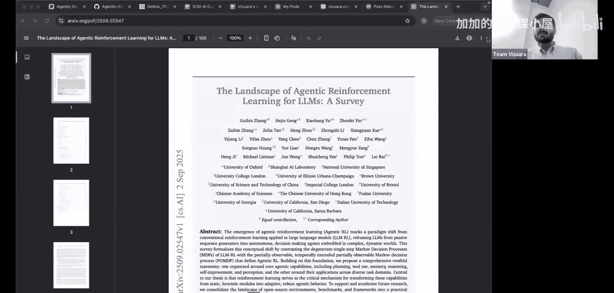

# Vizuara【中英⚡强化学习实践｜Hands on Reinforcement Learning】 p02 P2 Agentic Reinforcement Learning ｜ Hands on Reinforcement Learning [BV1sdypBJEXw_p2]

Okay， so today I want to try and。Experimental lecture。

 so it is something which I have been reading up for the past two three weeks。

And the topic which we are going to cover today is called agent reinforcement learning。So far。

 we have seen how RL has progressed through the last 50，60 years we started with。

Classical reinforcement learning， where we looked at the algorithms of。

Monti Carlo temporal difference and then dynamic programming methods。And then two words。2014， 2015。

 we entered this era of deep reinforcement learning and that mainly happened when the Atari paper came out。

So people started applying reinforcement learning to tasks in robotics and video games。

The main change which happened during that phase was that we could now represent our policy as a neural network。

 which previously could be represented in the form of a table。

But it is impossible to represent all the states and their values in one single table and people are always trying to experiment that can we represent the policy as a neural network。

 but until actually before the deep QM paper in 2014。

 there was a TD Ga on paper which came out in I think around 200 which also was a proof of concept where deep neural neural networks can be used to represent policy。

And then after 2015， when people really started applying reinforcement learning to LLMs happened because the algorithm of PPO was invented。

 which was proximal policy optimization。This happened in 2017。

And then people found that PPO algorithm is very well suited for using RL in LLMs。If you remember。

 that's the same time when transformers。The paper attention is all you need happened and the parallel research was going on in the LLM space and people also applied RL in LLMs。

But the best application was through reinforcement learning through human feedback， which。

Made sure that okay you are pretraining a base model that is fine。

 but how do you make the base model aligned with human preferences to behave like a chatbot like humans interact with each other so that is called as post training and in post training a crucial component was that of alignment and reinforcement learning through human feedback played a big role in that。

So the first Cha GPT， which came out in 22 December， it would not have been possible without。RLHF。

 which at the heart of it had PPO， which had come out five years earlier in 2017。

Then people understood that， okay， you are using PPO and in RLHF， one of the crucial step is。

You have a reward model。 So reward model is sort of like。

You pass in any kind of prompt and the completion and the model gives you a score which ratess how good or bad the completion is。

And people train this reward model based on human preferences and why is this required because if you have questions which are very subjective in nature。

 for example， if you ask me， do you like this poem or not？My answer will differ from your answer。

 so what people did was people gave。Humans。A preference between two options where they had to select。

Their own preference， so for example， if I'm given two poems。

 I can compare two poems that is better than asking me to score for each individual poem。

And then based on these preferences which human labelers gave， a reward model was constructed。

Now this process was very expensive， like monetary expensive。

 it incurred millions or billions of dollars because it involved a lot of human labor cost。

And it was not also only。High budget AI labs could do the RLHF process， startups。

 people who do not have access to that kind of money have no idea how the RLHF pipeline works。

The the first paper which made this accessible to everyone was the paper which introduced this concept of using LLMs as a judge。

 so it basically said that you don't need human enableers to label the preferences but you can pass it to an LLM and。

The LLM can be used as the judge if you prompt it saying that。

You have this role and you have been given two answers and you have to rate one answer so then people started using that and the first LLM which performed well in that was GPT 40。

And then that completely revolutionized the RLHF workflow because it suddenly made that accessible for everyone。

😊，So even smaller AI labs could now align their models to human preferences because they could use LLM as Js。

Okay， so this is also called as R AIF， which is reinforcement learning through AI feedback because there is no human in the loop anymore。

Now， okay fine， so we have gone from PPO to RLHF to RL AI but 2025。

One more thing came out which was GRPO， the main problem with PPO is that you need a critic model which is very heavy。

 it takes a lot of memory。GRRPO came and said that you remove the critic model from your pipeline completely and。

Instead of having a critique， use sample multiple responses and calculate the advantage。

From the relative rewards which these responses get。

And that made sure that you don't need a very heavy critic model in the RLHF pipeline anymore。

But they added one more interesting innovation was they introduced this reinforcement learning through verifiable rewards。

Which means that you use。Let's say， completions which can be verified。

Which do not even require a reward model， for example。

 mathematics coding all of these tasks are there are objective answers。

 either something is right or something is wrong you don't need a human labeler or even an AI to give feedback on that so essentially there pipeline you reduce the number of models from four to2 now you only needed the base model which is the。

Main policy that you are trying to train。And you need the reference model so that you make sure that your model doesn't diverge too much from the reference model。

 so it'll reduce the number of models from four to2。

So these were the stages which have happened when applying RL and LLMs and in the last lecture we actually looked at the entire GRPO pipeline。

And we looked at some nice examples where we can transform a model into a reasoning LLM using the process of GRPU。

Now the next frontier， which is very new， it has only started in the last three， four months。

Is reinforcement learning agents or agent RA？The objective of agent RL is basically to use reinforcement learning to operate a set of tools and perform some tasks。

Using LLMs。So。If you look at Cha GPT， Gemini， all of these now have a deep research board where you ask any question and it takes some time。

 sometimes it takes 10， 15 minutes for the LLM to go through a bunch of documents and come up with answer。

 which is usually very comprehensive。Now behind the scenes， if you look at it。

 they have implemented agent reinforcement learning。And the paper。

 which I have referred for today's lecture， I am just going to share it with all of you。It is a very。

Interesting paper， it is somewhat long。But many of the pages are taken up by the references so。

Actually， the paper is 50 pages long。 It appears to be 7500 pages long。 So it。

 it outlines the landscape of reinforcement learning in。

For LLms， so I'll just start sharing my screen now。

So this is the paper which I' have shared with all of you。So this paper came out early this month。

And。All of the references you will see are mostly from this year on year because as I said。

 this is not a very old field。Basically it goes through all the details and what exactly is agent orial。

 etc， but today's lecture we have dedicated to this。

And the reason I wanted to cover this as a last lecture of our boot camp is because I really think agent R is the future and my thinking is heavily influenced from this paper。

 which was written by David。

