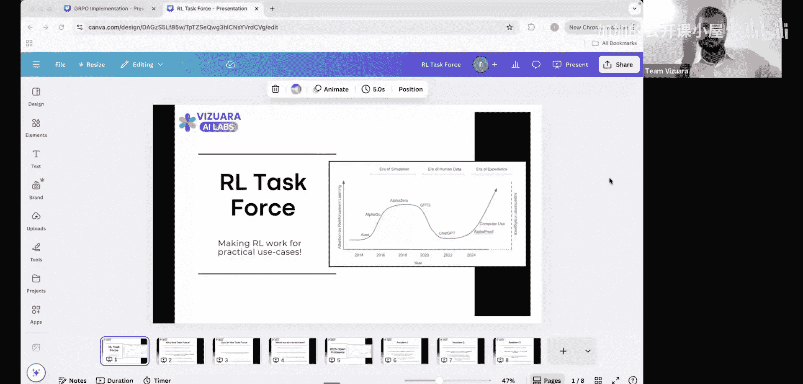
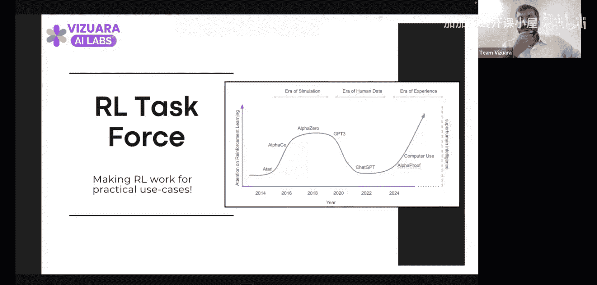
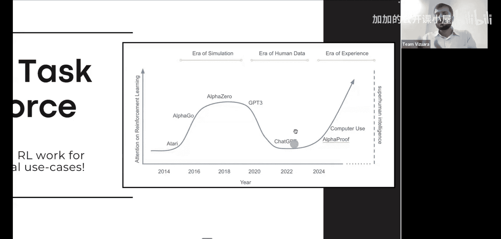
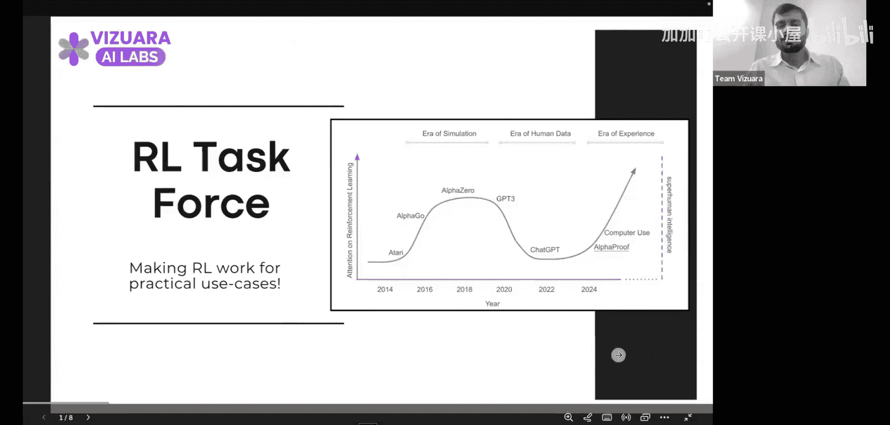
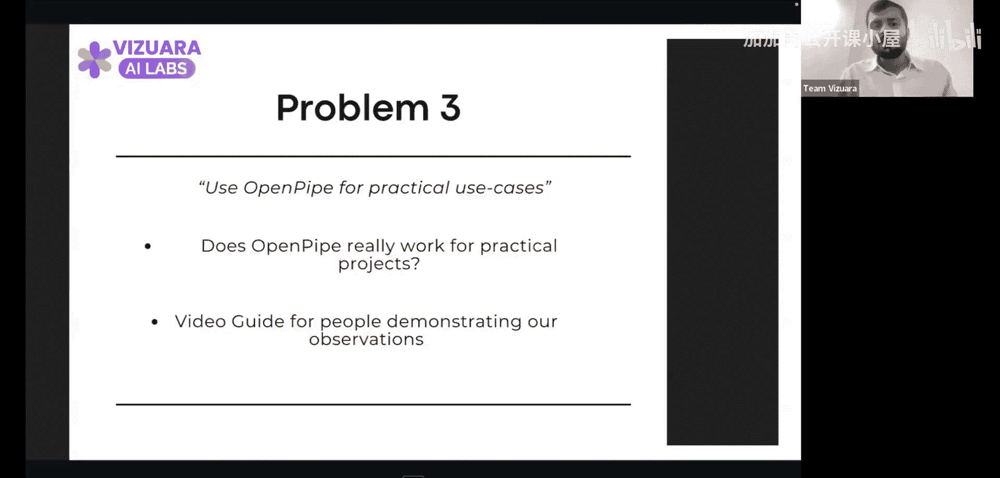

# Vizuara【中英⚡强化学习实践｜Hands on Reinforcement Learning】 p04 P4 GRPO From Scratch ｜ Hands-on Reinforcement Learning [BV1sdypBJEXw_p4]

Okay， everyone， let us get started。对。So today is the seventh lecture of our boot camp and we are going to cover a very important topic today。

 which is group Re policy optimization GRPO。Before we even start covering GRPO。

 I wanted to discuss something important with all of you。

So as you might have seen as the bootcamp progresses the number of people attending start to drop off is a very natural。

Learner' tendency， which we have seen in almost all of our courses until now。

But it looks like several of you have been seeing your names throughout these lectures。

 is which means that you are really passionate about this subject。So I want to share one。Initiative。

 which we have started at Vijara with all of you。

And this initiative is mostly started by recognizing the importance of reinforcement learning。

In the coming years， so if you can see from this graph， right？

From 2014 to 2018， we were in the era of simulation。

And then we move to the era of human data where we saw all these LLMs。

 which are powered by massive amounts of data they are trained with this much amount of data。

And then going ahead， because data is only so much。

 you cannot feed a huge amount of data or there is a limit to the amount of data you can feed。

To a model。所以。make sense that your LL M will。Going ahead your AI agent will learn from experience。

And this is exactly what we have been covering in the reinforcement learning essentially what this means is that the agent will try out different things in the environment。

 gather experiences and become better and better so this is marked as the third phase which is the era of experience and a lot of experts believe that we are slowly going to enter into this phase and to be able to successfully build agents which learn from experience reinforcement learning is at the heart of it。

So what we have done here is that。We have started an RL task force。

Where the objective is to make reinforcement learning actually work for practical use cases。

So what do I mean by that let me explain so basically currently there is a lot of happiness surrounding Ral。

People do not have a huge amount of clarityity as to whether to use RL， whether to not use RL。

And a lot of industries are in fact using reinforcement learning for many of their tasks in the post training part of their pipeline。

 but these are all proprietary use cases。And for a very long time。

 the reinforcement learning has been thought of as a very niche domain which only specialized experts can work on this was actually the case from 2017 to 2020 I would say when the PPO algorithm was developed and after that RLHF was developed。

And you needed to be someone who has played around with these algorithms。

For a long time to be able to actually achieve something meaningful out of it。

So the field was not readily accessible for people who are not immersed in that ecosystem before。

But now after 2021 onwards， things have drastically changed。And。

You you no longer need to be immersed in one of the top AI labs to be able to successfully run reinforcement learning experiments。

And there are several reasons why that is the case。I will list down some of the reasons now。

 some of them you might not be familiar with， but I'll explain this either in this lecture or the next lecture。

So one of the main reasons why RL has become accessible to a more wider community was。

Transition towards simpler algorithms like GRPO。Elimination of costly human preferences。

 data collection process。With the， let's say， the paper， which。

Talked about reinforcement learning through AI feedback， which is RL AIF。

Which says that you no longer need to have human annotators sit down and。

Give their preferences to have a chosen answer and a rejected answer。

 which is what is used to construct the reward model， but you can simply use an LLM as a judge。

So this immediately made the whole reward model construction process accessible to people。

Who do not have that much budget to， you know， pay people， help them annotate and。

This process used to take millions of dollars for open AI。

 and suddenly it was made very accessible for people like us who can run these experiments now。

And several reports have。Demonstrated that G4 is a very good judge it gives。

Preferences which are very similar to what humans can give。

So you can now intuitively understand what this means right， the moment you have LLM as a judge。

It means that the whole process of reward model construction just became。One level simpler。And then。

Recently three months back， there was a company called Open pipepe。

 which launched an open source library， which can basically。

Prain reinforcement learning agents on specific tasks。 So they， they took a task of。

Of an email research agent where the task is basically you search an email and retrieve the relevant information and they showed that reinforcement learning actually performs better than agents。

like。From the shelf directly， if you use any error imagess like lets say GPT Chde， Lama etc ceter。

 if you take a smaller model and train it using reinforcement learning it performs much better and recently they have actually launched this。

Library called RT I'll show that library to you in some time and that has made reinforcement learning even more simpler because。

It basically uses GRPO at the heart of it which is what we are going to discuss right now。

 but at least in my experience it was the first time when I saw reinforcement learning being used for agent tasks。

So far we have seen reinforcement learning used for fine tuning tasks， right making LLMs better。

 but we have not seen RL actually used for agentic tasks。

And that is when we start to think about RL in a much more broader context。

 initially we started with RL okay， fine we can play video games using RL。

Then we moved on to using RL with LLMs and then the next step is using RL with agents。

So that is still not a very well explored field， but。It is becoming very。

 very accessible to AI practitioners who do not have access to a large amount of budget。

So that's why I think it's very important to have a task force which is up to date with what is happening。

And then。You know， explore and exploit the use of RL for practical use cases。

So what we aim to achieve is to make production level RL accessible to everyone and remove the hiness and mystery surrounding RL and stay up to date with these tools。

 for example Openpipe has launched this brilliant tool but no one has made any kind of tutorial on it how to use that tool for any practical task。

So the goal is very simple to show that RL works。For specific cases or maybe it does not work whatever it is。

 but we need to give some quantitative proof that this is what RL can do and this is what RL cannot do。

So there are a lot of open problems which we have discussed。

 the first one which I released publicly through LinkedIn also was this tinyy RLHF to steer SLM towards human preferences。

And then the second project is。This was inspired from a discussion with one of the person from the boot camp I had last week。

 but then after our discussion I did some research and I found out that constructing reward model itself is sometimes not very easy and there have been very good progress in the last year where a reward model construction has been made significantly easier using LLM as a judge is of course an option but you can do even better so。

This is another problem where we empower people to construct reward models in a very smart way without using expensive setups and the third one is using open pipe for practical use cases so this is another project which I think has a lot of potential these guys have recently secured good funding also so it looks like。

