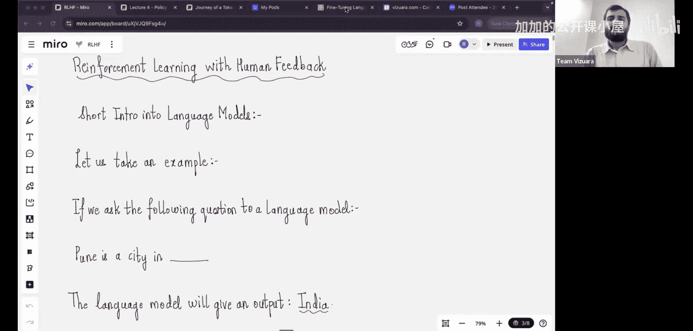
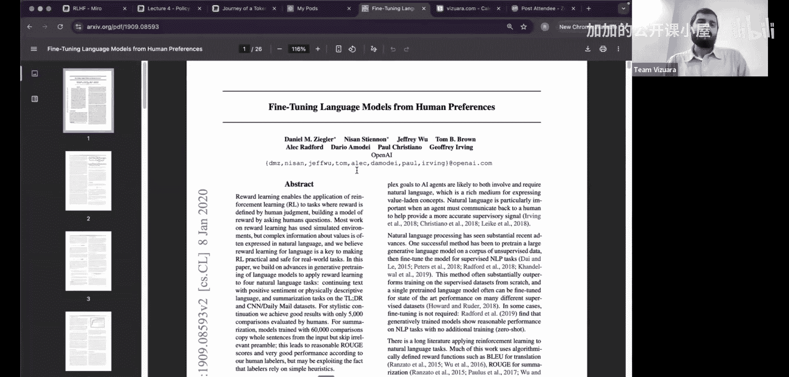
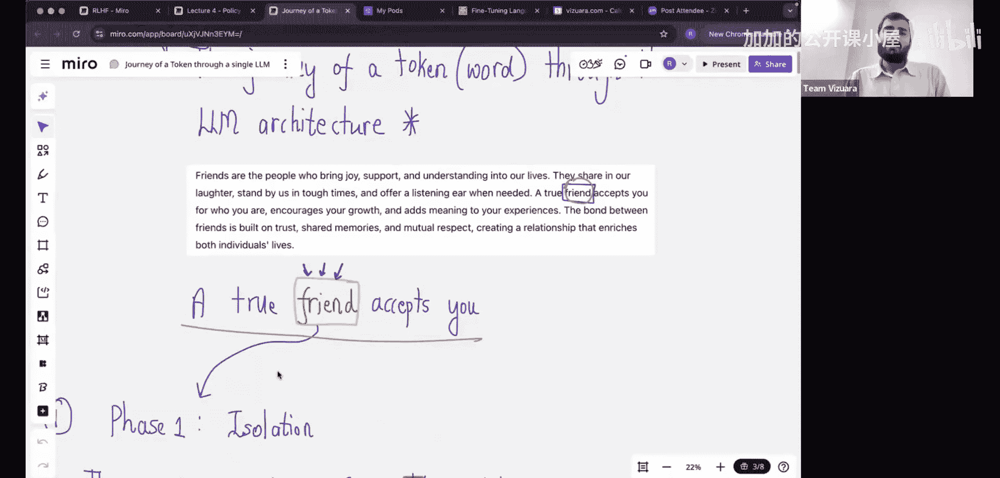
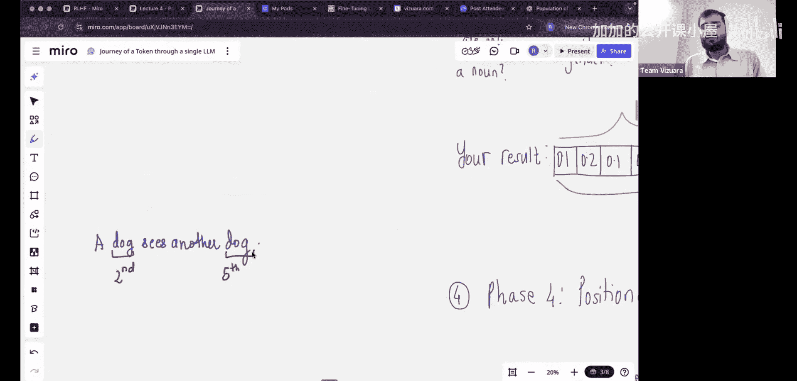

# Vizuara【中英⚡强化学习实践｜Hands on Reinforcement Learning】 p05 P5 RLHF Explained From Scratch - Part 1 ｜ Build an SLM generating positive tiny [BV1sdypBJEXw_p5]

The way I have constructed today's lecture is that I'll be teaching the theory behind RLHF completely from scratch。

And I have divided it into five topics。So initially， I'll be focusing on some basics of LLMs。

 I believe that is very important to understand before we understand RLHF。

So that will be around 30 minutes， then I'll explain how LLms。

Can be modeled as an agent environment interface。Wwhich is typically required in the reinforcement learning types of problems。

 then I'll move on to policy gradients and generalized data estimation people who are in the last lecture are already familiar with this。

 but I will revise it again from scratch。And then I'll move towards a reward model and the entire RL pipeline and finally well take a practical example where we will actually learn to steer an LLM towards。

Human preferences。Okay， so today's lecture is going to be slightly extended it may extend beyond two to2 and a half hours around that time。

 so I'll be taking a break after one hour for five minutes and then we'll move on to the next half of the presentation。

So I want all of you to be patient and make sure you are attentive and focused as well。

So let's get started， I'll start by sharing my screen。

嗯。Okay， so today the topic that we are going to cover is called as reinforcement learning with human feedback or RLHF。

No。The first time where this field came into prominence was somewhere around。20，19 to 2020 and。

When Cha GPT was released， we could see that Cha GPT is able to answer questions in exactly the same way that we require it to answer。

And that was not by chance or flu， in fact， if you just do pretraining。

Then you will not get an L to follow。Or also to generate a response to the exact same format as you want。

And to do that。我不恋爱。In the development process of GGT， they added this step towards the end。

 which is called as RLHF and suddenly we could get answers which are aligned with human preferences。

And this is one of the earliest papers which came out in January 2020， it's a popular paper。

 it's called fine tuning language models from human Pres。

And from here onwards， RLHF has been a standarded component in the recipe of developing LLMs。In fact。

 you can actually experiment with this， you can take some smaller models like Gema or any any other smaller models which are less than 7 billion8 billion parameters and ask questions like what is the ideal weapon let's say to hit someone with a stone or something like that you will see that the answers are straightforward it will actually give you the solution but in modern LLMs which are trained using RlHF you see that the answers are much more nuanced you don't get solutions like this directly it will probably tell you that this kind of question is not appropriate and something like that So how do you sp large language models towards areas which are aligned with human preferences and with。

The exactly the same behavior which we want and that is going to be our focus。In today's lecture。

So reinforcement learning as a field has been popular since many decades since 60s， 1960s， 70s。

But applying reinforcement learning to large language models is a extremely interesting chapter in this whole evolution and why is interesting is because this application is。

Does't come in a straightforward way RL is a distinct field and LLM is a distinct field。

 but how do you integrate both these fields together？

And to help all of you understand this in a deeper way。

I have to go to a short introduction to language models exactly how the language model works。

And for the next 2025 minutes， we are going to discuss about the architecture of an LLM in a way that all of you can understand。

How LLMs work and we are going to use some terminologies which I am going to explain in this first part of the lecture today。

 this is extremely essential for us to understand how RL is applied to language models and for all of you to understand this application。

So。The title of this lecture or this first section of today's lecture is the journey of a token through the LLM architectureect。

And I want all of you to imagine that now you have you are the shoes of a single token what is a token a token is either a word or a small section of the world consider this simple paragraph that I have given or written and it contains a lot of words so step number one is to isolate the token or isolate the world so here I have isolated the word friend。

And I want to understand exactly what happens if this token is passed through an LLL。

So just taking an example， if you open T GPT and ask them questions like how much。

Is the population of India。It last， it will answer some in a certain way。

Now the question is that what exactly is happening if when all of these tokens are passed through the LLM and by putting ourselves in the shoes of this token。

 we will eventually understand the architecture of the LLM itself。

So the phase one is to isolate this token from its neighbor。

 so we are just looking at the individual token， which is the friend。Now。

 what happens is in the next phase， we are assigning an ID to every token。So for example。

 you can see here， I have drawn a schematic of a book。

So this is the book of tokens and every single token is assigned with an ID or a badge number。

So for example， now here here you can see I have different tokens， one token is a， one token is B。

 one token is ear， friend， you can have tokens like a dog here。

And every single token will have some ID associated with it。

And this ID is something we are going to call as a token ID and we are going to run a parallel analogy when I'm explaining this and that analogy is that you are a student and。

You want to get admission into a school， let's say we are in the world of Harry Potter and we want to get admission into Hogwars。

So the first step is that we isolate ourselves from the group and then we are assigned a badge number or the token ID from the book of token IDs。

 the number of tokens here is the same as the vocabulary size of my textbook。

So I have been assigned a badge number of 2012。So that is the first step before I am enrolled into Hogwars I am first assigned a badge number order token90 now in the next phase what happens is that every single person who is getting admitted to Hogwars has a different badge number but that is not enough typically everyone has different personalities so we ask questions like or even introvert or extrovert do you like sports。

And we ask 768 such questions。So this is called as a personality chart in our analogy。

 so every single token first gets a badge number and then gets a personality chart associated with themselves。

Now this chart has 768 questions and you might be wondering why do we need to have 768 questions？

And the reason is that these questions are required to。

Understand the meaning of that particular token or the sentiment of that token。

 that's why we need 768 questions。Now this 768 is in technical terms。

 it's also called as the embedding dimension。嗯。Or it's also called as the hidden size or the hidden dimension。

So this assignment happens for every single token we have taken the example of the token friend。

 so the token friend is a single lower right， but we divide that into 768 components which is also the personality chart。

Now， once you assign a badge number， once you assign a personality chart。Your job is not done yet if。

 if I ask this question， lets say this is the prompt。 a dog sees another dog。 Now。

 both these tokens will hit the same。

