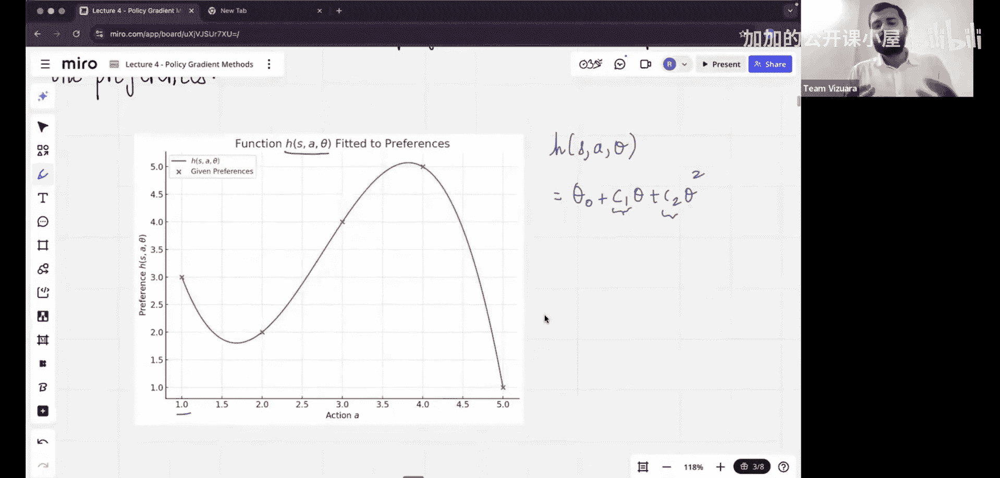

# Vizuara【中英⚡强化学习实践｜Hands on Reinforcement Learning】 p06 P6 Lecture 4 - Policy Gradient Methods from Scratch ｜ Hands-on Reinforcement Lea [BV1sdypBJEXw_p6]

So before we start。

I just want to say that today's lecture is going to be extremely important。

Because it's going to set the foundation for。The application of reinforcement learning in large language models。

And we are going to look at a concept today which is at the heart of RL applied to LLMs。

So let's get started I'll start by sharing my screen。Okay。

 so the topic of today's lecture is policy gradient methods。

And we are going to understand about policy gradient methods in complete depth。

So that you understand all of these algorithms you might have heard about PPO， GRPO。呃。

All of these algorithms are actually a derivative based on policy gradient methods。

So if you want to understand these algorithms， it is very important for us to first develop a very fundamental understanding of what is the meaning of policy gradient methods。

So let's， first of all， do a small recap of what we have done so far。

The question that we have always been interested in the reinforcement learning is that。

If I am in a specific state， then what action should I take in that specific state？

And this is told to us by the policy of our agent so far， what we have been doing is that。

First thing we looked at was tabular methods。Intabular methods。

We create a table where you have state selections as the first column。

And the second column is the Q value。And you keep on populating this table so that your estimates of Q values keep on getting better and better。

But the problem is that this method is not scalable。And why it is not scalable。

 it's because as your state and increase， the number of entries in your table also increases。

So it is not possible for us to use tab methods when looking at complex problems like。

The At game simulation， which we looked at in the last lecture。So， then。

How did we modify our approach then we said that okay fine let's not do tabular methods anymore。

 but instead of that we will construct the neural network。Search that。When， given a state。

It will predict the Q values for all the actions for that specific state。

And the advantage of constructing such a neural network is that。

You do not have to maintain lengthy tables， but rather now you have。A trained neural network。

 which you can use。To predict the Q values of the states and actions which your agent has not seen in the past before。

 so this made representation of large scale systems suddenly possible to us。

We could represent complex games， complex environments where there are huge number of states ands without having to write all the single details。

In a table and we looked at a very nice example of this in the last lecture where we will learned how to build an agent which can play video games。

By using the neural network to approximate the Q values。

So this is what we looked at in the last lecture。Now we are going to go one step further。

The question that we ask is。Currently the way we are taking our actions is we are asking the question for every state and action。

 what is the best Q value or for every state which action has the best Q value and then you choose to take that action for that specific state。

Now we ask the question that can we do something better than this？To give you an analogy。

 let's say we want we are in a specific state right now and we want to go to a destination。

Let's say I'm going from a city a to a place big in the same city and there are five different actions I can take。

Now， whatever we are doing right now is basically we are calculating the time taken from lets say point a to point B and we are choosing the path which。

Allows us to get to point B in the best possible time if that's the reward we want to optimize。

 but we are not directly answering the question， which part should I take？

Now the question we are asking is that given a state can I directly get the probability distribution for all possible actions？

Without。Going through the Q value。So。Q value is almost like something which we we have based our policy based on the Q value。

 but you might ask the question that why is this Q value required why can't I directly get my policy why can't I get a pro distribution for every state which looks something like this let's say I am in a specific state and there are three possible elections。

And the probability distribution looks like this。This is 03 and this is 0。8， let's say。

And this is even a2 and A3。So I can clearly take action A2 for this specific state because the probability is the highest or rather I take action A2 with the probability of08 and then I take other actions with a less probability。

So。In today's lecture， we are going to look at a class of methods which completely bypass the need to calculate the Q values。

 and they can directly give you the probability distribution for every state。

And this is extremely efficient in terms of。Implementing reinforcement learning problems for large scale systems。

Because it directly allows us to estimate the policy without going through the intermediate Q value functioning between。

And these class of methods are called as policy gradient methods。

 so let's try to understand them in detail。So so far we have looked at action value function and asked the question for every state which action is giving me the maximum Q value。

Now， what we'll be doing is that we are going to learn。

An optimal policy without considering the value function at all。

So my objective is going to be to estimate pi of a givenS。

 which means what is the probability of taking a specific action if the agent is inside a specific state or if the agent has collected a specific observation from the environment。

And this is going to be denoted as pi of a givenness。

And we are also going to introduce a parameter theta， which is called as the policy parameter。

So this is how we are going to write our policy pi of a given s comma theta。

Because our policy is dependent on the policy parameter theta。Now， let's。

Take a deeper look into what exactly does it mean to have a policy parameter。

Lets construct a hypothetical example， let's say we have a state S and there are five possible actions in the state。

And these actions are denoted by A1 a2， A3， a4 and A5。

And on the right hand side we write down the numerical preferences for these actions。

 so a1 has a numerical preference of 3 a2 has2 a3，4， a45 and a5 is the most preferred action。

 which has the preference of1。Now my objective is to convert these preferences。

Into a policy representation using a policy parameter theta。So let's see how we can do it。

 Some of you already might have some intuition about this if you have。

Learned about the soft max function before， but if not Im going to explain that again right now。

 so first of all， let's try to capture this through some kind of a polynomial let's say we capture it。

Through this polynomial。So you can see that this polynomial perfectly goes through my data for action 1。

 the preference is 3 for action 2， the preference is 2 and for action 5， the preference is1。So this。

Function can be written as。Theta 0 plus c1 Theta plus C2 theta square， let's see。And we have。

Estimated this C1 and C2 so as to fit this data。So this is an example of a function which we have。

Parameterized with a parameter theta。Theatta can also be thought of as weights as you。

As you see， when you think about neural networks， you have weights。

