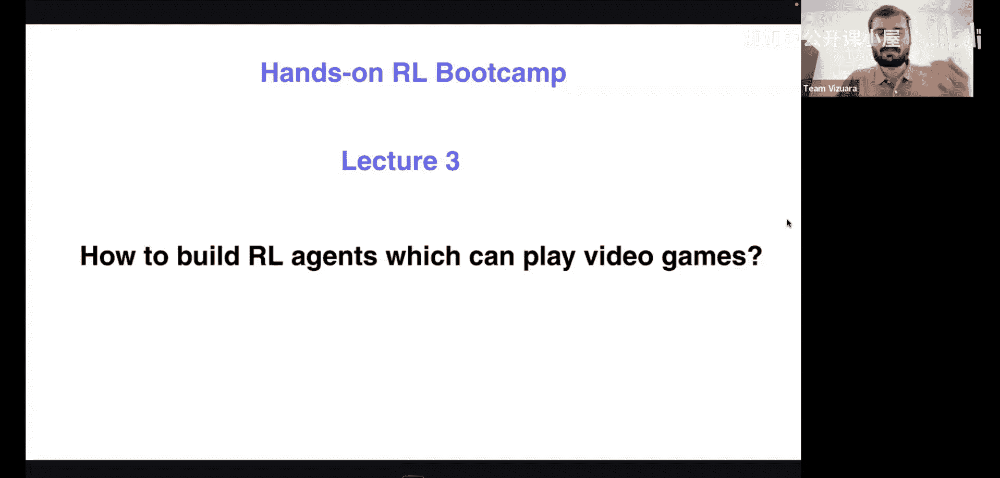
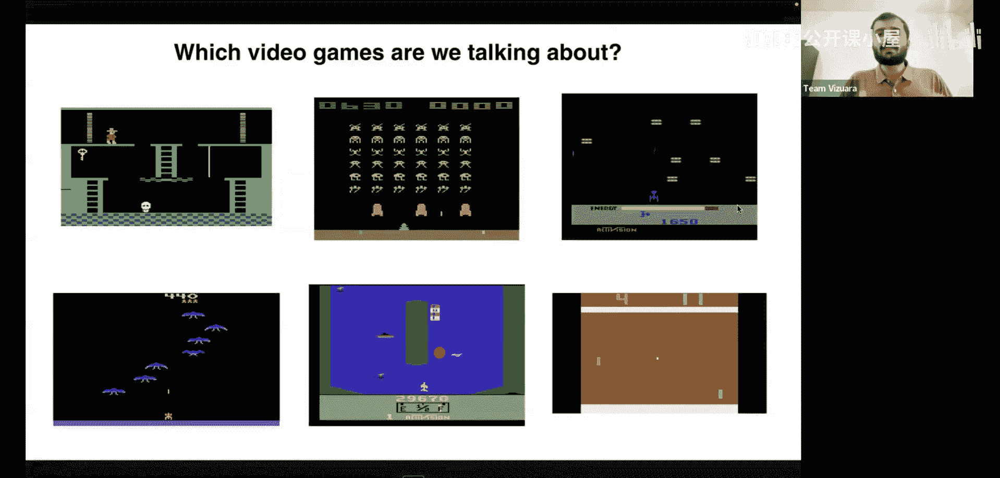
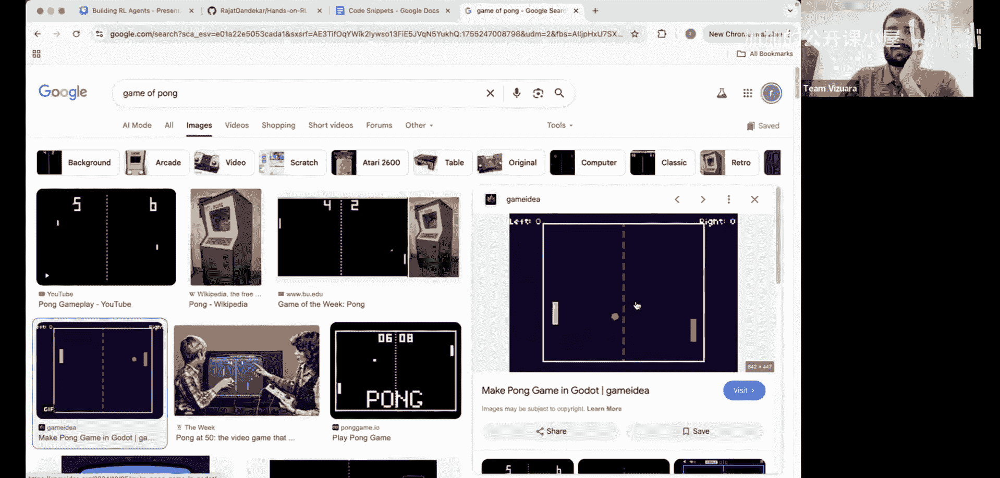
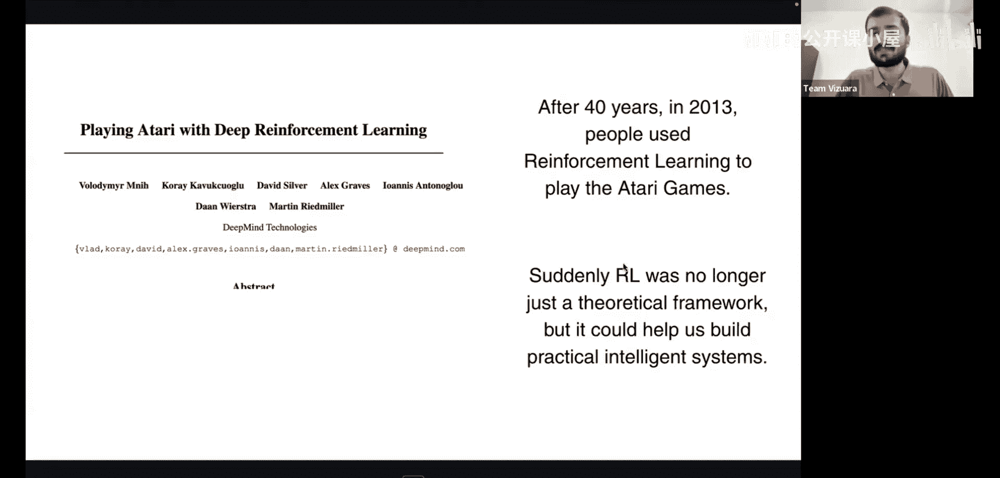
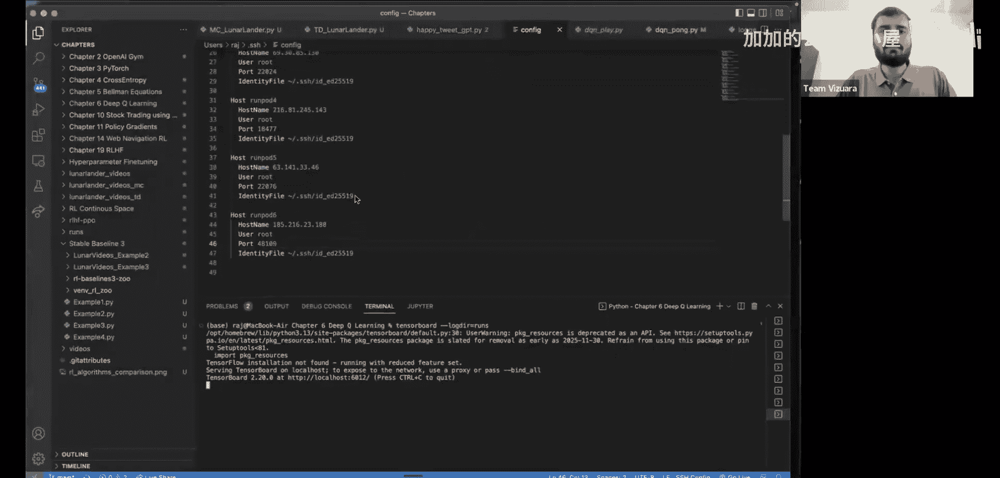
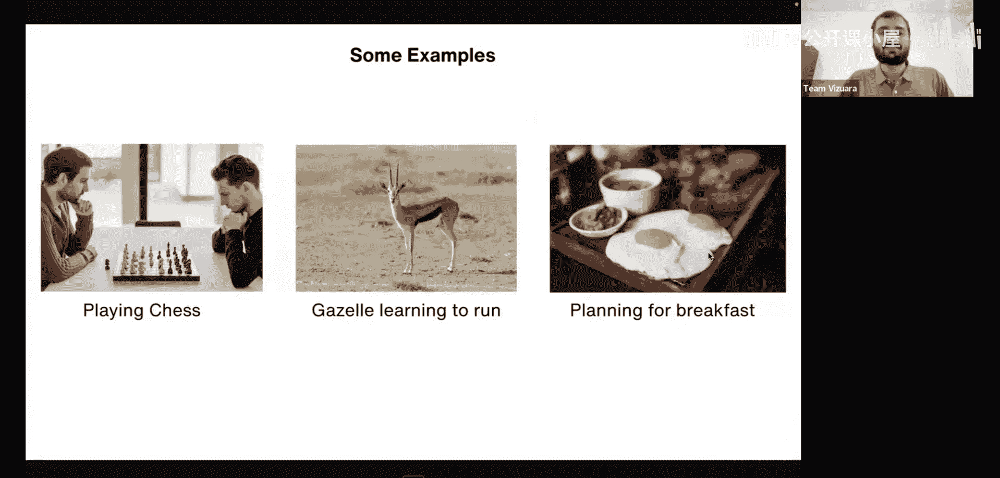

# Vizuara【中英⚡强化学习实践｜Hands on Reinforcement Learning】 p07 P7 Lecture 3 - Deep Q Networks ｜ Hands-on Reinforcement Learning [BV1sdypBJEXw_p7]

Okay everyone， let us get started with today's lecture。

So today is I would say one of the most interesting lectures of this boot camp and is it is very much practical。

So let me start sharing my screen and let's start to understand this。Okay。

 so today we are going to understand how to build RL agents which can play video games。

And we are first going to understand this topic from a historical perspective。

 and then slowly we are going to build our understanding to be able to build this a region by ourselves。

So let us get started。

So first of all which type of video games are we talking about so these are the type of video games we are talking talking about I'm not sure how many of you have played such video games which。

Were not necessarily having the best of graphics， but they kind of looked like this。

So I have definitely played these video games， these are also called as arcade games actually。

So you can see that the graphics quality is really poor。 today's video games are。

Have have much more clarity and are much more realistic。

 but today we are going to learn how to play one such video game。😊。

So the history of video games has been that the first ever video game to be built in an arcade was developed by Atari in the year 1972。

 which is around 53 years back。So it was a coin operated video game you had to insert a coin and then play this game of pong and the concept was completely revolutionary at that time。

You can actually check out out pong as I'm going along in the game of pong what happens is that you have you have a paddle and then the opponent has a paddle。

 Maybe I can show you how this。Game， game plays out， so。

This is how the game of Pongga actually looks like。

So you can see here， let's say the the ball moves around and then your goal is to get the ball past the opponent。

So basically， you can either move your paal up and down。

Or you cannot do anything and just keep the paddle the way it is。

 The concept was completely revolutionary at the time， and people really loved it。

 No one knew what was video games before。 But then this was first installed in a in， in an arcadeing。

😊，Now， this was fine， but it was still not available for people at home because these arcade units were very big and they were installed in some kind of。

Area which had a big space， so it was not available for people to be consumed at their houses。

So then this was the case until microprocessors became available in the year 1975。

So because microprocess became available in 1975 Atari released the home version of Bong。

 it was a self contained unit you can just plug it into the TV and play you can see how you can plug this into the TV I'm showing this on the image on the left。

And it was an instant hit you can you can imagine why kids love playing these kind of video games and this was exactly 50 years ago so and then this made home gaming completely mainstream。

So this， this has been the history of video games， how they have evolved over the years。

And then in 1977， the arcade video computer system was launched and then。

It sold even more number of units， it sold four LA units。So these video computer system or VCS。

 they had knobs which you can control and then you can control the characters in the video games with the help of these small little knobs which you can see on the screen。

But then。Okay， fine we brought the video games from an arcade or a big space level to homes。

But then people are still not satisfied。 We wanted to write codes to。Interact with the system。

Autonomously， and then people ask this question that can we develop an AI which can actually play these video games。

Can intelligent systems be developed like that？呃。So after 40 years that is in 2013。

 this idea was actually actually proven in this paper。

 it's a very famous paper it gave rise to the birth of the field of deep reinforcement learning and it was published by Deep Mind。

And then suddenly people realize that reinforcement learning is not just a classical theoretical framework。

 which。Looks great on a piece of paper， but there are a lot of practical applications。

And when you will see this in in today's lecture， you will actually。Get this feeling that， okay。

 I have actually built something is which is truly intelligent。

That feeling I personally did not get when I used supervised or unsupervised machine learning algorithms because you knew what youre doing。

 you're giving a lot of training data to the system and then the system is learning from it。

But with reinforcement learning， it almost feels like you are developing a colon of a human who is intelligent。

And that's what people realized after 2013。And you might have realized that this coincided with。

The boom in convolutional neural networks when AlexNe was developed around a similar time。

So the boom of deep learning coincided with this paper coming out very nicely。And this was。

One of the main reasons why the field was reborn。I wouldn't be wrong in saying that if this paper would not have come out。

 ArL would have been a data field， people knew that okay it is promising but no one had really seen any good applications coming out of it。

So I'll just stop sharing my screen and load one more presentation。

Okay， I hope you can see my screen so after this。Now we are going to understand how exactly did this transformation happen and we are going to replicate this paper playing Atari with deep reinforcement learning in today's lecture that is going to be our major objective of today's lecture and we are going to do that in four or five parts and I am deliberately going again through the basics of Ar because some of you might need that revision before I directly jump onto the main concepts which are introduced in the Atari paper in 2030 so this consider part1 as a revision of all we have covered so far in a very simplistic terms so that you can easily understand。

In reinforcement learning we have an agent environment interface。

 so typically you have an agent which receives a set of observations from the environment or states and then based on these set of states。

 the agent performs an action。According to a policy pie。

 and then after the agent performs the action， the agent receives a reward from the environment。

And then again， it。It takes an action， receives another reward， and this process continues。

So all the reinforcement learning problems are first modeled in the agent environment interface with states actions。

 rewards and policy which guides the behavior of the agent。

Some examples that we looked at classical examples， playing chess， a gazee learning to run。

 then planning our our breakfast in all of these examples。There is a specific goal in the mind。

 so for example， when I am playing chess， my goal is to win against my opponent。

And。At every state， which is a configuration of the。

