# Vizuara【中英⚡强化学习实践｜Hands on Reinforcement Learning】 p08 P8 Lecture 2 -  Three Pillars of Classical Reinforcement Learning｜  Hands on Rei [BV1sdypBJEXw_p8]

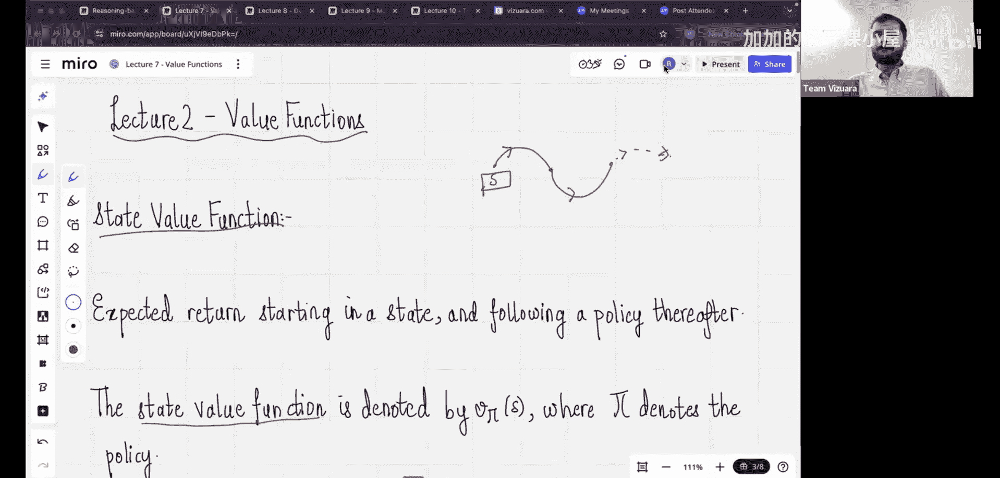

Okay， so before we move on to today's lecture， I want to quickly recap。

What we covered in the last lecture so in the last lecture we started looking at the very basic four elements of reinforcement learning。

And those four elements were。Number one was the policy。Number two was。Three workss。

Number three was value。Values and number four was。Model of the environment。So。

What these four elements mean is that the policy is something which tells you the behavior of the agent at every state of the agent。

 the agent needs to pick the best possible action and this action selection is guided by the policy。

So that's the policy then rewards are for every state which the agent encounters。

 the agent takes an action and immediately gets a reward from the environment。

That's the second element values is something very different from rewards。rewardwards is only。

Considering about short term desirability， but in value。

 we are considering long term desirability of the state we are not just。

Individualally evaluating single rewards， but we are adding all the rewards together till the end of the episode and we are evaluating the return which the agent receives in the episode。

 not the reward。So that is the value and last is the model whether it is a model free or a model based environment。

 so many examples in this boot camp we are going to mostly look at。A model pre environment。

Then what we looked at is we looked at specific type of state signals which satisfy a very unique property that。

To determine the dynamics of the system， you don't need to know anything other than the current state of the system。

 You don't need to know the history of the past。 Whatever has happened in the past。

 we are going to say that okay we don't care what has happened in the past we are only concerned about we are only concerned about the present state of the agent and all I need to know to predict the future is the present state and this property of the state signal is called as the mark of property。

And the state which satisfies that is called as a Markovvian state or a Markov state。

So in the remainder of the boot camp we are going to be only looking at processes which are Marovvian in nature。

 so when I say that I mean all the statess or observations。That we are going to encounter。

 they are going to satisfy the mark of property that' is going to be the implicit assumption in all the examples that I'll be discussing even today。

 so I won't reiterate again and again that dis satisfies the mark of property here。

Towards the end of the last lecture， we saw how to work around with Open air gymnasium and how to control a lunar lander。

To land on a surface。But we notice that we are missing one key element there， which is the policy。

That's the reason we took random actions for every state。

 The objective was to show you that reinforcement learning can be very practical also and。

I wanted to give you a flavor of how to implement the agent environment interface。In practice。

So in today's lecture， we are going to focus on this part。So in particular。

 we are going to look at how to。Take actions that make sense instead of taking random actions for every state。

And everything boils down to this。You can model a reinforcement learning system very nicely you can tell me that Ive modeled the agent environment interface。

 these are the states， these are the rewards which my agent is receiving and these are the type of actions but it won't be useful at all unless you tell the agent what actions to take at each state and that is exactly what we are going to focus on today。

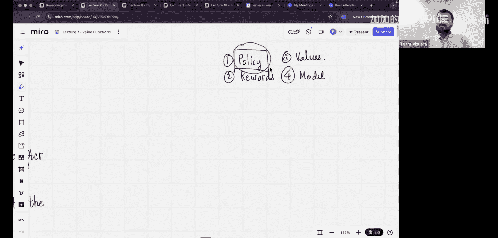

So。Whatever we are going to cover today comes under the field of classical ael。

It is extremely important to understand all the modern reinforcement learning algorithms and I would say this part where all the major development has happened。

 everything that has happened has built upon the classical reinforcement learning algorithms。

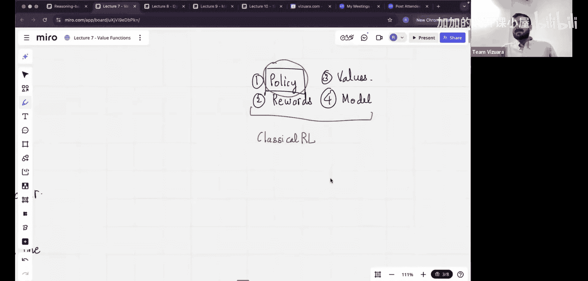

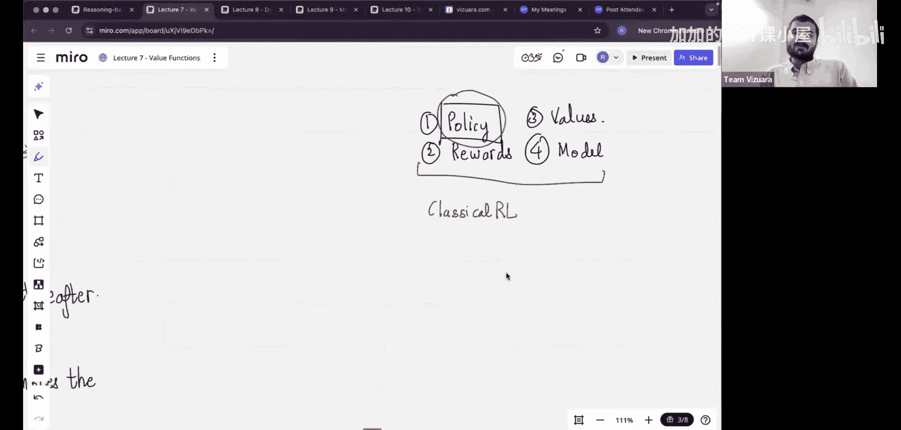

So we are going to look at when。

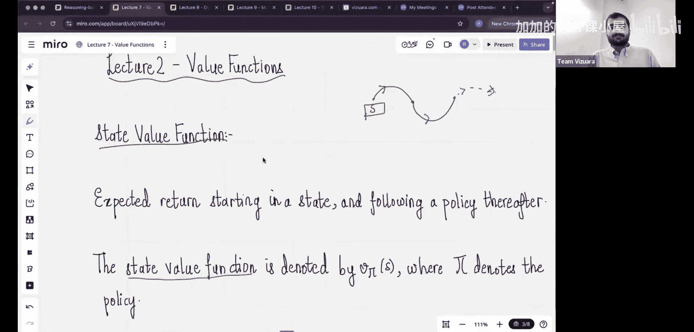

Important definition to start this lecture with and that definition is called as the state value function。

Right now， we have only discussed about。Or valuesal。In an intuitive way。

 but we haven't really discussed about what is the meaning of value of a state。

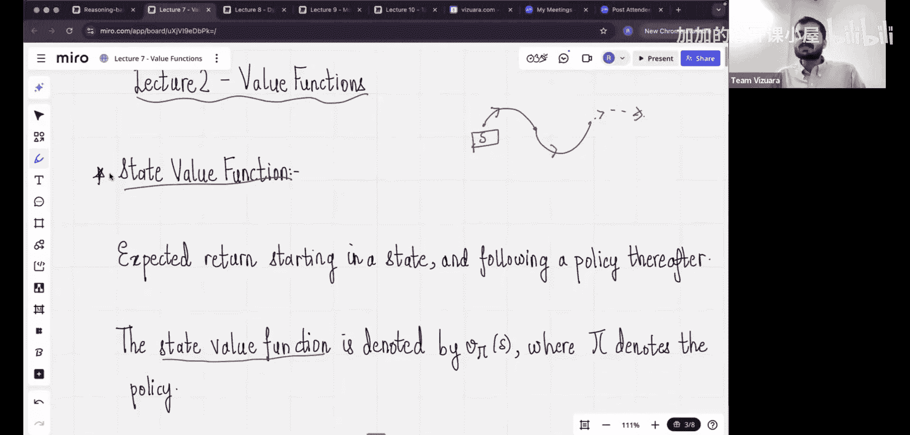

And I'm going to explain this with the example。Let's say。You are at a specific state。

And there are a bunch of actions possible in that state， but you take action A。

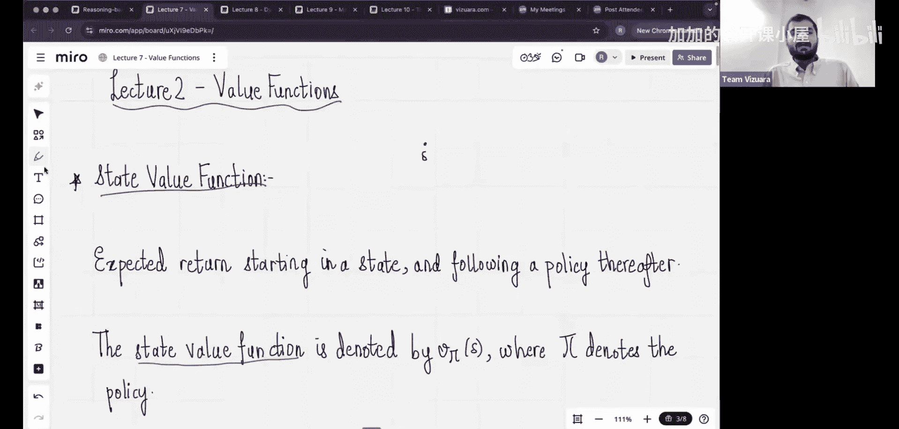

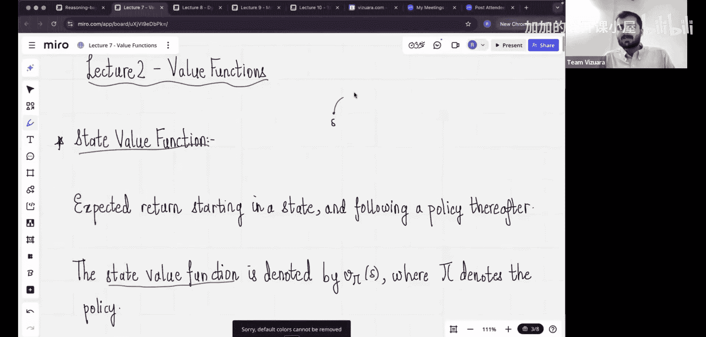

You land in state as well。You take action E2， you land in state2。Similarly。

 you continue it till you take。Action 80 and Land in state ST， which is the end of the episode。

The question that I am asking is， what is the value of this state？

And the way we formulate it mathematically is。We look at all the rewards which the agent receives so from S to S1。

 the agent receives a reward of。I。From S1 to S2， the agent receives a reward of R2 and here in the last step the agent receives a reward of Rt。

So the value of this state is going to be the summation of all those rewards R1 plus。

R 2 plus dot dot dot Rt， let's say it comes out to be 30。

So then you might ask me the question that Ra， this is fine， but what if？In the next episode。

 this agent follows a completely different trajectory and you get a expected return of 50 or a return of 50。

So these returns might vary for different trajectories or different episodes which the agent follows。

So what we do is we take the mean of all this。In other words， we take the expected value of。

The return。Remember in the last lecture we talked about returns， which is denoted by G of T。So。

Essentially， how we calculate value is that we say that let's run the agent for let's say 10 episodes。

We calculate the return for each episode， we add them up together and we divide by 10 to calculate the mean of all the returns。

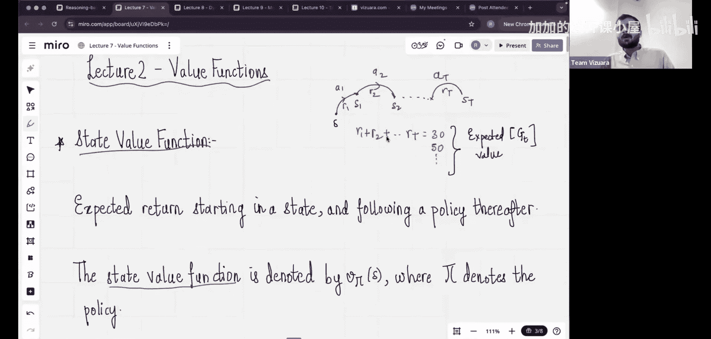

So this is exactly what。The value function of a state is defined formally。

 it is defined by saying that the value function is the expected return which the agent receives。

Starting in a state and following a specific policy thereafter。

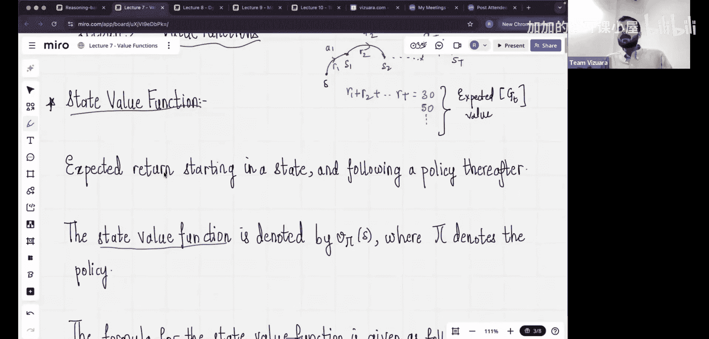

I never told you what how I am choosing these actions that is implicit in my explanation I am assuming that some policy is known and actions are selected。

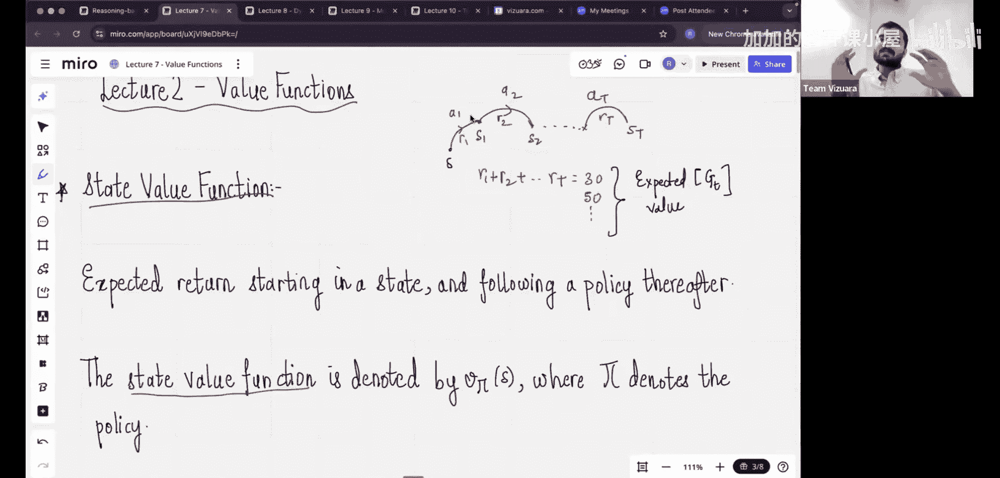

And this state value function is always denoted by the symbol VI office。

 whichever papers of reinforcement learning you will read。

The community has been incredibly consistent with all these notations。

 which makes paper reading somewhat easier in the field of R。 So whenever you see v pi office。

 it means that we are calculating the value function for a particular state， which is the。😊。

Expected value of the return， which the agent receives。

Starting with that statement and following the policy thereafter till the end of the episode。

So this policy is renoted by file。

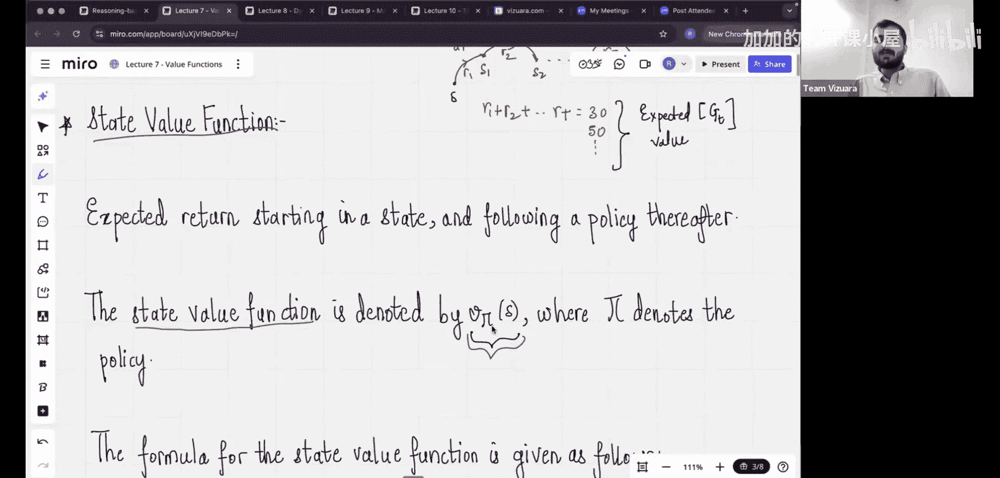

And the formula is something we have already seen before。

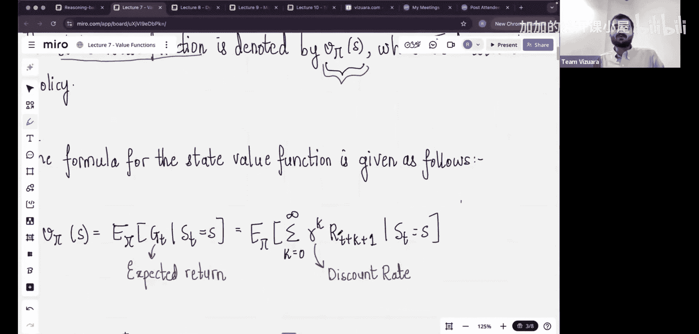

It's the expected value of G of T where G is the expected return。

Or G is simply the return and remember how we calculate G。

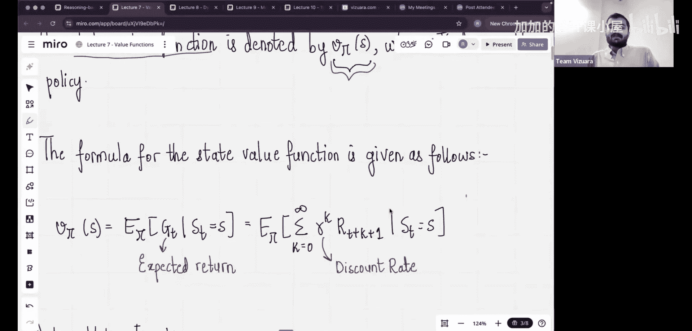

We don't just do R1 plus r2 plus r 3， but we do R1 plus。Gmma times are 2 plus。

Gmma square at times are 3 plus dot dot dot。So here gamma is the discount factor and we do this because。

Immediate rewards are more valuable compared to rewards which are received later in the trajectory of the agent。

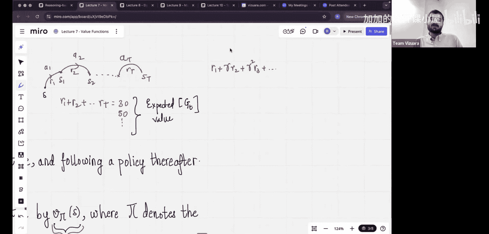

So mathematically， this is expressed like this。It's okay if some of you are completely uncomfortable with this Sigma notation。

This is called as a sigma notation where you have an index running from zero to in infinity essentially what you are doing is that you are summing up all the。

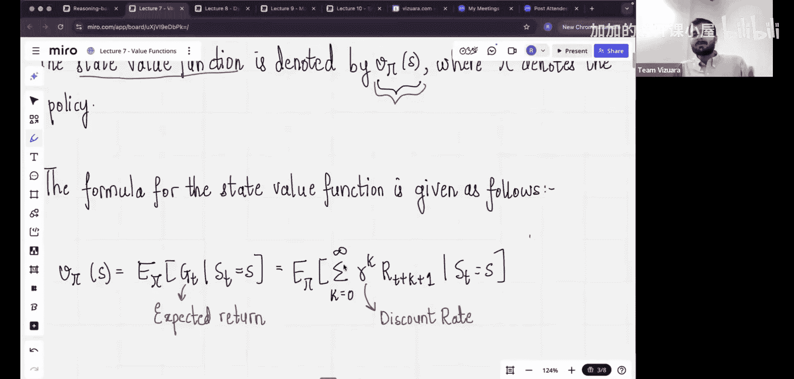