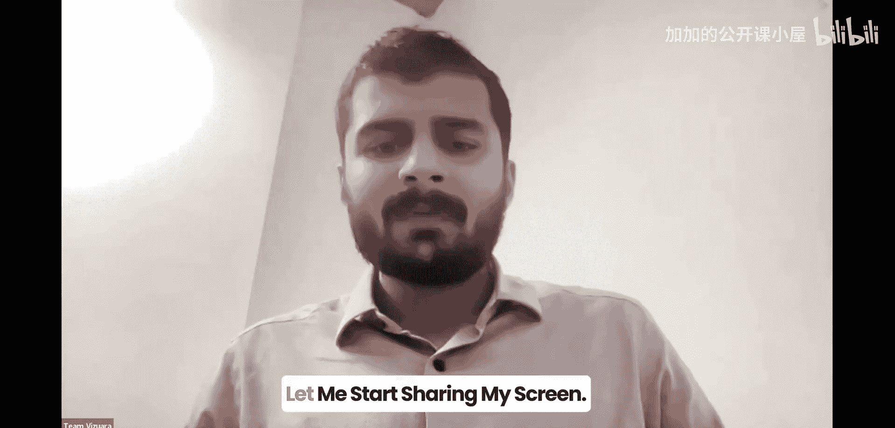
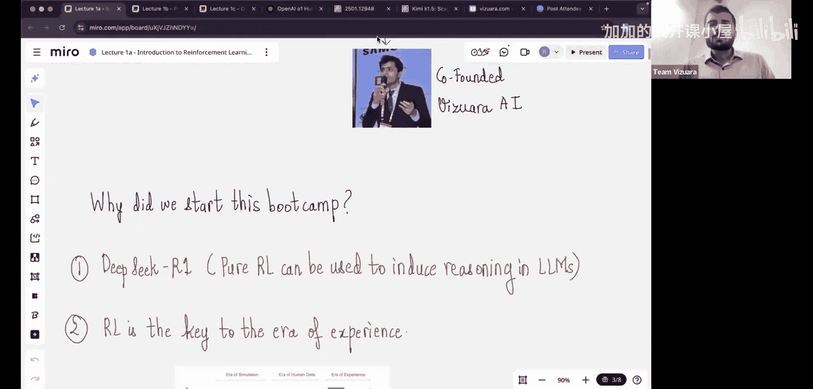
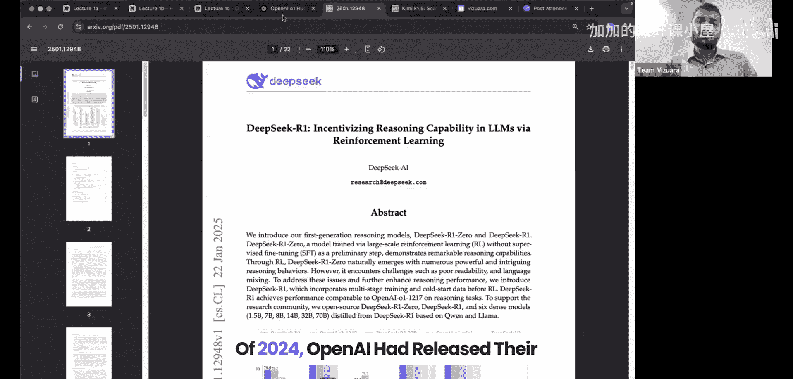
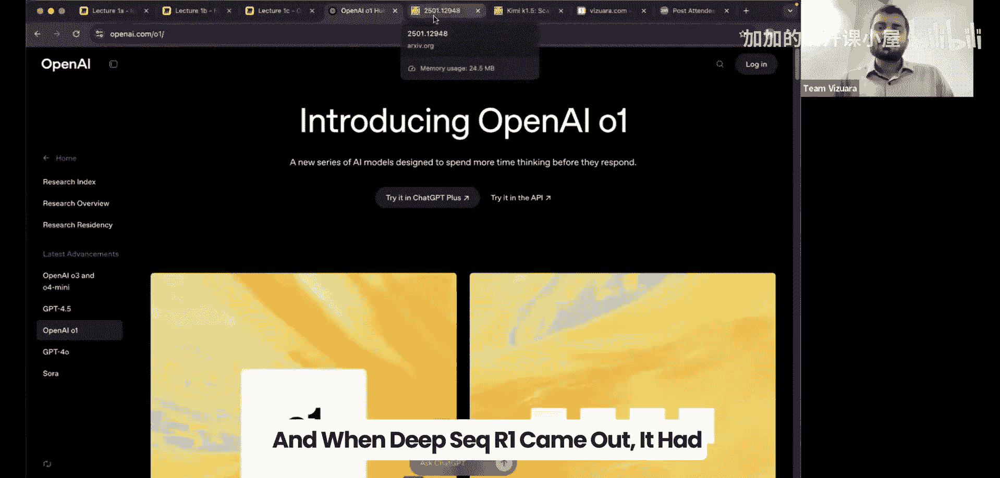
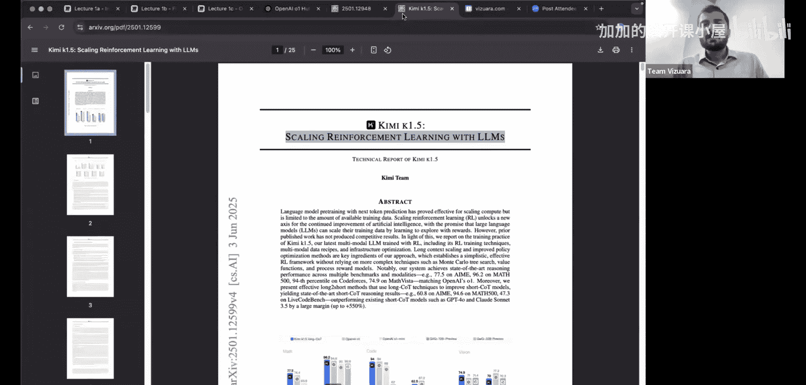
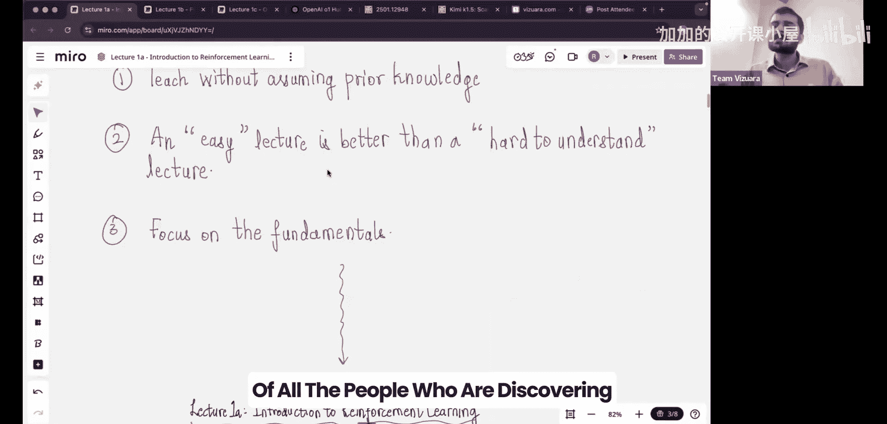

# Vizuara【中英⚡强化学习实践｜Hands on Reinforcement Learning】 p09 P9 Hands on Reinforcement Learning - Lecture 1 [BV1sdypBJEXw_p9]

Okay everyone， let us get started， so welcome to this boot camp called as hands on the reinforceforment Learning。

Let me start sharing my screen。

Okay， so。Firstly， about me， I'll be the instructor for this course。

I'm one of the co founders of Visura， I have pursued my ViTec and MTch from IIT Madras。

 and after that I have pursued my PhD from Purdue University。And then after completing my PhD。

 all of us me Rajansther we returned back to India。

And we started this venture with a mission to make artificial intelligence really accessible for all。

And we are covering a topic today called reinforcement learning， which。

Has always been somewhat in the sidelines up until this year where deep sequs released and suddenly reinforcement learning came back into the linelight again。

So let's get started， first of all， why did we start this boot camp right now？诶。

So one of the main reason was the release of this paper called deep sea carbon， this paper came out。

In in the January of this year， and it really shook the world and the reason that happened was that before deep sea came。

In the September of 2024， Open AI had released their first reasoning model called Open AI O。

But the problem was that this was a complete black box people had no idea how they had made reasoning work。

 it could be anything inside the black box。And when deepepse I came out。

It had accuracy levels which were quite comparable to that of open AIO。

Which made people suddenly realize that， okay， whatever these people have done in the paper。

 it must be similar to the recipe which Owen has followed。

And I want to take you to one figure in this paper called yeah， this is。

This is a figure which is called as the Aha movement。Just take a look at the caption of this figure。

 it says that an interesting aha movement of the inter version of deep C carbon10。

The model learns to。rethink using an anthropomorphic tone and this allows us to witness the power and the beauty of reinforcement learning。

So deep seek showed that you cannot induce reasoning in an LLN without having reinforcement learning at the heart of it all。

And after deepy paper was released there has been literally a spge of reasoning models coming out of all the AI labs。

 everyone Gemin and I anthropic Po AI are continuously releasing reasoning models recently there was a model called Kmi K 1。

5。And this entire paper is dedicated to reinforcement learning。

So reinforcement learning has suddenly caught the limelight and people have started to take it very seriously。

 another reason which I personally feel why RL is going to be very important in the coming years is because。

If you look at where we are right now， where we are presently， we are using a lot of LLMs right。

 but these LLMs have a very important phase called pretraining which is trained on a huge amount of data so we are still operating in the era of human data without the knowledge of the data the LLM is not really smart。

Now we are slowly entering into the era of experience what does the era of experience mean it means that the agent will experience events by itself。

Learn from those experiences and iteratively improve from those experiences。

 So we don't have to give a lot of data to the agent， but the agent will acquire the data by。

interactacting with the environment and learning from it。

 and this is exactly what the field of reinforcement learning actually talks about。

So so far right reinforcement learning have been associated with these video games a lot of you might have heard that RL is used to play。

Atari games and。That was a big breakthrough moment。And then。

Alphago was another example where reinforcement learning was used to。

Make artificial intelligence really clever in these games。

 but no one really applied RAL to LLMs in the last two three years。

 in fact Chad GPPT could not have been made without the invention of reinforcement learning through human feedback which was at the heart of aligning the LLMs towards human preferences。

So the reason Im talking about all of this is because I really think from the bottom of my heart that reinforcement learning is going to be a very significant driver in the AI revolution in the coming years。

And we should。Focus to understand the concepts behind RL and then slowly progressively understand how reinforcement learning is used in large language models。

Now how has RL progressed through the years， if you look at the timeline。

 the field itself is not very new， it has been around since 1950s and from 1950 to 1990 is the era which we call as classical reinforcement learning。

And then after 90s all words， we had a transition towards policy gradient methods。

And to 2013 onwards。People started talking about using neural networks。

In the reinforcement learning problems， so the field of deep reinforcement learning was born。

And then 2018 onwards， we started using RL in LLMs。So you can see there are these four errorss。

 which。The AI community has seen with respect to reinforcement learning。

 so whatever we are going to cover as a part of this series。

You are going to be closely witnessing the work of brilliant scientists through multiple decades。

 how they have invented these algorithms。And we could not be here using Cha GPT without understanding the contributions of all all these giants from 1950s。

 so this course is going to be arranged in such a way that we cannot truly understand modern reinforcement learning unless we appreciate classical RL because classical RL is really at the heart of it。

And then we are going to slowly advance and move towards modern reinforcement learning and understand how reinforcement learning is used in large language models that is going to be one of the key focus in this bootcm。

So。What is my goal， my goal is three things， first thing to help you deeply understand the theory behind ArL。

To give you the confidence to set up and write codes to solve viral projects recently I was having conversation in our company and people have this general belief that reinforcement learning is a very theoretical field。

 They don't really know how to build R agents on their own。

 so my aim is to break that that perception and give you a sense of how reinforcement learning can be practically。

deployed， it is as simple as deploying neural networks using pi orchard tensor flow。

So I want to help you get that confidence as well， it's not going to be just a theoretical course but it's going to be very practical also that's why the name is very suggestive it says hands on reinforcement learning。

And then I want to help all of you develop a deep sense of enjoyment for the field。

 I have a specific bias towards reinforcement learning compared to other disciplines within AI because I believe that RL is something very close to the human experience whereas other fields are not that close but as you will see in this lecture reinforcement learning is quite similar to how humans think so you will feel a natural sense of understanding as I'm progressing through the topics。

And then when you see an agent actually learn from experience it almost feels like I'm simulating intelligence in my computer。

 so I had that feeling when I first implemented these agents on my own。

So I want to transfer that deep sense of enjoyment to all of you as well。

And then my teaching style that Ill not be assuming any prior knowledge。

 and I believe that an easy lecture is always better than a lecture in which people say it was hard to understand so。

That is my philosophy and I'm going to be focusing on the fundamentals。

One thing Ive realized is that if your fundamentals in RL are very clear and very spot on。

 it helps while you are using reinforcement learning algorithms in practice so you need to have an understanding of the theory as well。

So now let's rewind 50 or 70 years back and。Try to be in the shoes of all the people who were discovering this nascent field at that time。

First of all， let's understand。