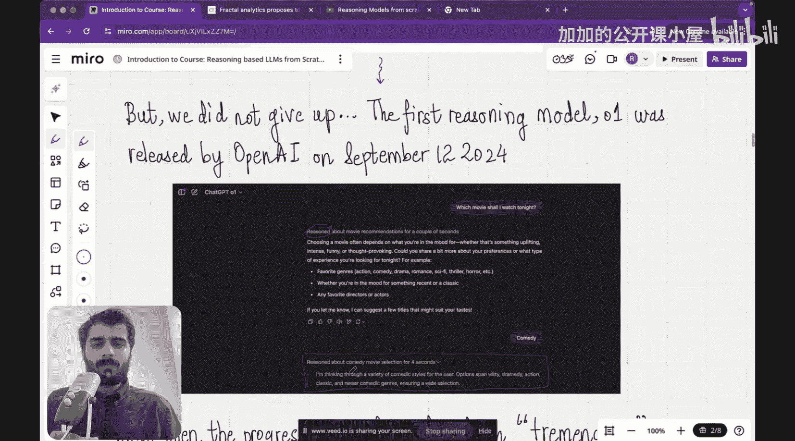

# Vizuara【中英⚡从零开始构建推理LLM｜Reasoning LLMs from Scratch】 p01 P1 Reasoning LLMs from Scratch - Series Introduction [BV1N3xWzWETL_p1]

🎼Yeah。

Hello， everyone。And welcome to this course on the reasoning based large language models from scratch。

We are incredibly excited to launch this course and to be able to provide this knowledge to all of you。

So before we get started， I would like to introduce myself。My name is Dr。

 Ra Ddiker and I will be your instructor for this course。This is the first course that I'm teaching。

As a part of our YouTube channel， you might get me confused with Dr。

 Raj who has taught courses like building your realLM from scratch or ML teach by doing or build neural networks from scratch I am his twin brother don't confuse me with him。

Okay， so a bit about myself， I have done my BT and M tech from IIT Madras and after that。

I did my PhD from Purdue University in the US。I have always been a very passionate teacher and educator。

In fact， during my college days， there were a lot of friends and people who advised me。

That you teach concepts very well， why don't you become a teacher？

But I was very passionate to do research at that time， so I went ahead and did my PhD。And then。

After all， my calling came after me and I co found in Vijara along with Rajan Srither。

And now we have this mission to make artificial intelligence accessible to everyone。

And it gives me immense pleasure to be able to teach this course to all of you。呃。Okay。

 that is enough about me。Let's。Let's dive into the course details for now。

So if you have stumbled upon this video， the one thing I can guarantee you is that。

You will be able to follow every single thing that I'm teaching in all the videos that follow without any prior knowledge。

So my teaching style is based on two quotes， the first quote is that if I am not able to teach a group of beginners about a subject。

Then I myself have not understood the subject and I take this very， very seriously。

And the second is that I try to make the subject as simple as possible。

These quotes might be inspired from other people， but for now I am taking the liberty to attribute them to me。

Okay， so this is going to be the teaching style， we are going to explain all the concepts。

 everything from scratch in every single video。And。I am going to make sure that whatever I teach。

 so let's say I'm teaching a concept X。Then I'm not using the word X in my explanation。

Because that defeats the whole purpose。Okay， now let us get started。

 let us understand what this course is all about and why are we talking about。

TheReaing based elementsms right now。So， firstly。Human beings， like all of us。

 have this incredible power of。😊，Being able to think deeply about a subject。

Let's say you are ordering a cake for your mother on her birthday。

There are a lot of things that you think about first is what is your favorite cake？

Should I try something different this time？What was her reaction last time to the cake which I had ordered。

 did she like it， did she not like it， has something changed in the last year has she developed？

Dislike towards any particular flavor， etc ce， has she expressed any recent cravings for that matter？

There are a series of thoughts which go on in our brains。

And the interesting part is that all of these thoughts happen in a very， very small fraction of time。

 that is they happen extremely fast。So this is what I'm calling as thinking deeply。

There are a series of thoughts which run through our minds whenever we are making a decision。

Which is what we call as thinking。然后呃。This is what we call as reasoning or thinking and we say that human beings have the power to reason。

Now， if you think about reasoning。Reasoning comes into two types。

 there is a fast type of reasoning and there is a slow type of reasoning。

Which is also called as system 1 reasoning or system2 reasoning。What is system one reasoning。

 system1 helps us think immediately for an answer。You can see from this image that it constitutes almost。

95% of of our brain。 this is system 1。So for example。

 if I ask you the question what is the capital of India？

The answer just comes naturally to us because it is driven by two things it is driven by our intuition。

All our past experiences， etc ceter， and our instincts。

So system 1 accounts for 95% of our entire thinking process。Systteem two is where you know。

 we take time to think about a subject。It it takes effort for us to think and this is the system which。

Which is slow， logical， lazy and indecisive。For example。

 let's say I want to go home tonight after this recording is over and I want to watch a movie。

Now there are a lot of things I need to consider which genre which OTT platform are there any any recent releases。

 what are the reviews on the rotten tomatoes， how have people reviewed it etc。

 what are the IMDP reviews there are so many things that are coming in my mind right now that Im not even able to make a very fast decision。

This is the type of question which comes under system 2。

You know where you take your time when you think about the question in a very slow and deliberate way。

Now呃。The central question which a lot of people， everyone in the AI communitys interest is。

Can artificial intelligence reason？So maybe you think， yeah， it should reason right。

 isn't AI made to think like humans？Well the answer is no， AI is not made to think like humans。

 AI is made to answer like humans。Have a look at the first version of Ch GPT。

 which came out in November 2022。It was able to answer the questions very fast， for example。

 here you can see。Because it was made to answer like humans， but。If you ask me the question。

 did chat GT 3。5 reason， then I am not sure right， where is the reasoning here？

You directly get the answer， you do not get the step by step process by which Chad GT 3。

5 is actually thinking。So chat G 3。5 was a crazy good on tasks， so let me rephrase this。

 it was crazy good on system one type of tasks。So Chaji 3。5 was crazy good on tasks。

Which was system one kind of tasks。That is tasks which required fast and immediate answers。

For complex tasks which required reasoning like solving puzzles， thinking and planning。

 it was not very good。呃。So from this figure， we can see that charge GPT 3。

5 was good in in one type of thinking， but it did not display any science where it could actually reason。

It could actually think about the question and give you the answer so as a user I could see that I am getting an answer。

 but I am not sure if Cha GPT has really understood。The the problem or not。

And one manifestation of this was that Chad GPT 3。5 hallucinated a lot。

 which means that sometimes it used to be very random answers which did not make any kind of sense。

Now， if you have actually understood the question or if you are reasoning。

 then you will never give such random answers。Which was the first sign that， okay。

 this was an AI which。Was made to answer like humans。

 but it was not made to reason or think like humans。But we did not give up。

 the research continued to develop and the first reasoning model overall was released by open AI on September 2。

 2024。Now here Ive asked it the exactly same question which I referenced before。

 which movie shall I watch tonight？And you can see here that it says reason about movie recommendation for a couple of seconds。

And at the bottom also you can see Chan GPPT1 says that Im thinking through a variety of comedic styles for the user。

Options， pa， Dramed action， Class， etc。

