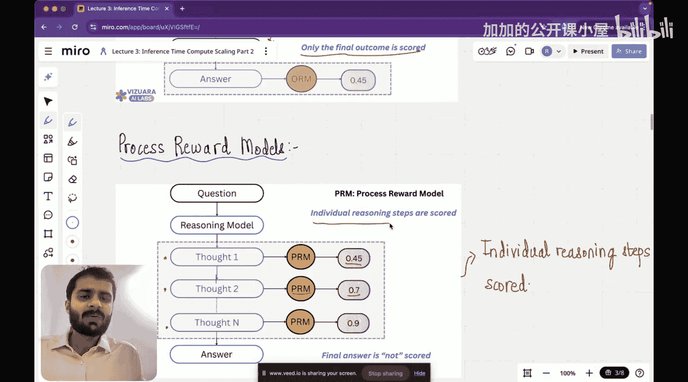

# Vizuara【中英⚡从零开始构建推理LLM｜Reasoning LLMs from Scratch】 p03 P3 Verifiers - Beam Search ｜ Reasoning LLMs from Scratch [BV1N3xWzWETL_p3]

🎼Yeah。

Hello everyone and welcome to the next lecture on reasoning based large language models。

Today is the third lecture in our course。And we will continue the discussion on inference time compute scaling。

Remember in the previous lecture， we discussed about chain of thought reasoning。

And zero short reasoning。Both of these are prompting techniques which are used。

To nudge the LLM to reason before the LLM provides an answer。

Remember that in the chain of thought reasoning， we saw that。For bigger models。

The chain of thought reasoning performed much better compared to smaller models。

And we saw this using a practical demo on Google Collab as well。

What did we see in zero short reasoning？In zero short chain of thought reasoning。

 we do not give any input output examples in the prompt that is why it's called as zero short。

Instead of that， we simply nudge the LLM to reason by telling the LLM to think before it answers。

It turns out that such a clever union nudging。Significantly outperforms plain zero short reasoning。

Without giving this statement which tells the element to things step by step。

Both of these remember they are prompting techniques， which means that。

When the user is typing the prompt。That round is combined with either。

Input output pairs of examples with a chain of thought or by a simple statement which says let's think step by step。

Today， we will understand about a second category of。Test time compute。

 which is called as search against verifiers。And this is going to be very different than plain prompting。

So lets begin and let us understand what is the meaning of search against verifiers。

So verification means the process of generating different answers and then finally selecting best answer out of all the answers which have been generated。

Now verification， why are we even discussing about verification。

 lets try to understand it with the help of the following diagram。So in this diagram。

 what we see is that we ask a question at the top。And then the question gets passed to the reasoning model。

And then what happens is that instead of providing one answer in the output。

 the reasoning model provides。Four different answers， which are labeled as even。A2， a3 and A4。

Now there is a verification layer in between which verifies which answer is the best out of the four answers and then finally the best answer is given。

This is called as the verification layer， and we are going to learn exactly about this layer in today's lecture。

So，Let's look at a very simple analogy， imagine that you are given a task of you know。

 selecting the best quality crop in a field。And let's say the field is huge and you start by surveying the field one by one。

 you find a crop you pluck it out and you see that okay this is a really good crop do you stop at that。

No right， generally what we do is that we pluck more and more crops and then we select the best crop out of maybe five or six that we have sampled。

That way， the probability of getting the best crop increases。

That is exactly the case with large language models also。Instead of generating a direct answer。

 what is usually done is that there are a sample of answers which are generated and then with the help of the verification layer。

 the best answer out of the samples is chosen。And then that answer is shown back to the user。

Now lets go back to the title of this lecture inference time compute scaling。

 how does this fit under this title well remember that if we have a verification layer。

We talked about test time compute in the first and second lecture when you have a verification layer it is going to increase the computational resources which the LLM uses。

During inference。That is why it comes under inference time。

Compute scaling because the inference time is going to increase。

Lets look at it the the in the form of a diagram whenever you are using an LLM。There is。

A pre training。Then there is fine tuning。And then there is inference。

So without verification inferences like this， but when you increase verification。

You are basically increasing the time。Which the LLM takes to give you the answer because you are sampling from different answers and you are selecting the best answer。

 that's why it increases the inference time compute。Now， this verification layer that we looked at。

 it can either be done by humans or it can be done by a model。

The models who do this verification are called as reward models。

Why don't you go to Huging face and type this reward model， it's called reward model in deerta。

V3 large v2 what it says is that this reward model is trained to predict。

W generated answer is better judged by a human given a question。

So it is used for model evaluation reward score in RLHF and detect potential toxic responses wire ranking so this model is trained such that if you give an input to this model it will give you a score。

Based on how good the generated answer is。So the training data that this model has been trained on。

Was generated by humans itself。And then that data is being used to train the model。

So we are essentially mimicking the ability of humans to verify answers by replacing humans with a model。

Okay， so these are called as reward models because。

The best answer is rewarded with the maximum score。If the answer is not good。

 then the score will be less and the reward will be less。In the next section。

 we are going to look at reward models in detail。So more specifically。

 there are two types of reward models， there are outcome reward models。

 and there are process reward models。And the purpose of both these type of models are。Pretty much。

You know， explain in their names， so let's look at the first category which is the outcome reward model。

So imagine that you have a question and you pass this question into a reasoning model。

So the reasoning model is going to give you a chain of thought， you know。

 it's going to give you the thought process through which it thinks before it gives you the answer。

Now， what the outcome reward models do is that they don't evaluate these thoughts。

They don't care about the thoughts basically， they only care about the final answer and only the final outcome is scored。

 So here OM represents the。Outcome reward model and。

0int 45 is the score which the ORM gives to the final answer。

The next category which are more popular are process reward models。

And these are these make more sense because。When you are using a reasoning model。

The thought process is very important for you。So there needs to be a mechanism which judges not just the final answer。

 but also the individual thoughts。Which are leading to the final answer。

So here what you see is that thought1 is sent to the process reward model and then the model is scoring the thought thought2 is again sent to the process reward model and the model is against scoring the thought。

So here the main difference compared to the ORM is that in。

