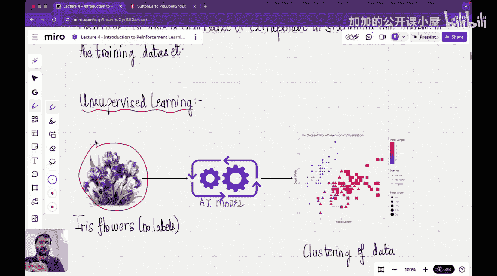

# Vizuara【中英⚡从零开始构建推理LLM｜Reasoning LLMs from Scratch】 p04 P4 Reinforcement Learning - Basics ｜ Reasoning LLMs from Scratch [BV1N3xWzWETL_p4]

🎼Yeah。

Hello everyone and welcome to the fourth lecture in the series on reasoning based large language models。

In today's lecture， we will start a very， very interesting topic which is reinforcement learning。

So far in the course we have covered the techniques which come under the category of inference time compute scaling。

 which means that we are not touching the train model at all。

 what we are doing is that we are simply doing some processing in the inference stage。

We saw two examples of this， the first example was that of prompting there we saw the examples of chain of thought prompting。

And zero short chain of thought prompting。And we saw that for larger models。

 how can chain of thought illicit reasoning in these models？

So larger models perform better and better at reasoning tasks。

If we simply nudge them with a simple problem saying that lets things step by step。

 or if we give them some input output pairs of examples， which teaches the model how to think。

Through워 gene of power。So and in the next lecture， we discussed about another set of methods in the category of inference time compute scaling。

 which is that of using verifiers。So verifier is where you ask the ALM to generate samples of answers。

 and then you have a verification layer which looks at all these answers and which chooses the best answer among them。

So usually whenever people use a reasoning based LLM。呃。

There is a verification layer before the user gets the answer and the verification layer itself。

usually has a reward model， which can be an outcome based reward model or a process based reward model。

And within the reward models， there are categories we looked at three main categories。

 first is majority voting second is best off end sampling and third is。Beam search。

And we looked at these three examples in detail and we saw。

How the verification layer is implemented in practice。Now， starting from today's lecture。

 we are going to focus on a completely different category of inducing reasoning in large language models。

 which is using pure reinforcement learning。And。This is an example where we are not going to tweak the inference stage of the large language model。

 but we are directly going to tweak the model itself。And to understand how the model is tweak。

 how to apply pure reinforcement learning to convert a non reasoning model into a reasoning model。

 we need to first。Spreendhen our fundamentals and our understanding of reinforcement learning itself。

And the approach that we are going to take in this course is that we are going to understand reinforcement learning from the net sand bolts。

O， so呃。This is a perfect segue for。People to understand about reinforcement learning。

 to appreciate reinforcement learning， and then finally well look at。

How reasoning is connected to reinforcement learning。

 but for a few lectures starting from today I want you to keep the reasoning part aside we will come to that eventually and we will show you how that how reinforcement learning is connected to reasoning but before we come to reasoning let us purely focus on reinforcement learning as a standalone subject。

Okay， so let's begin。We will start our journey by understanding about classical reinforcement learning。

 and then subsequently we'll move to modern methods of reinforcement learning。ok。

The book which all of you should refer to is this one。

 reinforceforment Learn and Intro by Suton and Barto。

 this is an excellent book and this is going to be our guide which will follow。

During these reinforcement learning lectures， this PDF is available for free if you just type this in Google。

 you will be able to download this PDF easily。Let's get started。So firstly。

 to understand about the reinforcement learning problem。

We need to understand how different is this problem compared to supervised learning and unsupervised learning supervised and unsupervised learning are two categories in the field of machine learning。

And。These are usually taught in the fundamentals of machine learning course。

Here I'm going to explain these methods also to use so that the。

Reinforcement learning program will be much clearer。

So supervised learning are a category of problems where。

We have a bunch of data with us and this is label data so what we do is that we collect all this label data and we pass this label data to a model。

And then we ask the model to make a prediction on unseen data。So an example of this would be。

 let's say I want to develop a model which takes the MRI scan of the brain of a patient and tells me whether。

The tumor is malignant or benign。So to make this sort of a prediction what I first do is that I collect a lot of label data。

 so label data means that I collect a sample。I collect samples of data where。

I have MRI scans as the input and I have labels whether the scan is benign or the scan is malignant now this labeling is done by humans itself。

And then。This is what I train my model on。So I have a huge collection of label data， maybe 5。

000 samples of this。In which I have some in the benign category and some in the malignant category and then I feed all this data into an AI model and then what I expect the AI model to understand is that I expect the AI model to look at all the images and try to understand the differences between benign and malignant。

These can be intricate differences or these can be differences which are visible to the naked eye。

 but we don't tell the model what are the differences。

It is the model's job to go over all the images and find patterns that can help the model distinguish between benign and malignant tumors。

Once the model has completed its learning process after that。

 then we feed in a new image which is not there in the。

List of training images and then we ask the model to look at this new image and make a prediction that whether this new image falls in the benign category or it falls in the malignignant category。

So this is a typical example which comes under the category of supervised learning。

Why does the name supervised appear in the name of this category？The reason is that。

We are giving label data。So since we are giving labels， it means that。

The model is prepared under the supervision of。Humans who have already labeled the data。

 that is why the name。Is written as supervised learning。The main objective of。

Supervised learning category of problems is to be able to generalize。

Or extrapolate to situations which are not present in the training data set。

This is what makes this category of learning so appealing。Finally， you try to。

Answer questions which are not there in the training data。

 and this can be only done by achieving some sense of generalization or extrapolation。

From the situations。In the training data， two situations which are not present in the training data。

Now let's come to the second category of problems， which is unsupervised learning。

So based on the previous discussion you can probably guess that in unsupervised learning there are no labels in the data which is provided to the model。

 a typical example which is often given in this to explain this category is imagine that you have a bunch of flowers。

And。Let's say， there is a huge garden and。YouYou are visiting the garden as a scientist and there are。

There are a bunch of flowers， You know that all of these flowers fall。

Under the same banner of iris flowers， but you do not know how many species of flowers are there in the garden。

So your objective as a scientist is to go over the entire garden and make a prediction。呃。

About the number of species of iris flowers which are present in the garden。

Now here the problem is that you are not given any labels。

