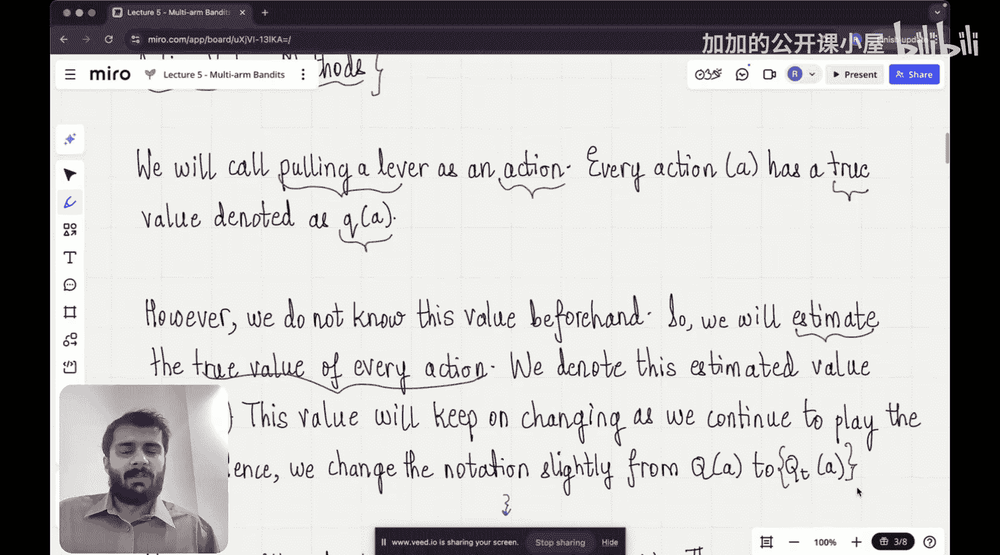

# Vizuara【中英⚡从零开始构建推理LLM｜Reasoning LLMs from Scratch】 p05 P5 Lecture 4b - Multi-Arm Bandits ｜ Reasoning LLMs from Scratch [BV1N3xWzWETL_p5]

Hello everyone， and welcome to the next lecture of the course， Reaing LLMs from Sctch。

In the previous lecture， we looked at the basics of reinforcement learning。

We begin by understanding how reinforcement learning is different from the other two categories。

Of supervised learning and unsupervised learning。Then we looked at some practical examples which really motivated this field of reinforcement learning。

After that， we looked at the different elements of a reinforcement learning problem。

 which includes the policy。The reward signal。The value function and the model of the environment。

Then we took an example of the game of Tito， and we understood the true meaning of value。

And how can we update the value of states so that we develop a strategy to maximize our winning probability in the Ti tao game。

Today's lecture will be a continuation of the last lecture。对。

And today well focus on this topic of multi arm bandits。

So when I first started reading about this topic， I was a bit。Surprised by the name of this topic。

 what does it mean by multi arm bandits and。How exactly is it connected to the reinforcement learning problem？

So it turns out that there is a very clear connection between multiam bandits。

And the reinforcement learning problem， which we will get to understand as we proceed towards the end of this lecture。

So for now， just forget。About the last lecture and well make a very neat connection between this lecture and the last lecture towards the end of this lecture。

So let us start to understand this topic of multiar bandits。First。

 let us see what is the meaning of one o banditton。Where is this phrase even inspired from。

So there is a popular game， which is called as the one arm bandit。

Which you can see written over here。When I'm banded。The objective of the game is to pull a lever。

 this is the red lever which you see on the right。So you have to pull the red lever。And。

In some cases， the symbols will line up。In some cases， the symbols will not line up。

If the symbols line up， you will make money， if the symbols don't line up， you will lose money。

So it's really a very simple game， but very popular among kids。And。

Why is it called overwhelmed because there is a single lever and why bend it？Bandit。

 because the machine。In a way steals your money like a thief。

That's why it's called as a one on bandit。And。It turns out that this this machine or this popular game。

Is very similar。To the kind of problems that we are going to look at。In this lecture itself。Now。

 if this is a one on bandit， then what is a multi arm bandit？

You can guess it easily multi arm means that there should be more livers， not just one single liver。

So in a multi arm bandit problem， instead of having one lever。

 you have four different levers as I have shown in this figure。This is lever number one。

 This is lever number two。 This is lever number 3， and this is lever number 4。Now。

 the problem is that。You do not know the actual value of each of these levers。And。

If you know the actual value， then it's a very easy game， you will just。Keep on pulling the lever。

With the maximum value。So let's say if lever number four has the maximum value。

 I'll always keep on pulling lever number four。But the problem here in this game is that you do not know the values。

Of each of these levers beforehand。So you do not know which one of these lever should I play？

And every time you pull you pull a lever you get a different reward so let's say in my first attempt I pull lever 1 I get a reward of 0。

5 then I pull lever 2 I get a reward of 0。8 so I might think that okay that means lever2 is better than lever1 right but that is not the case because maybe next time when you pull lever 1 you might get a reward of2。

So in this game of multi arm bandit， which is a for arm bandit in this case。

We have to pull the levers continuously。And eventually。

Develop a strategy so that we pull the right levers to get the maximum reward。

And we are going to look at this simple setting and we are going to understand some。

Very important features of the reinforcement learning problem。

 which are going to be useful for us in the subsequent lectures。But before we go ahead。

 I want to make sure that all of you have understood the setting of this problem。

Instead of four levers， now you can imagine a game with multiple levers that is why it is called as a。

N arm bandit problem。So there are， lets say， multiple levers and you do not know the actual value of these levers。

 but your aim is to play the game more a number of times so that you understand what is the actual value of these levers。

Let us understand what I mean by that。So we will look at a type of methods which is called as action value methods。

Even if you don't understand this name right now， it's all right， just forget about this name。

 keep it aside for now。We will call pulling a lever as an action。

Remember in the previous lecture on reinforcement learning。We saw that。

Every problem in which the agent is learning from an experience。

Is associated with some actions when I am playing chess， then a move is an action。

When a gazee is learning to walk or run。Then。The phenomenon of walking or running that is an action。

When Phil is eating his breakfast。Then grabbing the cereal bowl。

 grabbing the spoons and eating the cereal， those are all actions。

When a rumor robot is charging and moving inside a room。Then the movement is an action。

 the charging is an action。So in this case， pulling a lever is an action。

And every action has a true value。Which is denoted by。Q of it。

Now if we do not know this value beforehand， if we knew this value beforehand， then。

The game would have been very simple if we will always choose the lever with the highest value。

So we do not know this value beforehand and。The whole objective of this game is to estimate。

The true value of every action。And we de this estimated value by Q of a。

And since this value will keep on changing as we continue to play this game。

 we are going to slightly change the notation from Q of a2。😊，Q sub P of A。As you can see in this。

In this term。O， so呃。

This is the estimated reward for。For a particular action。

Now can we write down a formula for the estimated sorry this is the estimated value of this particular action。

Can we write down a formula for the estimated value of a specific action？

Just pause here for a minute and think about it。And then go ahead。With the video。

So the estimated value of an action。Is the average reward of。

All the times when the action is played before time T。For example。

 if I want to understand what is the value estimated value of pulling lever number one。

What I will do is that I will look at all the attempts in the past where I have pulled liver。

