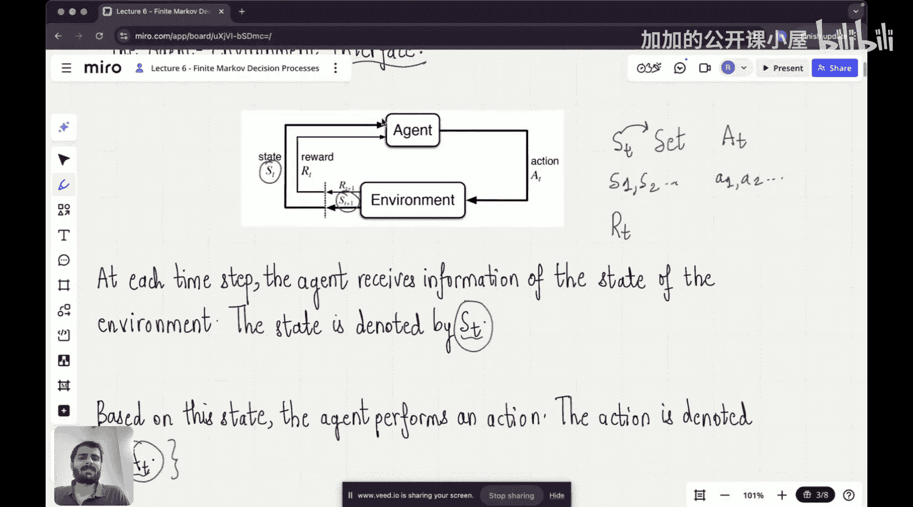

# Vizuara【中英⚡从零开始构建推理LLM｜Reasoning LLMs from Scratch】 p06 P5 Markov Decision Processes ｜ Reasoning LLMs from Scratch [BV1N3xWzWETL_p6]

Hello and welcome to lecture 6 of the course， Reasoning LLM from Sctch。Since the past two lectures。

 we have been focusing on the topic of reinforcement learning。

In the first lecture of reinforcement learning we looked at what is the meaning of reinforcement learning。

 how are RL problems different from supervised learning and supervised learning problems and then we looked at a category of RL problems which are called as multi arm bandits。

In today's lecture， we will start to discuss the core of reinforcement learning。

 which is finite Markov decision processes。This problem defines the field of reinforcement learning。

 and we are going to understand this problem completely from the scratch。To understand this problem。

 we will first start by defining the structure which is called as the agent environment interface。

Remember in the first lecture about reinforcement reinforcement learning。

 we said that there is an agent which interacts with the environment around it。

And then it gets more and more experiences from the environment and learns and becomes better and better to achieve a reward or a goal。

Now we are going to formalize this intuition in the form of this agent environment interface。

What this interface says is that there is an agent。At the center of。

The reinforcement learning problem。 Now this agent。Is receiving information from the environment？

About。The state of the environment and the state is denoted by S of T。So at every time step。

 the agent is receiving some sort of an information from the environment which is denoted by S of T。

And then based on the information or the signal the agent receives from the environment。

It is going to take a certain action。And this action is denoted by A of T。And then。

After the agent performs this action， one time step later。

 the agent is going to receive a reward from the environment after this action is performed and then it is going to go into a new state。

Now， we are going to follow certain。A certain nominc when we define。The state。

 the reward and the actions。The states are always represented as capital S of T。

Capital denotes the set。And small S， for example， S1 and S2 etc。

 these denote the actual value of the states within this set。

 similarly actions are denoted by A of T， the action set is denoted by A of T。

 and individual actions within this action set are denoted by A1 A2 A3 etc。

And then in a similar fashion， the reward set is denoted by R of T。

And then the individual rewards are denoted by R1 R2 or three， small letters， etc。

So the agent receives a state which is a signal from the environment S of T and then it takes an action based on that signal and then after it takes an action。

The agent or the state is going to change the agent is now going to receive a new state from the environment which is denoted by S of t plus1 and then along with this state the agent also receives a reward so the state and the new reward goes go hand in hand the new reward is denoted by R of t plus1。

This is the。Structured。Under which we are going to work。In the remainder of this lecture。

So let us go ahead Now what happens is that。You might be thinking about， okay。

 after it receives this state， how does the agent perform this action？

Is there some kind of a mapping which tells the agent what action to take so the answer is yes。

 there exists a mapping from every state。To the probability of selecting each possible action in that state。

And this mapping is called as the agent's policy。So the policy is the mapping from every state of the agent。

都。The probability of selecting each possible action from that state。

So this mapping is called as the agent's policy in a way the policy is what dictates what actions the agent is going to take。

Whenever the agent receives a specific signal from the environment。

And we denote this policy as pi of T。And this notation also， you will see often pi T a given S。

 which means that given。The state is。The probability that action a is chosen is given by this policy。

 so a given S。Action given the state S， that is how we have to read this symbol。Now， let's try to。

Understand some examples of states， examples of states are let's say sensorensor reading。

 then an intermediate position while playing a chess game or playing a go game。

There are some abstract notions of states as well， which are。Alex say， I'm going to office， but。

I'm not sure where my car keys are， so that。Or that governs the state of my mind。

So state is also an abstract notion where if I'm interacting with a person。

 then before I have any conversation with a person。

 whatever memory I have in my mind about my relation with that person can also be thought of as a state a state is whatever information you can give to the agent to enable it to perform an action within。

An environment that is the meaning of a state。Now， examples of actions can be。

 let's say voltages applied to motors of a robotic arm。

 whether or not to have lunch or pedalling wheels of a bicycle when a small child learns to ride the bicycle for the first time。

So there is a difference right between states and the environment states is like the information that you have and then actions are。

😊，呃。Actions are the。Sort of。Decisions that you take once you get the information from the environment。

 that is the difference between states and actions。

Now we'll start to understand the agent environment interface with some practical examples which will concretize your understanding about this interface and how to formulate problems in terms of the agent environment interface。

So the first example that we will take is that of a bioreactor don't worry about what a bioreactor is even I am not exactly sure about the workings of a bioreactor。

 but we don't need to know that all we need to know is，The bioreactor is a machine which。

Which is used to produce useful chemicals。And the way it does that is by having some sensors which takes readings and then based on the readings。

It tries to achieve a certain temperature and a certain stirring rate within the bioreactor now given this much information。

 let's try to think what are the state's actions and rewards in the agent and environment interface。

So what are the states， the states are the information we receive from the environment。

 so these are the readings of the sensors。And the readings of the thermo couplele。

What are the actions， the actions are the target temperature and the target stirring rate which I am reaching within the bioreactor。

So to achieve the target temperature， I will turn on my heating element and activate my heating element to achieve a target stirring rate。

 I will activate the motors within the bioreactor。So these are the type of actions that I will take based on the information that I get from the environment。

And what are the rewards， the rewards are the moment to moment measures of the rate at which useful chemical is produced in the bioreactor。

So you can see that states are vectors， but the reward is a single scalar。For example。

 the states can be written as this vector where the first element of the。

